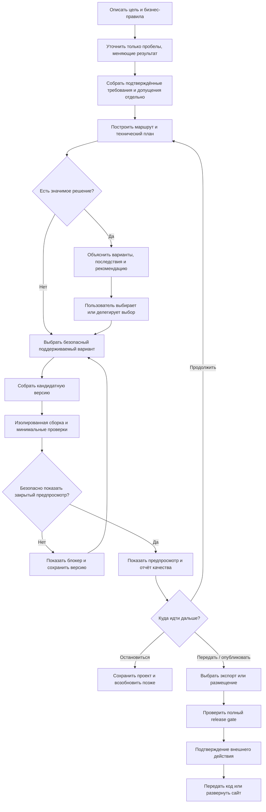
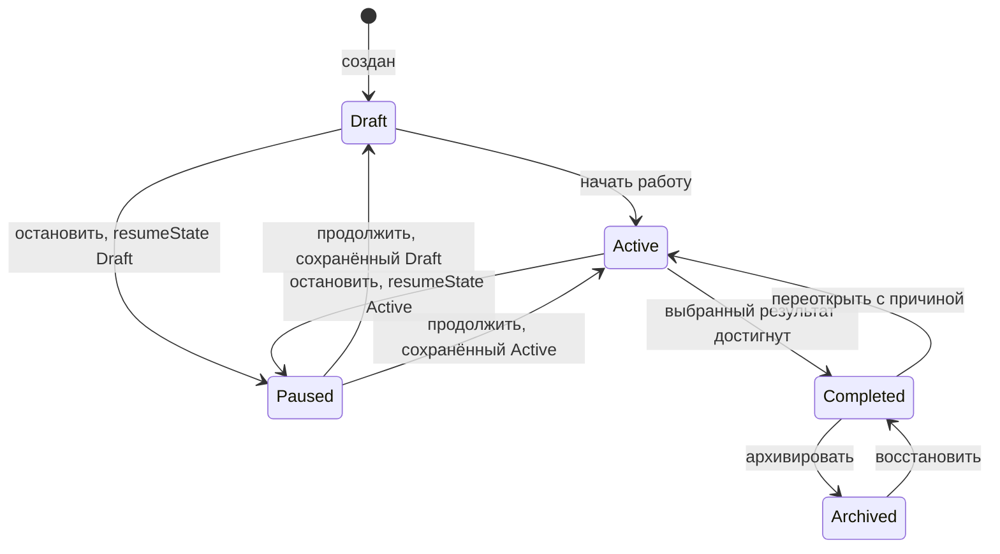
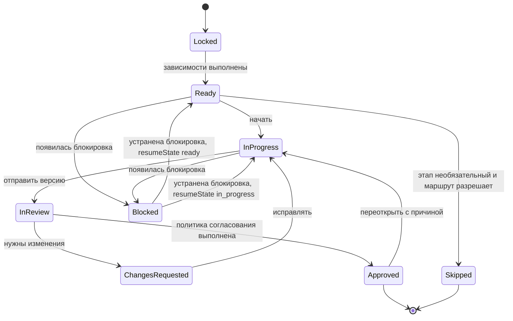
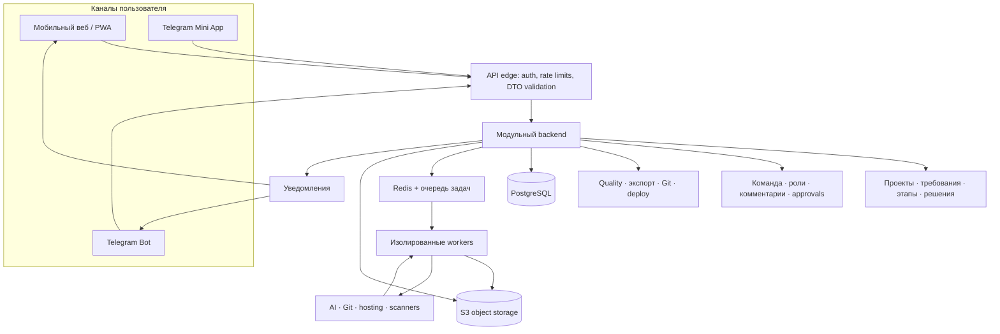
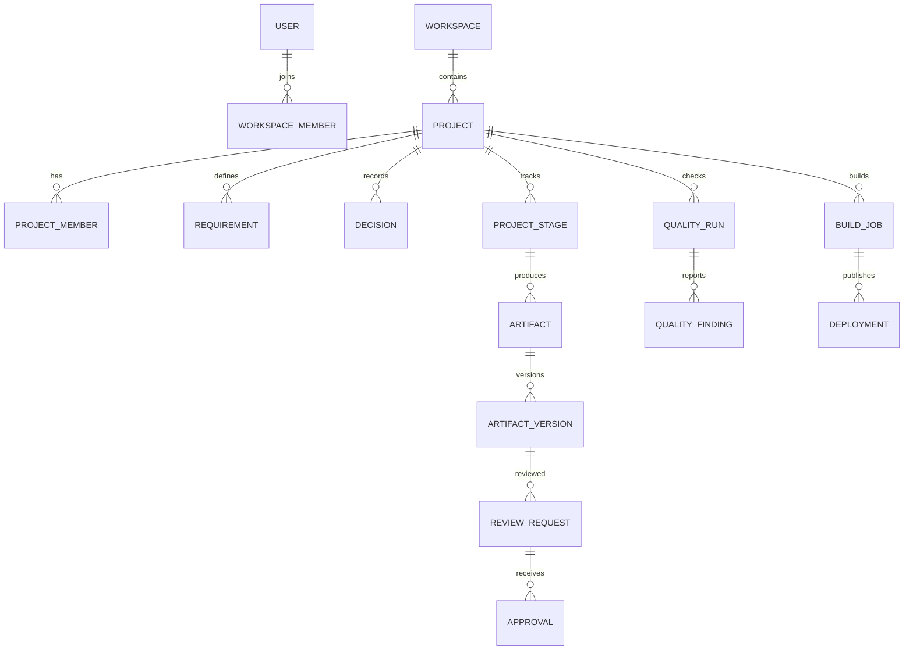

# BuildPath — схема бизнес-логики и архитектуры

Документ объясняет работу продукта и его техническое устройство одним связным описанием. Это целевая архитектура для реализации; текущий репозиторий содержит спецификации и HTML-концепт, а не работающее приложение.

## 1. Идея продукта

Пользователь описывает желаемый результат и бизнес-правила. Техническая спецификация и предпочтения по технологиям необязательны. BuildPath превращает продуктовые требования в план, собирает кандидатный сайт/приложение, проверяет его, показывает результат и помогает довести до нужной точки: ТЗ, логика, дизайн, код, согласованный этап или опубликованный сайт.

BuildPath отвечает за процесс и понятные объяснения. Пользователь принимает продуктовые решения и контролирует значимые последствия. Система не требует вручную выбирать каждый технический инструмент. Первая автоматическая генерация ограничена поддерживаемыми веб-сайтами; нативные приложения и сложные продукты сначала получают спецификации/макет/пакет передачи, пока их capability profile не покрыт полным генератором и проверками.

## 2. Бизнес-логика: путь пользователя

### Что пользователь должен сообщить

Минимальный ввод — цель продукта и что пользователь/клиент должен уметь сделать. Чтобы построить точное ТЗ, BuildPath выясняет аудиторию, сценарии, бизнес-правила, содержание и ограничения. Пользователь может ответить свободным текстом или голосом, пройти вопросы, приложить материалы либо импортировать существующий сайт.

Если у пользователя есть техническое задание, стек или обязательные ограничения, он добавляет их по желанию. BuildPath проверяет их на совместимость и фиксирует как требования. При конфликте сервис показывает проблему и варианты, но не заменяет ограничение молча.

### Как система принимает решения

- **Подтверждённые требования** определяют ожидаемое поведение.
- **Предположения** помечаются отдельно и задаются пользователю, если способны изменить структуру, стоимость или результат.
- **Реализационные детали с низким влиянием** BuildPath подбирает сам из поддерживаемых и безопасных вариантов.
- **Значимые решения** показываются как короткий выбор с преимуществами, ограничениями, рекомендуемым вариантом и последствиями. К таким решениям относятся стоимость, внешний аккаунт, доступ к коду/данным, переносимость, публичность и публикация.
- Пользователь может поручить выбор BuildPath в рамках предпочтений. Отдельное подтверждение всё равно нужно перед оплатой, подключением внешнего аккаунта/доступа, передачей исходников и production-развёртыванием.

Команда «создать» или «изменить» разрешает сделать кандидатную версию для предпросмотра. Она сама по себе не означает согласование требований, одобрение этапа или разрешение на публикацию.

## 3. Состояния проекта и переходы

### Состояние проекта

Пауза меняет состояние проекта, но не затирает состояние этапов. Завершение определяется выбранным результатом: проект может закончиться на согласованном ТЗ, логике, дизайне, исходниках или опубликованном сайте. Завершённый проект можно открыть заново; архив сначала явно восстанавливают. Эти переходы и причины записываются в журнал.

### Состояние этапа

resumeState сохраняет, откуда этап был заблокирован. Переход в следующий этап — действие handoff после Approved, а не отдельный статус проекта. Handoff передаёт версии согласованных результатов зависимым этапам; система проверяет требования, политику одобрения и отсутствие блокирующих замечаний атомарно.

Каждый этап хранит входы, ответственного, версию результата, критерии готовности, участников согласования и статус. Политика приёмки задаёт, достаточно ли одного одобрения, нужны ли все назначенные люди или указанное число одобрений. Все решения привязаны к конкретной версии артефакта. Изменение согласованной версии требует нового review.

## 4. Архитектура системы

### Компоненты

| Компонент | Ответственность | Важная граница |
|---|---|---|
| Web/PWA | Опрос, проектный workspace, просмотр и работа с телефона | Не считается границей безопасности; доступ проверяет API |
| Telegram Bot / Mini App | Вопросы, уведомления, статусы, комментарии, согласования | Для каждого действия проверяются identity, роль и права проекта |
| API и модульный backend | Учётные записи, проекты, состояния процесса, требования, решения, роли, аудит | Детерминированные правила; авторизация на каждом запросе |
| PostgreSQL | Транзакционные данные, версии маршрутов, решения, review и audit | Ограничения целостности и tenant isolation |
| Redis и очередь | Долгие jobs, retries, прогресс и idempotency | Очередь не является источником истины для бизнес-состояния |
| Object storage | Загрузки, версии документов/исходников, отчёты и экспорты | Приватные объекты, короткоживущие ссылки, сканирование файлов |
| Workers | Импорт, AI-задачи, сборки, quality checks, архивы, экспорт и публикации | Выполняются изолированно, с CPU/памятью/временем и сетевыми лимитами |
| Capability manifest + SiteSpec compiler | Версионированный каталог реально поддерживаемых функций и детерминированный рендер страниц из typed-модели | ИИ может предлагать изменения в схеме, но не включает неподдерживаемые возможности |
| Внешние адаптеры | Модели ИИ, Telegram, Git providers, хостинг и проверочные инструменты | Credentials зашифрованы; адаптер можно заменить |

На старте это модульный монолит API плюс отдельные очередные workers, а не набор микросервисов. Модули выделены по бизнес-ответственностям, чтобы их можно было развивать независимо без распределённой сложности.

## 5. Основные данные

Ключевые правила данных:

- Требование хранит автора/источник, статус (предложено, подтверждено, предположение, открытый вопрос), область и дату изменения.
- Решение хранит категорию, варианты, рекомендацию, выбранный вариант, последствия, нужен ли явный выбор и кто/когда решил.
- Артефакты версионируются неизменяемо; build, review и quality report ссылаются на конкретную версию.
- Статус готовности проекта вычисляется из фактов и критериев, а не из текста ИИ.
- Workspace/project/stage membership проверяется сервером на каждом действии. Изоляция tenant обязательна.

## 6. Генерация и контроль качества

Стек BuildPath как платформы и стек созданного пользовательского сайта — разные профили. Первая генерация пользовательских сайтов использует Next.js App Router + TypeScript в static-first режиме; сервер и база данных появляются только при наличии поддерживаемой функции. Если пользователь требует неподдерживаемый стек или возможность, система формирует спецификацию/пакет передачи либо предлагает перейти на поддерживаемый профиль только с согласия пользователя.

1. Система сохраняет подтверждённые продуктовые требования и выбранные ограничения.
2. Планировщик формирует технический план и список страниц/функций из поддерживаемых шаблонов.
3. Запрос пользователя создаёт версионированную кандидатную сборку; код не исполняется в API или web-процессе.
4. Worker собирает проект в изолированной среде и запускает применимые проверки.
5. Quality report содержит статус, серьёзность, доказательства, версию политики, инструменты и понятный способ исправления.
6. Закрытый предпросмотр для итераций доступен только после минимальных проверок изоляции и помечается как непроверенный; публичная ссылка и production требуют полного quality gate. Критические/высокие security-блокеры и обязательные проверки нельзя пропускать по умолчанию.
7. После проверенного предпросмотра пользователь может попросить правки, вернуть прошлую версию, экспортировать код или перейти к публикации.

ИИ — заменяемый адаптер. Формы, состояния, правила согласования, версии, проверки прав, quality gates, экспорт и история остаются детерминированными и работают независимо от конкретной модели.

## 7. Доставка кода и развёртывание

BuildPath получает каталог поддерживаемых возможностей от адаптеров, а не обещает любую интеграцию. Варианты объясняются до подключения:

- **Оставить проект в BuildPath** и продолжать работу с телефона.
- **Скачать ZIP** с исходниками, выбранными документами и инструкцией запуска.
- **Подключить Git** и передать изменения в выбранный репозиторий с явным указанием ветки и прав.
- **Опубликовать через поддерживаемый hosting provider** после просмотра target, домена, публичности, стоимости и проверки целевого build.
- **Получить инструкции** для самостоятельной публикации или передачи разработчику.

Сервис запрашивает внешние credentials только при выборе соответствующего подключения. Production deployment — отдельное действие с подтверждением; система сохраняет deployment ID/URL/status и предлагает rollback, если провайдер его поддерживает. Если операция не подтверждена провайдером, UI показывает «неизвестно/проверяется», а не «успешно».

## 8. Что показано в HTML-макете

HTML-концепт содержит продуктовый лендинг и интерактивный макет проектного workspace. Макет демонстрирует информационную архитектуру интерфейса: список этапов, текущий статус, требования, рекомендации, решения пользователя, участники, quality report и доставку кода. Данные демонстрационные; макет не подключён к API и не выполняет реальную генерацию, регистрацию, оплату или публикацию.

## 9. Решения реализации

Основной стек, layout репозитория, API, сущности, security, jobs и quality policy заданы в [технической спецификации](TECHNICAL_SPECIFICATION.md). Полные пользовательские требования и критерии приёмки — в [ТЗ](PRODUCT_REQUIREMENTS.md). Последовательность вертикальной реализации — в [плане](IMPLEMENTATION_ROADMAP.md).

