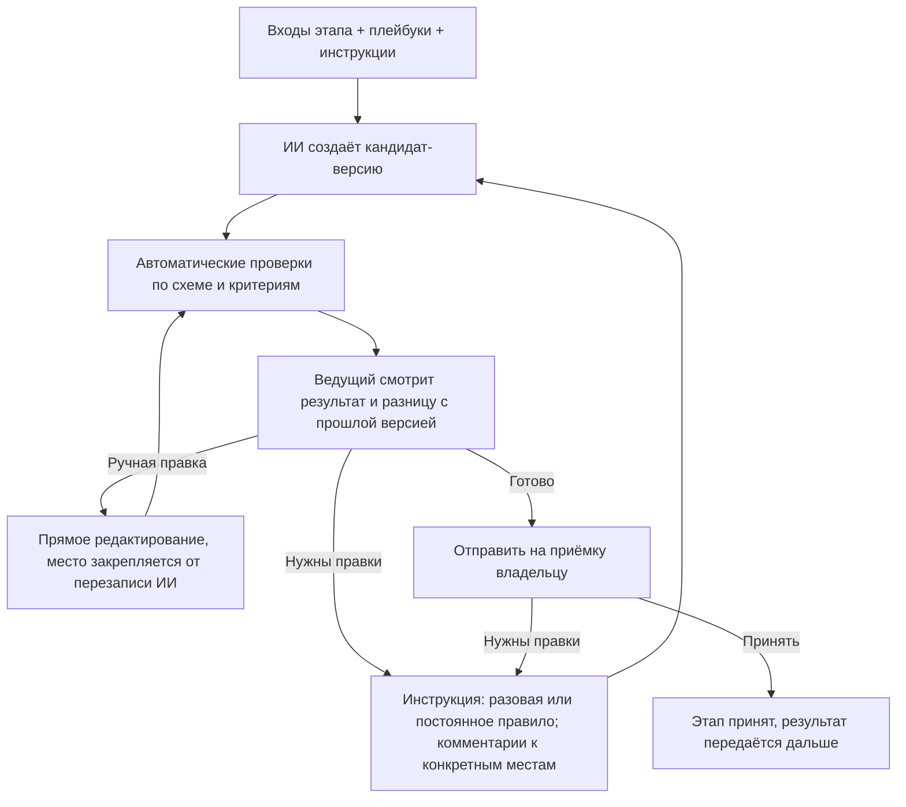
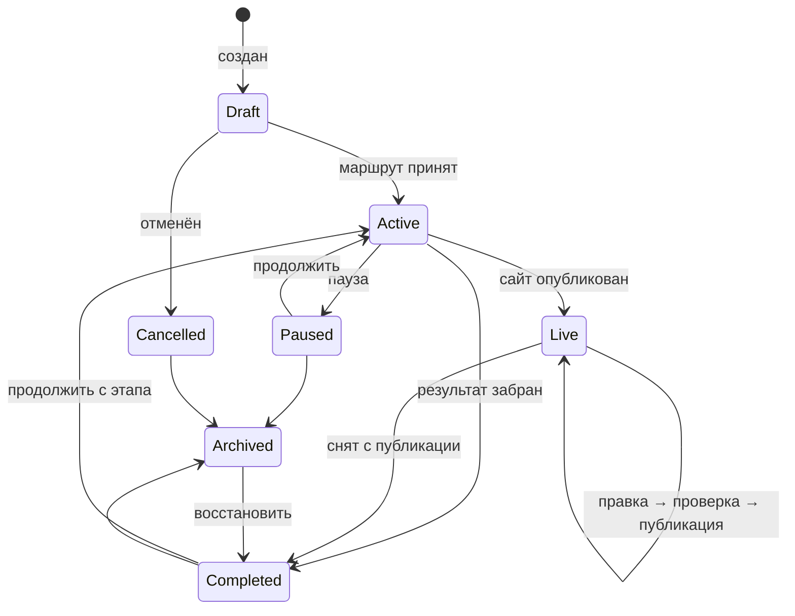
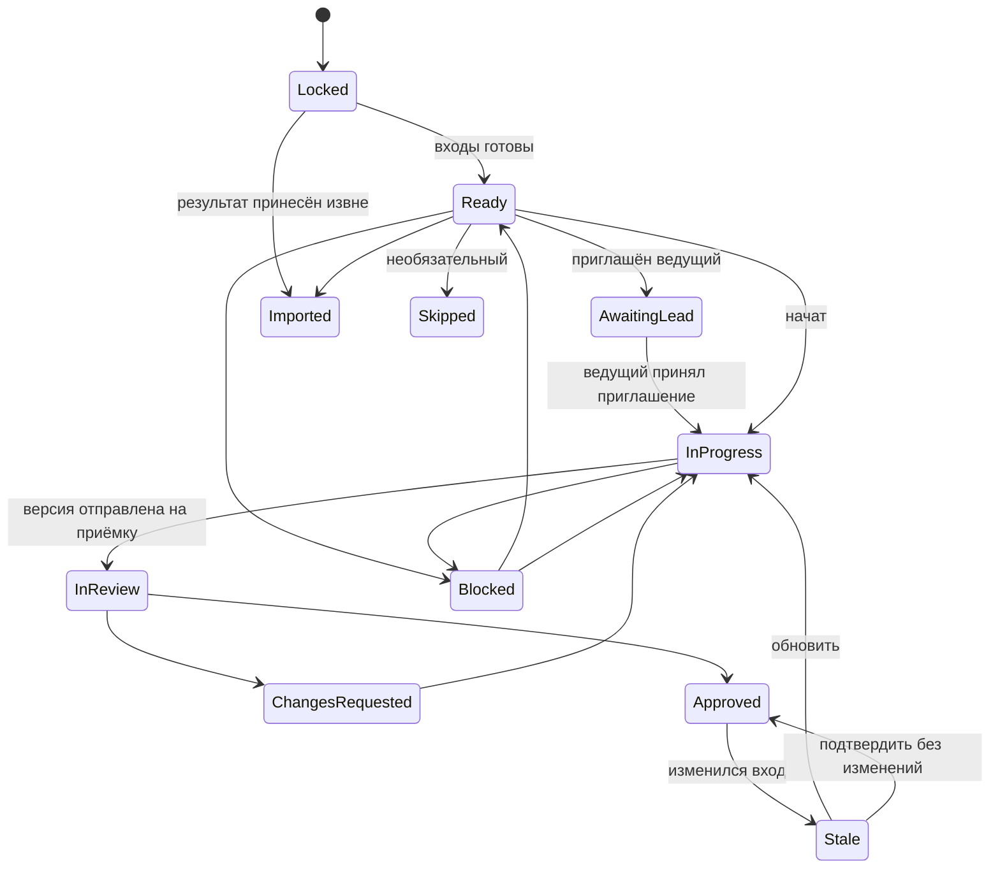

# BuildPath — модель работы по этапам: ИИ выполняет, люди направляют

**Статус:** проект нормативного документа. Часть II (карта проекта, контракты, полный цикл разработки) добавлена 10 ноября 2026 года. После согласования положения переносятся в PRODUCT_REQUIREMENTS.md, TECHNICAL_SPECIFICATION.md и IMPLEMENTATION_ROADMAP.md, а этот файл остаётся подробным описанием модели.

## 1. Идея

BuildPath — среда разработки, где работу на каждом этапе выполняет ИИ. Люди не делают работу вручную: они ставят задачу, дают ИИ инструкции, проверяют результат и решают, когда этап готов.

- Набор этапов зависит от типа проекта и его функций.
- На каждом этапе есть **ведущий** — человек, который направляет ИИ. По умолчанию это владелец проекта.
- Владелец может пригласить **специалиста** (UX, дизайнер, аналитик, разработчик, юрист…) ведущим или консультантом на конкретный этап. Ценность специалиста — его знания, переданные ИИ в виде инструкций, правок и проверки.
- Платформа даёт каждому этапу **встроенный набор экспертных инструкций**, поэтому новичок может пройти весь маршрут без специалистов.
- Проект можно остановить после любого этапа и забрать результат, а можно начать с любого этапа, принеся готовые материалы.

Ключевая единица продукта — **этап с контрактом** (входы, выходы, критерии приёмки) и **циклом работы с ИИ** (инструкция → версия → проверка → правка → приёмка).

## 2. Основные понятия

| Понятие | Смысл |
|---|---|
| **Тип проекта** | Лендинг, магазин, кабинет, мобильное приложение и т. д. Задаёт шаблон маршрута. |
| **Признаки (features)** | Оплата, аккаунты, персональные данные, бронирование… Добавляют обязательные этапы и проверки. |
| **Маршрут (Route)** | Граф этапов проекта с версией: шаблон типа + признаки + выбор владельца. |
| **Контракт этапа (StageDefinition)** | Версионированное описание: входы, выходы, критерии приёмки, уровень поддержки ИИ, встроенный плейбук, доступ по умолчанию, форматы экспорта. |
| **ИИ-агент этапа** | Исполнитель этапа. Работает только с материалами этапа и создаёт кандидат-версии артефактов. |
| **Ведущий этапа** | Человек, который даёт ИИ инструкции, запускает генерацию и отправляет версию на приёмку. Владелец или приглашённый специалист. |
| **Консультант** | Специалист без права запускать ИИ: комментирует, предлагает инструкции, проверяет. |
| **Плейбук (Playbook)** | Набор экспертных инструкций и чек-листов для типа этапа. Бывает встроенный (от BuildPath), проектный и личный плейбук специалиста. |
| **Инструкция этапа** | Конкретное указание ИИ в рамках этапа: разовая («сделай hero короче») или постоянная правило («все CTA — глаголом»). |
| **Запуск ИИ (GenerationRun)** | Одна генерация: входы, инструкции, плейбуки, модель, результат, проверки, стоимость. |
| **Артефакт** | Результат этапа (ТЗ, схема логики, структура, контент, дизайн, SiteSpec, код, отчёт). Только неизменяемые версии. |
| **Пакет результата** | То, что владелец забирает при остановке: принятые артефакты + сводка + открытые вопросы. |

## 3. Маршрут зависит от типа проекта

| Тип / признак | Этапы маршрута (по умолчанию) |
|---|---|
| Лендинг, портфолио, визитка | Цель → Контент и структура → Дизайн → Сборка → Проверка → Публикация |
| Сайт компании / каталог-меню | Цель → Требования → Структура → Контент → Дизайн → Сборка → Проверка → Публикация |
| Интернет-магазин, запись, кабинет | Цель → Требования → Бизнес-логика → Структура и сценарии → ТЗ → Прототип → Дизайн → Техплан → Реализация → Проверка → Публикация → Передача |
| Мобильное / desktop-приложение | Цель → Требования → Бизнес-логика → ТЗ → Прототип → Дизайн → Техплан → (Реализация, пока генерация не поддерживается — передача разработчику) |
| + оплата | + «Платёжные сценарии», усиленная проверка безопасности |
| + персональные данные | + «Данные и согласия» (какие данные, зачем, политика конфиденциальности, удаление) |
| + несколько ролей / аккаунты | + «Роли и права» внутри бизнес-логики, проверки авторизации |

Этап обязателен, если без его результата следующий этап нельзя выполнить или проверить, либо этого требует признак риска. Остальные этапы необязательны и пропускаются с объяснением, что останется неизвестным. Маршрут — ациклический граф; независимые этапы могут идти параллельно.

## 4. Контракт этапа

1. **Входы** — какие артефакты нужны и какая минимальная полнота.
2. **Выходы** — артефакты с типизированной схемой. ИИ возвращает данные по схеме, а не произвольный текст или код.
3. **Критерии приёмки** — автоматические проверки (схема, полнота, сборка, quality gate) и чек-лист для человека.
4. **Уровень поддержки ИИ** из каталога возможностей: `ai_full` (ИИ создаёт готовый результат), `ai_draft` (ИИ создаёт черновик, нужен эксперт), `ai_assist` (ИИ только помогает, результат загружается извне). Уровень определяет платформа, а не модель.
5. **Встроенный плейбук** — экспертные инструкции BuildPath для этого типа этапа.
6. **Рекомендация по специалисту** — например: «Платёжные сценарии: рекомендуем подключить специалиста, ИИ здесь даёт только черновик».
7. **Доступ по умолчанию** и **форматы загрузки/экспорта**.

## 5. Цикл работы на этапе

Правила цикла:

- **Запускать ИИ** могут только ведущий этапа и владелец. Консультанты и проверяющие оставляют комментарии; ведущий одним действием превращает комментарий в инструкцию.
- **Точечные правки.** Комментарий привязан к месту артефакта (раздел ТЗ, секция страницы, элемент макета). ИИ меняет только указанную часть и показывает разницу.
- **Ручные правки** допустимы всегда. Отредактированное вручную место закрепляется: ИИ не перезаписывает его без явной инструкции.
- **Правило вместо повторения.** Если ведущий исправляет одно и то же, система предлагает сохранить исправление как постоянное правило этапа или проекта.
- **Происхождение версии.** Каждая версия хранит: входы и их версии, плейбуки и их версии, инструкции, модель, автора запуска, результат проверок, стоимость. По этим данным видно, кто и почему изменил результат.
- **Приёмка.** ИИ никогда не принимает этап. Принимает владелец или назначенный им проверяющий. Если ведущий — сам владелец, он может принять результат сразу (личный режим, без тупика согласования).

## 6. Инструкции: приоритет и безопасность

Порядок приоритета (сверху — важнее):

1. Политика платформы, права доступа, quality gate.
2. Подтверждённые требования и решения владельца.
3. Постоянные правила проекта (их утверждает владелец).
4. Инструкции и плейбук ведущего этапа.
5. Встроенный плейбук BuildPath.
6. Комментарии участников, ещё не превращённые в инструкции.

- Инструкции специалиста **не могут** менять подтверждённые требования, права, проверки безопасности, расходы и публикацию. Если инструкция противоречит требованию, ИИ не выполняет её молча: система показывает конфликт и предлагает владельцу изменить требование.
- Предложения специалиста по изменению требований оформляются как **предложение изменения** и вступают в силу после подтверждения владельцем.
- Плейбуки и загруженные инструкции проходят ту же проверку, что и пользовательские инструкции для ИИ в PRODUCT_REQUIREMENTS.md: карантин, извлечение текста, проверка на prompt injection, явное включение.
- Граница доступа ИИ задаётся сервером, а не текстом инструкции: никакая инструкция не даёт ИИ прочитать материалы вне области этапа.

## 7. Специалисты

### 7.1. Роли на этапе

| Роль | Что может |
|---|---|
| **Ведущий** | Давать инструкции, запускать ИИ, редактировать, подключать свой плейбук, отправлять на приёмку. |
| **Консультант** | Видеть этап, комментировать, предлагать инструкции и правила, ставить отметку «проверено специалистом». |
| **Проверяющий** | Принимать или возвращать конкретную версию (назначается владельцем). |

На одном этапе может быть один ведущий и несколько консультантов. Владелец всегда может вернуть себе роль ведущего.

### 7.2. Доступ специалиста

По умолчанию специалист и ИИ, которым он управляет, видят одно и то же: принятые входы этапа и артефакты самого этапа.

| Можно | Нельзя по умолчанию |
|---|---|
| Читать принятые входные артефакты этапа | Видеть другие этапы и их обсуждения |
| Запускать ИИ на этапе (ведущий) в пределах бюджета | Видеть участников, бюджет проекта целиком, оплату, настройки |
| Редактировать артефакты этапа, обсуждать, загружать файлы этапа | Скачивать материалы без разрешения владельца |
| Подключать свой плейбук к этапу | Видеть секреты, ключи, подключённые аккаунты |
| Отправлять версию на приёмку | Публиковать, передавать код наружу, приглашать других |

Владелец может открыть дополнительный артефакт на чтение, отдать артефакт со скрытыми разделами, запретить или разрешить скачивание, задать срок доступа и условия конфиденциальности. До отправки приглашения система показывает, что именно увидит специалист.

### 7.3. Жизненный цикл доступа

1. Владелец приглашает специалиста на этап с ролью, областью доступа и бюджетом ИИ.
2. Специалист принимает приглашение и условия — доступ открывается.
3. После приёмки этапа право запускать ИИ и редактировать закрывается автоматически; чтение — через настраиваемый срок (по умолчанию 7 дней).
4. Владелец может отозвать доступ в любой момент; версии, инструкции и сообщения остаются в истории.
5. Если ведущий ушёл, этап получает статус «Ожидает ведущего», владелец берёт его на себя или приглашает другого.

Все выдачи, расширения и отзывы доступа и все запуски ИИ пишутся в журнал аудита.

### 7.4. Плейбук специалиста — его актив

- Специалист может сохранить свои инструкции и чек-листы как личный плейбук и применять его в разных проектах.
- Плейбук не содержит данных проектов: при сохранении правила из проекта система просит обобщить его и проверяет, что в нём нет фрагментов чужих материалов.
- Владелец видит, какой плейбук подключён к его этапу, версию и статус проверки. Содержимое по умолчанию видно владельцу; закрытые плейбуки возможны позже, только при проверке платформой (см. раздел 13).
- Проектные правила, созданные на этапе, принадлежат проекту и остаются у владельца после ухода специалиста.

## 8. Бюджет ИИ

- Генерации тратят лимиты тарифа владельца. До запуска показывается примерная стоимость.
- Владелец задаёт бюджет на этап или на назначение специалиста; специалист видит остаток. При исчерпании бюджета запуск останавливается, владелец может добавить.
- Учёт использования (UsageRecord) ведётся с первой версии продукта, даже если тарифов ещё нет.

## 9. Остановиться на любом этапе и забрать результат

- Владелец в любой момент нажимает «Забрать результат».
- Пакет результата: все принятые артефакты, сводка решений, допущения, открытые вопросы, список непройденных этапов и что для них понадобится. По желанию — постоянные правила проекта, чтобы следующий исполнитель (человек или другой ИИ) продолжил в том же стиле.
- Непринятые черновики можно добавить с пометкой «черновик, не принят».
- Форматы: ТЗ и логика — DOCX/PDF/MD; дизайн — изображения и ссылки; код — ZIP или Git; сайт — экспорт сборки.
- Пакет тоже версионируется; к проекту можно вернуться и продолжить.

## 10. Начать с любого этапа

1. Владелец выбирает стартовый этап.
2. Система показывает, какие входы требует этап, и просит загрузить их или указать ссылку.
3. Материалы проходят проверку безопасности и сопоставляются с типами артефактов. ИИ помогает разобрать документы в структуру этапа (например, ТЗ из PDF — в реестр требований), полнота считается по схеме.
4. По каждому входу видно: принят / неполный / не найден и что именно отсутствует.
5. По пробелам владелец выбирает: дозаполнить коротким опросом; дать ИИ восстановить недостающее в сокращённом этапе; принять риск — пробел становится допущением, видимым следующим этапам.
6. Предыдущие этапы получают статус **«Импортирован»**: результат внешний, платформа его не создавала. В сводке готовности это видно отдельно от «Принят».

Существующий сайт или код сначала проходит анализ в режиме только чтения (уже реализован); отчёт становится входом стартового этапа.

**Режим принесённого материала.** Для каждого принесённого результата (готовый бэкенд, дизайн, тексты) владелец выбирает, что с ним можно делать дальше:

| Режим | Смысл | Пример |
|---|---|---|
| **Закреплён** | Использовать как есть, ИИ и специалисты не меняют. Если следующему этапу чего-то не хватает, это показывается как пробел и вопрос владельцу, а не правка | «Вот наш API, его не трогать, сделайте фронтенд» |
| **Можно дорабатывать** | Становится обычной версией этапа: ИИ может предлагать изменения, они идут через приёмку и уведомления (раздел 11) | «Вот макеты, поправьте под мобильные» |
| **Справка** | Не артефакт этапа, а источник сведений: ссылки на документацию, примеры, конкурентов. ИИ читает их как данные, а не как инструкции | Ссылка на документацию платёжного сервиса |

Режим можно поменять позже; смена с «Закреплён» на «Можно дорабатывать» — решение владельца с записью в журнал.

## 11. Изменения между этапами: версии, уведомления, согласование

Каждый этап работает на **закреплённых версиях входов**: в версии артефакта записано, на каких принятых версиях предыдущих этапов она построена. Новая версия на предыдущем этапе ничего не меняет у следующего молча.

1. **Новая принятая версия** на этапе A создаёт **уведомление об изменении** (ChangeNotice) для каждого зависимого этапа B: что изменилось (разница), кто изменил, почему (комментарий автора) и что это значит для B (сводка влияния от ИИ: «меняется цена в 2 услугах, затрагивает блок "Услуги"»). Уведомление получают ведущий B и владелец — в приложении, по почте и в Telegram.
2. **Этап B продолжает работать на старой версии**, пока его ведущий не решит. На карте у B значок «Есть изменение входа»; если B был принят, он получает статус «Устарел».
3. **Решение на этапе B** (ведущий или владелец):
   - **Принять** — B переходит на новую версию входа; ИИ готовит предложение обновления B с разницей, оно идёт обычным циклом (раздел 5).
   - **Принять без изменений** — новая версия входа закрепляется, результат B остаётся в силе (например, изменение B не касается).
   - **Обсудить** — комментарий к конкретным местам изменения уходит автору этапа A: «если цены меняются, раздел "Тарифы" ломается, предлагаю…».
4. **Ответ этапа A** на обсуждение: выпустить новую версию с учётом комментария (цикл повторяется с шага 1), объяснить и оставить как есть, или передать решение владельцу.
5. **Владелец — арбитр.** Он видит все открытые обсуждения на карте, может закрыть любое решением и задать срок ответа. Если ведущий B не ответил в срок, владелец решает за него.
6. Пока по изменению идёт обсуждение, этапы, которые зависят от B, видят только принятые версии B — незавершённые споры не расползаются по графу.
7. Все уведомления, решения и ответы хранятся в истории этапов и в журнале проекта: видно, кто, когда и почему принял изменение.

**Реализовано (10 ноября 2026):** открытие принятого этапа больше не делает зависимые этапы устаревшими — они работают на его последней принятой версии. Новая принятая версия создаёт уведомление для каждого этапа, построенного на ней напрямую и уже имеющего работу: список изменений простым языком, закрепление прежней версии, запрет приёмки и отправки на приёмку до решения. Решения: «Принять и обновить», «Этот этап не затронут», «Задать вопрос»; ответ автора изменения: «оставить», «выпущу исправленную версию», «пусть решит владелец». Владелец может решить вместо ведущего. Новая версия заменяет уведомление и сохраняет закрепление; возврат к закреплённой версии закрывает его. Уведомления — в Telegram и на почту. **Срок ответа** (настройка проекта, 1–14 дней, по умолчанию 3): после срока — одно напоминание ведущему и владельцу, ещё через 2 дня владельцу предлагается решить за этап (проверка каждые 15 минут). **Пояснение ИИ** — по кнопке «Объяснить простыми словами»: что изменилось, что это значит для этапа, что проверить и совет (обновить, оставить, обсудить); это только совет, считается как обычный запрос к ИИ и сохраняется у уведомления. Ещё нет: комментария автора к новой версии («почему»).

Изменения **контракта** (раздел 22) идут по тому же правилу, но новая версия контракта сначала утверждается владельцем, и уведомление получают все параллельные этапы, построенные на нём.

## 12. Состояния

### 12.1. Проект

- **Draft** — маршрут ещё не принят.
- **Active** — этапы идут.
- **Completed** — результат забран; продолжить можно обычным действием.
- **Live** — сайт опубликован; правки идут коротким циклом «инструкция → кандидат → проверки → публикация» без повторного маршрута.
- **Cancelled / Archived** — брошенный проект можно отменить и убрать в архив.

### 12.2. Этап

Статусы в интерфейсе: «Закрыт», «Готов к началу», «Ожидает ведущего», «В работе», «На приёмке», «Нужны правки», «Принят», «Устарел», «Импортирован», «Пропущен», «Заблокирован». Внутри «В работе» идёт цикл ИИ (раздел 5); отдельные запуски ИИ — это не смена статуса этапа.

## 13. Данные (дополнения к модели)

- **StageAssignment:** stage, user, role (`lead | consultant | reviewer`), accessScopeId, aiBudget, termsVersion, dueDate?, status.
- **AccessScope:** правила (artifact/stage, действие `read | write | comment | download | run_ai`, скрытые разделы, водяной знак, expiresAt). Вычисляется сервером на каждом запросе и передаётся в AI gateway как граница контекста.
- **Playbook / PlaybookVersion:** владелец (платформа / специалист / проект), тип этапа, инструкции, чек-лист, статус проверки, видимость.
- **StageInstruction:** этап, автор, тип (`one_off | stage_rule | project_rule`), привязка к месту артефакта, статус (`proposed | active | disabled`), кто утвердил.
- **GenerationRun:** этап, кто запустил, входы и версии, плейбуки и версии, инструкции, модель, результат (artifact version), проверки, стоимость, ошибки.
- **ChangeProposal:** предложение специалиста изменить подтверждённое требование; применяется после решения владельца.
- **ArtifactVersion.inputVersions:** версии входов, на которых построена версия (закрепление, раздел 11).
- **ChangeNotice:** исходный этап и версия, целевой этап, разница, сводка влияния, статус (`open | accepted | accepted_no_change | discussing | resolved_by_owner`), срок, решение и кто его принял.
- **ChangeDiscussion:** сообщения между ведущими двух этапов по уведомлению, привязанные к местам в разнице; итог (`revised | kept | escalated`).
- **ImportedArtifact:** источник, проверка безопасности, сопоставление со схемой, пробелы, решение по пробелам.
- **ResultPackage:** версия, список артефактов и версий, сводка, допущения, открытые вопросы, формат.
- **UsageRecord:** генерации, сборки, хранилище, публикации — по проекту, этапу и пользователю.

## 14. Специалисты и деньги — по фазам

1. **Фаза 1 (MVP):** владелец работает со встроенными плейбуками; может пригласить своего специалиста по ссылке. Оплата между ними — вне платформы, ИИ-расходы — из лимитов владельца.
2. **Фаза 2:** каталог специалистов по типам этапов с отзывами и примерами; публичные плейбуки специалистов, которые можно подключить к этапу без найма человека.
3. **Фаза 3:** оплата через платформу по результату (раздел 29.3): владелец платит при приёмке, платформа выплачивает специалисту; платные плейбуки. Доход платформы — оплата за проект по расходу ИИ (раздел 28), комиссия со специалистов — не решено.

## 15. Что ещё нужно для этапов сайта (MVP-генерация)

- **Формы заявок без своего сервера:** встроенный обработчик BuildPath отправляет заявки владельцу в Telegram и на email.
- **Контент:** этап «Контент» в MVP — ИИ пишет тексты по цели и аудитории, владелец загружает фото с телефона.
- **Публикация по умолчанию** на поддомен BuildPath без отдельного аккаунта; свой домен и внешний хостинг — опции.
- **Политика конфиденциальности и согласие** добавляются автоматически, если сайт собирает персональные данные.

## 16. Telegram в этой модели

- Ведущий может давать ИИ инструкции голосом или текстом в Telegram и получать новую версию с превью.
- Владелец получает «Принять / Нужны правки» по каждой отправленной версии и уведомления о заявках с сайта.
- Права проверяются так же, как в вебе: бот не расширяет область доступа.

## 17. Порядок реализации (предлагаемая правка roadmap)

1. **Маршрут, контракты этапов и цикл работы с ИИ** для лендинга и сайта компании: инструкции, точечные правки, закрепление ручных правок, происхождение версий, встроенные плейбуки, приёмка в личном режиме, пакет результата.
2. **Генерация сайта:** Контент → Дизайн (шаблоны) → Сборка → предпросмотр → правки → публикация на поддомен; встроенный обработчик форм; учёт использования ИИ.
3. **Начать с этапа:** приём материалов, статус «Импортирован», пробелы.
4. **Специалисты:** приглашение ведущим или консультантом, область доступа, бюджет ИИ, личные плейбуки, предложения изменений, автозакрытие доступа, аудит.
5. **Telegram:** инструкции, приёмка, уведомления.
6. **Live-режим** и свой домен.
7. **Каталог специалистов, публичные плейбуки и оплата.**

Уже реализованные анализ сайта и сверка с дизайном становятся инструментами этапов «Проверка исходных материалов» и «Проверка качества».

## 18. Критерии приёмки модели

- Новичок без специалистов проходит маршрут лендинга до опубликованного сайта, только давая ИИ инструкции и принимая результаты.
- Комментарий к конкретной секции превращается в инструкцию; ИИ меняет только эту секцию и показывает разницу.
- Место, отредактированное вручную, не перезаписывается следующей генерацией без явной инструкции.
- Для любой версии видно, какие входы, плейбуки, инструкции и модель её создали и кто запустил генерацию.
- Специалист-ведущий видит только свой этап; ИИ, запущенный им, не получает материалы других этапов — проверяется на уровне API и AI gateway.
- Инструкция специалиста, противоречащая подтверждённому требованию, не выполняется молча, а показывается владельцу как конфликт.
- После приёмки этапа специалист больше не может запускать ИИ и редактировать; событие видно в журнале.
- Запуск ИИ останавливается при исчерпании бюджета этапа.
- Владелец останавливается после ТЗ и скачивает пакет результата; начинает с «Реализации», загрузив дизайн, и видит пробелы и статус «Импортирован».
- Изменение принятого артефакта помечает зависимые этапы «Устарел» с предложением обновления.
- Новая версия на этапе не меняет работу следующего этапа, пока его ведущий не примет её; обсуждение изменения доходит до автора, и его ответ виден обоим этапам и владельцу.

## 19. Решения по умолчанию (9 ноября 2026)

Приняты, пока владелец продукта не решит иначе:

1. Первые типы проектов — «Одностраничный сайт» и «Сайт компании».
2. Владелец всегда видит содержимое плейбука, подключённого к его этапу.
3. Публичные плейбуки и каталог специалистов — после приглашения своих специалистов (фаза 2).
4. Модель дохода не выбрана; учёт использования ИИ ведётся с первой версии.
5. Первая публикация — на поддомен BuildPath; до её реализации результат скачивается файлом.

## 20. Что реализовано (срез 1)

- Каталог маршрутов `1.0.0` для двух типов, контракты этапов «Цель сайта», «Услуги и цены», «Структура и тексты», «Внешний вид», «Сборка и проверка» с пояснениями, полями, критериями приёмки и встроенными плейбуками.
- Старт с любого этапа: выбранный этап и предыдущие открываются; материалы можно вставить текстом; полные материалы получают статус «Импортирован».
- Цикл работы с ИИ: инструкция на весь этап или на один блок, постоянные правила этапа и проекта, закрепление ручных правок, происхождение каждой версии, возврат к любой версии, дневной лимит генераций на проект. Без ИИ — ручное заполнение и шаблонные черновики текстов и стиля.
- Приёмка владельцем в личном режиме, статус «Нужно проверить» (`stale`) для зависимых этапов при изменении принятого, пакет результата на любом этапе, завершение и продолжение проекта.
- Детерминированная сборка одностраничного сайта без скриптов с проверками (главная кнопка, контакты, пустые места, заголовки, контраст WCAG AA, SEO).

### Срез 2: публикация и заявки

- Публикация принятой сборки на поддомен BuildPath после явного подтверждения: адрес предлагается по названию (транслитерация), проверяется на занятость; сайт можно обновить до новой принятой сборки или снять с публикации. Пока сайт опубликован, проект в состоянии `live`, правки идут обычным циклом этапов.
- Опубликованные сайты отдаёт отдельный процесс на отдельном домене: только принятый HTML без скриптов, CSP с `frame-ancestors 'none'`, страница о данных, `robots.txt`, `sitemap.xml`.
- **Технологии** (карточка «Технологии»): технологии BuildPath — то, что платформа действительно собирает и проверяет (HTML и CSS без скриптов; для онлайн-записи — приложение на Node.js), свой стек у разработчика (BuildPath готовит требования, тексты, дизайн и технический план, но не пишет и не проверяет код в этом стеке) или конструктор сайтов (тексты переносятся вручную). Выбор виден на этапе «Сборка» и записывается в файл результата проекта.
- **Свой домен** (карточка «Адрес сайта»): владелец вписывает купленный домен, BuildPath показывает запись DNS (CNAME для www, A для домена без www) и проверяет её. Пока проверка не прошла, сайт по домену не отдаётся и сертификат не выпускается; после — домен становится основным адресом в `robots.txt` и `sitemap.xml`, адрес BuildPath продолжает работать. Домены .kz и .қаз подключаются только если сайты размещены на серверах в Казахстане (правила зоны KZ); иначе карточка объясняет это и предлагает другую зону или свой сервер в Казахстане. Проверено локально с тестовым DNS-сервером; с реальным доменом и сертификатом — не проверялось.
- Главное действие «Оставить заявку на сайте»: форма без скриптов, обязательное согласие на обработку данных, страница о данных с контактами владельца, защита от спама (скрытое поле, запрет чужого Origin, лимиты 5 заявок в час на посетителя и 200 в сутки на сайт), IP хранится только в виде хеша, автоудаление заявок через 365 дней.
- Уведомления владельцу: Telegram (привязка аккаунта одноразовой ссылкой на бота, `/stop` для отключения) и email; статус доставки сохраняется у заявки. Список и удаление заявок в приложении.

### Срез 3: специалисты

- Владелец или менеджер приглашает специалиста на один этап как ведущего или консультанта; перед отправкой видно, что специалист сможет и чего не сможет. Приглашение действует 7 дней, привязано к почте и отправляется письмом (если настроена почта) или ссылкой, которую владелец пересылает сам.
- Специалист не становится участником проекта: он видит только свой этап и принятые результаты его входов, ИИ по его запросам получает тот же объём данных. Публикация, заявки, результат проекта, другие этапы и инструмент сверки ему недоступны.
- Ведущий даёт ИИ инструкции, правит, добавляет правила этапа (не проекта) и отправляет этап на приёмку; владелец получает уведомление в Telegram. Владелец принимает этап или возвращает его с комментарием (ведущему тоже приходит уведомление). Лимит запросов к ИИ на назначение задаёт владелец.
- Консультант предлагает правки; ведущий или владелец одним нажатием отправляет предложение ИИ или отклоняет его.
- После приёмки изменения специалисту закрываются сразу, просмотр — через 7 дней. Доступ можно отозвать в любой момент. Все действия пишутся в журнал проекта.

### Срез 4: этапы в Telegram

- Бот после привязки: список проектов (и этапов, где вы специалист), карточка этапа со статусом, кратким содержанием текущей версии и тем, чего не хватает. Кнопки: «Попросить ИИ» (следующее сообщение — инструкция), «Собрать сайт», «Принять» с подтверждением, «Отправить на приёмку», «Вернуть на доработку» с комментарием, «Предложить правку». Голосовые сообщения пока не распознаются — бот просит написать текстом.
- Права те же, что в вебе: бот действует от имени привязанного аккаунта через ту же доменную логику.
- Mini App: кнопка «Открыть в приложении» открывает нужный экран внутри Telegram и входит без пароля по подписанным данным Telegram, если аккаунт привязан.

### Срез 5: фото на сайте

- Фото загружаются с телефона в блоки «Первый экран», «О вас», «Услуги», «Преимущества» и «Призыв к действию» на этапе «Структура и тексты»; там же — библиотека фото проекта (до 30), замена, удаление неиспользуемых.
- Перед загрузкой нужно коротко описать, что на фото: описание выводится в `alt` для незрячих посетителей и поисковиков. Сборка предупреждает о фото без описания и не проходит, если выбранное фото удалено.
- Безопасность: принимаются только JPEG, PNG и WebP по содержимому файла (до 12 МБ). Оригинал проверяется ClamAV; если проверка недоступна, загрузка отклоняется. Затем фото декодируется и пересохраняется в WebP до 1600 px — метаданные (в том числе место съёмки) и всё, что не является пикселями, удаляются. Блоки ссылаются на фото только по идентификатору; ссылки на внешние адреса не принимаются, на сайте показываются только фото этого проекта.
- ИИ не выбирает и не меняет фото: при переписывании текстов выбранные фото сохраняются, а выбор фото не считается ручной правкой текста и не включает защиту от ИИ.
- Доступ: библиотеку видят участники проекта и специалисты этапа текстов; менять — те, кто может редактировать этот этап.
- Предпросмотр и скачанный `site.html` содержат фото внутри файла и работают без интернета. Опубликованный сайт отдаёт `/img/<id>.webp` только для фото, которые есть на странице.

Ещё не реализовано: тонкая настройка доступа (открыть дополнительный артефакт, скрыть разделы, разрешить скачивание), личные плейбуки, предложения изменений, распознавание голосовых сообщений, кадрирование и галерея фото, проверка загружаемых файлов инструкций, состояние `Cancelled` проекта.

---

# Часть II. Карта проекта, контракты и полный цикл разработки

Принята 10 ноября 2026 года по постановке владельца продукта: BuildPath ведёт пользователя через все этапы разработки к качественному результату, показывает проект схемой, а не одним чатом, даёт варианты с инструкциями на каждом решении и позволяет работать параллельно там, где утверждён контракт.

## 21. Карта проекта

Главный экран проекта — **карта**: граф этапов маршрута, а не лента сообщений.

- **Узел** — этап. На нём видно: статус, кто ведёт (владелец, специалист или ИИ), версия результата, значки «ждёт вашего решения», «есть изменение входа», «идёт обсуждение».
- **Связи** — зависимости по артефактам. Связь от контракта к параллельным этапам выделена; связь, по которой пришло непринятое изменение, подсвечена.
- **Нажатие на узел** открывает рабочую область этапа: что нужно на входе, варианты и инструкции, работа с ИИ, версии и история, участники и их доступ.
- **Сводка над картой:** что сделать вам сейчас, что ждёт других, где обсуждения, сколько осталось до результата.
- **На телефоне** карта показывается вертикально: этапы сверху вниз, параллельные ветки — рядом в одной строке с горизонтальной прокруткой. Есть режим «список», где этапы сгруппированы по шагам маршрута.
- Карта строится из маршрута проекта (раздел 3) и меняется вместе с ним: добавили признак «оплата» — появился узел «Платёжные сценарии» с объяснением, откуда он взялся.

Чат с ИИ остаётся внутри этапа как способ давать инструкции, но не заменяет структуру проекта.

## 22. Контракты и параллельная работа

**Контракт** — артефакт, который фиксирует договорённость между этапами, чтобы они могли работать независимо. Примеры:

| Контракт | Что фиксирует | Кто на нём работает параллельно |
|---|---|---|
| Структура и сценарии | Страницы, экраны, переходы, роли | Тексты, дизайн, прототип |
| Технический план | Стек, модули, окружения, ограничения | Бэкенд, фронтенд, инфраструктура |
| Контракт API | Эндпоинты, схемы данных, ошибки (OpenAPI) | Бэкенд, фронтенд, тесты |
| Модель данных | Сущности, поля, связи | Бэкенд, миграции, аналитика |
| Дизайн-система | Цвета, шрифты, компоненты | Дизайн страниц, фронтенд |

Правила:

1. Контракт — обычный этап с версиями, но его **утверждает владелец** (или назначенный им проверяющий) отдельным действием «Утвердить контракт». ИИ готовит черновик контракта, проверяет полноту и непротиворечивость требованиям.
2. После утверждения все этапы, у которых контракт — единственный незакрытый вход, **стартуют одновременно**. Каждый работает только от контракта и своих входов.
3. Параллельные этапы не видят незавершённые версии друг друга. Если нужно что-то от соседа — это изменение контракта, а не договорённость в обход.
4. **Изменение контракта** — новая версия, которую снова утверждает владелец. Перед утверждением система показывает, какие параллельные этапы затронуты и в каком состоянии. После утверждения они получают уведомление об изменении (раздел 11).
5. Этап, который сводит ветки (например, «Интеграция и тесты»), стартует, только когда все входящие ветки приняты на одной и той же версии контракта. Его автоматические проверки сверяют каждую ветку с контрактом (схемы API, модель данных, компоненты).
6. Если ветка ушла вперёд на новой версии контракта, а другая ещё на старой, сводящий этап показывает, кого ждёт и почему.

**Реализовано (10 ноября 2026):** признак контракта в каталоге этапов; первый контракт — «Цель сайта» (кнопка «Утвердить», пояснение, что откроется одновременно и кто получит уведомление). «Внешний вид» теперь зависит только от цели и идёт параллельно с услугами и текстами. Этап, который сводит ветки (два и больше входов), нельзя собрать и принять, пока у этапов, на которых он построен, есть нерешённые изменения. Ещё нет: отдельных контрактов «Структура», «Технический план», «Контракт API», проверки веток на соответствие контракту (схемы API, модель данных).

**Реализовано (11 ноября 2026): «Бизнес-процесс» и «Архитектура».** Во всех маршрутах сразу после цели идёт этап-контракт **«Бизнес-процесс»** (для простой страницы — короткий): участники (клиент, бизнес, сотрудник, сайт или система, внешний сервис), сценарии по шагам (кто делает, что происходит и что для этого нужно — из фиксированного списка возможностей), правила и данные со связями «один / много». Черновик можно получить от ИИ, из шаблона типа проекта или начать с пустого; сервер приводит его к допустимому виду и показывает проблемы списком, а не отклоняет незаполненный черновик. Пользователь видит **схему процесса по ролям** (дорожки по участникам) и **схему данных**. «Технический план» заменён этапом-контрактом **«Архитектура»** без ИИ: платформа строит её из принятых цели, процесса и (для записи) расписания — из чего состоит система, схема данных, **сценарии по шагам** (кто кому что передаёт), страницы, ограничения и контракт API (OpenAPI 3.1: форма заявки или страницы записи). Раздел **«Что из вашего процесса делает сайт»** честно показывает для каждого шага: делает сайт, делается вручную вне сайта или сайт не делает (например, онлайн-предоплата) — с подсказкой оставить шаг ручным, записать в заметки разработчику или выбрать свой стек. Если процесс или расписание изменились, архитектура получает уведомление и не принимается до обновления; в файлы результата входит `architecture.md`. Маршруты (каталог 1.4.0): лендинг — цель → процесс → архитектура → тексты → внешний вид → сборка; сайт компании и запись добавляют услуги (и расписание для записи) перед архитектурой. Проверено локально: черновик процесса от ИИ (тестовый провайдер) → архитектура с покрытием шагов → сборка и файл результата; схемы просмотрены на экране 390 px. Ещё нет: проверки веток на соответствие контракту, автоматического переноса шагов «сайт не делает» в работу специалиста, содержимого шаблонов и архитектуры на языке проекта (сейчас на русском).

**Реализовано (11 ноября 2026): язык проекта и язык получателя.** При создании проекта владелец выбирает язык сайта (русский или английский). На нём — всё, что видят клиенты проекта: постоянные тексты опубликованного сайта, страницы записи и даты, страница о данных, ошибки форм, письмо-напоминание клиенту, приглашение мастеру и программа записи для своего сервера; а также шаблоны этапов, импорт текста, шаблон бизнес-процесса и «Архитектура» вместе с описаниями контракта API. Интерфейс BuildPath и уведомления участникам (смена этапов, приёмка, время и оплата, новые заявки и записи) приходят на языке аккаунта получателя, а не того, кто совершил действие. Проверено локально: английский сайт с записью без единого русского слова на странице при русском браузере посетителя; владелец с русским аккаунтом получил письмо о записи на русском. Telegram-бот отвечает на языке аккаунта (до привязки — на языке приложения Telegram); файл project.md, инструкции пакетов для своего сервера и README репозитория — на языке проекта (дополнено 11 ноября 2026). Ещё нет: казахского словаря (казахские проекты получают русские тексты платформы), смены языка после создания проекта, юридических документов на английском.

**Реализовано (11 ноября 2026): многостраничный сайт и контракт «Карта сайта».** Новый тип проекта «Многостраничный сайт»: цель → бизнес-процесс → услуги → **Карта сайта** → архитектура → тексты → внешний вид → сборка. «Карта сайта» — этап-контракт: 2–7 страниц, у каждой название в меню, адрес (первая — всегда главная «/»; адреса платформы вроде /book и /privacy заняты), задача для посетителя и блоки; схема показывает главную и страницы под ней. Начать можно с ИИ, типового набора или только главной. Тексты пишутся по страницам карты: у каждого блока своя страница, у каждой страницы — свой заголовок и описание для поисковиков; принять тексты нельзя, пока на какой-то странице нет блоков или главная не начинается с первого экрана. Архитектура перечисляет страницы карты, сборка делает по странице на каждую строку с общим меню, опубликованный сайт отвечает по каждому адресу и отдаёт sitemap.xml со всеми страницами; кнопка «Оставить заявку» ведёт на страницу с формой. Изменение карты рассылает уведомления текстам, архитектуре и сборке. Проверено локально: ИИ (тестовый провайдер) предложил 4 страницы, тексты вставлены готовым текстом и разложены по страницам, сайт собран, опубликован и открывается по всем адресам. Ещё нет: каталога товаров и блога, страницы на каждую услугу автоматически, больше 7 страниц.

**Реализовано (11 ноября 2026): небольшой интернет-магазин.** Тип проекта «Небольшой интернет-магазин»: цель → бизнес-процесс → **Каталог товаров** → архитектура → тексты → внешний вид → сборка. В каталоге до 60 товаров (цена в тенге, единица, наличие, фото), способы получения с ценой и признаком «нужен адрес», оплата при получении и/или переводом после подтверждения, минимальный заказ; цены ИИ не придумывает. Онлайн-оплаты в магазинах нет — платежи платформы пока работают в режиме имитации, и ненастоящую кнопку оплаты на живой сайт мы не ставим; архитектура пишет это прямо. На главной — витрина; корзина хранится в адресе страницы (без регистрации, cookies и скриптов), цены всегда пересчитываются на сервере по принятому каталогу. Заказ получает номер, клиент — личную страницу заказа с отменой, пока заказ не подтверждён; владелец получает уведомление и ведёт заказы на странице «Заказы»: подтвердить, выполнить, отменить. Бизнес-процесс магазина получил шаги «выбрать товары», «оформить заказ», «отменить заказ», «подтвердить или выполнить заказ», и архитектура показывает их как сделанные. Проверено локально: каталог вставлен готовым списком, магазин собран и опубликован, клиент собрал корзину, попытка подменить цену в форме проигнорирована, итог = товары + доставка, адрес обязателен для доставки, отмена клиентом и смена статусов владельцем работают, владелец получил письма о заказе и отмене (тестовая почта). Ещё нет: онлайн-оплаты, вариантов товара и остатков, писем клиенту, работы магазина на своём сервере.

## 23. Маршрут полной разработки

Для веб-приложения, магазина и кабинета маршрут по умолчанию:

Цель → Требования и ТЗ → Структура и сценарии (контракт) → **параллельно:** Тексты · Прототип и дизайн → Технический план (контракт: стек, API, модель данных) → **параллельно:** Бэкенд · Фронтенд · Инфраструктура → Интеграция и тесты → Хранение кода → Развертывание → Поддержка.

Для лендинга и сайта компании маршрут остаётся коротким (раздел 3); этапы «Хранение кода» и «Развертывание» в них необязательны: по умолчанию сайт публикуется на поддомен BuildPath, а код можно забрать.

Этапы, где генерация пока не поддерживается, получают уровень `ai_draft` или `ai_assist` (раздел 4) и честную рекомендацию подключить разработчика.

## 24. Карточки выбора: варианты и инструкции

Каждое решение с последствиями (технологии, хранение кода, хостинг, домен, почта, оплата) оформляется **карточкой выбора** — одним механизмом для всех этапов.

1. **Варианты** — 2–5 поддерживаемых вариантов. Для каждого простым языком: плюсы, ограничения, цена и кто платит, что придётся сопровождать, насколько легко уйти. Дата, на которую сведения актуальны.
2. **Рекомендация** — «для вашего проекта лучше X, потому что…» с опорой на требования и предпочтения владельца. Ни один вариант не объявляется лучшим всегда.
3. **Что нужно от вас** — пошаговая инструкция для выбранного варианта: создать аккаунт, нажать «Подключить», выдать доступ к одному репозиторию, купить сервер с такими параметрами, прислать адрес и ключ. Каждый шаг можно отметить выполненным.
4. **Проверка** — BuildPath сам проверяет результат шага (подключение работает, репозиторий доступен на запись, сервер отвечает, DNS настроен) и только тогда открывает следующий. Ошибка объясняется с тем, что сделать.
5. **Сделать самому** — для тех, кто не хочет давать доступ: BuildPath готовит пакет (код, инструкция, файлы настроек), пользователь выполняет шаги сам и отмечает готовность; проверка — по публичному результату, если это возможно.
6. Выбор записывается в проект с версией и причиной. Сменить вариант позже можно; карточка показывает, что это затронет.

Первые карточки:

| Карточка | Варианты на старте |
|---|---|
| Хранение кода | GitHub, GitLab (облако или свой сервер по адресу), скачать архив |
| Развертывание | Поддомен BuildPath; свой сервер или VPS (инструкция + Docker Compose + проверка); облачный хостинг статических сайтов; хостинг в Казахстане |
| Технологии | Рекомендованный стек из каталога возможностей и поддерживаемые альтернативы с объяснением, что меняется; «свой стек» — с честной пометкой, что генерация его не поддерживает и нужен разработчик |
| Домен | Купить у регистратора по инструкции, подключить свой, остаться на поддомене |

Подключение внешнего аккаунта, оплата, передача кода наружу и production-развертывание всегда требуют отдельного подтверждения владельца, даже если вариант выбран заранее.

**Реализовано (10 ноября 2026):** механизм карточек выбора (варианты, рекомендация с причиной, шаги с отметками, запись решения с версией карточки) и первая карточка «Где хранить код»: архив, GitHub, GitLab (gitlab.com или свой сервер с публичным адресом). Подключение — по ключу доступа к одному репозиторию; BuildPath проверяет право записи, хранит ключ зашифрованным и не показывает его. Отправка принятых результатов — одним коммитом, только после подтверждения с показом файлов и ветки. Вторая карточка — «Где будет работать сайт»: BuildPath (рекомендуется), GitHub Pages (только после подключения GitHub), свой сервер с готовым пакетом (страница, Caddy с автоматическим HTTPS, compose, инструкция) и автоматической проверкой адреса: BuildPath открывает сайт и сравнивает с принятой версией. Ещё нет: подключения через OAuth (кнопка «Подключить» без ключа), карточек «Технологии» и «Домен», развертывания на сервер самим BuildPath.

## 25. Доступ к внешним ресурсам и ИИ-агентам

Доступ к этапу (раздел 7) дополняется доступом к **подключённым ресурсам** проекта: репозиторию, хостингу, домену, сервисам.

| Право | Пример |
|---|---|
| Читать | Разработчик видит репозиторий, но не пушит |
| Писать в рабочую ветку | ИИ-агент или разработчик пушит только в ветку этапа, слияние — после приёмки |
| Развернуть на тестовом окружении | Разработчик обновляет staging |
| Развернуть в production | Только владелец или с его подтверждением на каждое действие |
| Управлять настройками и секретами | Только владелец; секреты никогда не показываются ни специалисту, ни ИИ |

- Права выдаются на этап и ресурс, со сроком; закрываются автоматически после приёмки этапа, как и доступ к этапу.
- **ИИ-агент** — такой же участник с ограниченными правами: работает в изолированной среде, видит только входы этапа, пишет только в ветку этапа, не получает секретов. Его действия пишутся в журнал так же, как действия людей.
- BuildPath использует подключения с минимальными правами (доступ к одному репозиторию, ключ только для развертывания) и показывает владельцу, что именно разрешено.

## 26. Порядок реализации части II

1. **Карта проекта** вместо списка этапов на текущих маршрутах; значки решений и изменений; режимы принесённого материала.
2. **Закрепление версий входов, уведомления об изменениях и обсуждение между этапами** (раздел 11) — сделано, кроме писем, сводки влияния от ИИ и сроков.
3. **Контракты и параллельный старт** в движке этапов: утверждение контракта, одновременный старт, сводящий этап — сделано для сайтов; контракты веб-приложения — с маршрутом «Онлайн-запись».
4. **Карточка выбора** как общий механизм; первая карточка — «Хранение кода» (GitHub, GitLab, архив) с проверкой подключения — сделано, без OAuth.
5. **Развертывание**: поддомен BuildPath, свой сервер по инструкции с проверкой, один облачный провайдер — сделано (GitHub Pages).
6. **Маршрут «Онлайн-запись к мастеру»** с техническим планом и контрактом API — первый полный цикл с кодом; доступ к внешним ресурсам и ИИ-агенты с ограниченными правами.
7. **Смета и учёт расхода ИИ по проекту**, затем оплата за проект вместо подписки (раздел 28, п. 4).
8. **Условия специалиста и учёт времени** (раздел 29): фиксированная цена или ставка, учёт активности, табель с результатами, лимиты, оплата при приёмке.
9. **История запросов к ИИ** (раздел 30) — сделано, кроме стоимости в деньгах и выгрузки.

## 27. Критерии приёмки части II

- Владелец видит весь проект одной схемой и за один взгляд понимает, что ждёт его решения.
- После утверждения контракта два этапа идут одновременно с разными ведущими; ни один не видит черновики другого; сводящий этап не стартует, пока обе ветки не приняты на одной версии контракта.
- Новая принятая версия этапа создаёт уведомление у зависимого этапа с разницей и сводкой влияния; зависимый этап продолжает работу на старой версии до решения; обсуждение доходит до автора, его ответ виден обоим и владельцу.
- Изменение контракта нельзя применить без утверждения владельца; перед утверждением видно, какие ветки затронуты.
- Карточка «Хранение кода» ведёт новичка от выбора до работающего подключения или до скачанного архива, объясняя каждый шаг; без подтверждения владельца код никуда не передаётся.
- Специалист с правом «писать в рабочую ветку» не может слить её в основную ветку и не видит секретов; ИИ-агент — тоже.

## 28. Решения владельца продукта (10 ноября 2026)

1. **Пользователь не разбирается в разработке.** Все экраны, варианты и уведомления пишутся для человека без технических знаний; технические детали — по кнопке «Подробнее». Приёмка кода опирается на объяснение изменений простым языком и автоматические проверки, а не на чтение кода.
2. **Весь код пишет ИИ внутри платформы.** Люди направляют, проверяют и принимают. Пользователь может принести готовый бэкенд или дизайн и начать со следующего этапа, выбрав режим принесённого материала (раздел 10): закреплён, можно дорабатывать или справка.
3. **Первый тип проекта с полным циклом** (код, хранение кода, развертывание) — **«Онлайн-запись к мастеру»**: услуги и мастера, расписание, запись клиента, уведомления, кабинет мастера. Понятная логика, есть данные и роли, частый спрос в малом бизнесе. Выбор сделан Claude по просьбе владельца.

   **Реализовано (10 ноября 2026), первый срез:** тип проекта «Онлайн-запись к мастеру» (цель → услуги → **Расписание и запись** → тексты → внешний вид → сборка). Новый этап без ИИ: длительность услуг, мастера (какие услуги, часы по дням недели), шаг времени, за сколько записываться, на сколько дней вперёд, срок отмены, часовой пояс; заполняется из принятых услуг. Сборка встраивает принятое расписание; на опубликованном сайте — раздел «Онлайн-запись» и страницы записи без скриптов: услуга → мастер или «любой свободный» → день и время → имя, телефон, согласие. Двойная запись к одному мастеру исключена (блокировка в транзакции, проверено 8 параллельными запросами). Клиент получает личную ссылку, по которой видит и отменяет запись до срока. Владелец получает уведомление в Telegram/на почту, видит «Записи клиентов», отменяет и отмечает «пришёл / не пришёл». **Свой сервер:** пакет для сайта с записью содержит программу записи (один файл без сторонних библиотек, Node.js 22+, собирается из тех же модулей расписания и страниц записи), принятое расписание, Caddy с HTTPS, compose и инструкцию; записи хранятся в файле на сервере владельца, страница записей /admin под паролем, уведомления в Telegram по желанию (проверено запуском скачанного пакета; сами файлы Docker Compose здесь не запускались). **Технический план** — этап-контракт после расписания: платформа сама составляет план из принятых этапов (что умеет, кто пользуется, какие данные, страницы, уведомления, где может работать, ограничения) простыми словами с пояснением для разработчика и контракт API (OpenAPI 3.1); владелец добавляет только заметки. Если расписание изменилось, план получает уведомление и не принимается, пока не обновлён; сборка проверяет версию плана. Ещё нет: кабинетов мастеров, напоминаний клиентам, перерывов и выходных по датам, предоплаты.

   **Реализовано (11 ноября 2026), напоминания:** клиент может оставить почту при записи — одно письмо приходит за сутки до визита (или за два часа, если записался позже), со ссылкой отмены, пока отмена ещё разрешена; после отправки или отмены записи адрес удаляется. У владельца в списке записей — состояние напоминания и кнопка «Напомнить в WhatsApp» с готовым текстом (отправляет сам владелец). SMS и сообщения в WhatsApp от имени платформы не отправляются. Проверено с локальной заглушкой почтового сервиса; реальная доставка не проверялась.

   **Реализовано (11 ноября 2026), мастера:** владелец приглашает мастера расписания по почте (ссылка на 7 дней, только для этого адреса). Мастер видит на странице «Мои записи» только записи к себе (время, услуга, имя, телефон и комментарий клиента), получает новые записи и отмены в Telegram или на почту и после начала визита отмечает «пришёл / не пришёл». Мастер не становится участником проекта: не видит проект, других мастеров и настройки, не отменяет записи. Владелец закрывает доступ в любой момент; все шаги пишутся в журнал проекта.
4. **Оплата — за проект плюс расход ИИ.** Платформа берёт деньги за проект; стоимость зависит от расхода токенов ИИ. До старта и перед дорогими действиями пользователь видит смету, во время работы — сколько потрачено против сметы. Это заменит текущие подписочные тарифы (docs/PLANS.md): переход описывается отдельно, существующие тарифы работают до него.

   **Реализовано (10 ноября 2026):** цены на ИИ задаются в админке (за миллион токенов на входе и выходе, с записью в журнал); у каждого запроса сохраняется его стоимость; смета проекта — диапазон по маршруту (обычное число запросов на этап × средний запрос × цена) и остаток на непринятые этапы; потрачено по этапам и участникам; цена одного запроса на странице этапа и в истории. Ещё нет: оплаты за проект, предупреждения перед дорогими действиями.

   **Реализовано (12 ноября 2026), лимит расходов на ИИ:** владелец или менеджер задаёт в карточке «Смета и расход» лимит на весь проект в тенге (целое, 1–10 000 000; по умолчанию подставляется верхняя граница сметы) или убирает его. Считаются все оценённые запросы проекта. С 80% — предупреждение в карточке и на странице этапа; если потрачено плюс обычный запрос больше лимита, новый запрос к ИИ не запускается (402 `PROJECT_SPEND_LIMIT`, проверка под блокировкой кошелька проекта), уже начатый ответ не обрывается — поэтому лимит может быть превышен не больше чем на один ответ. Пока цены на ИИ не заданы, лимит не применяется. Изменение пишется в журнал проекта (`ai_spend_limit_changed`). Проверено тестом на Postgres.

## 29. Условия работы специалиста: фиксированная цена или почасовая ставка

Принято 10 ноября 2026 года. Специалист присоединяется к этапу на одном из условий, которые видны обоим до принятия приглашения.

| Условие | Что фиксируется | Когда начисляется |
|---|---|---|
| **Фиксированная цена за этап** | Сумма, что входит в работу, число доработок без доплаты | При приёмке этапа владельцем. Можно разбить на части, каждая оплачивается при её приёмке |
| **Почасовая ставка** | Ставка за час, лимит часов на этап и на неделю, нужно ли согласовывать превышение | При приёмке: подтверждённые часы × ставка в пределах лимита |

Условия — часть назначения (StageAssignment) и версионируются: изменить ставку или лимит можно только по согласию обеих сторон, изменение пишется в журнал.

### 29.1. Учёт времени

Платформа сама считает время, когда специалист **действительно работает над этапом внутри BuildPath**:

- **Активность** — действия на этапе: правка артефакта, инструкция ИИ, запуск генерации, комментарий, просмотр разницы и версий, работа в Telegram по этому этапу. Клиент отправляет сигнал активности, только когда вкладка этапа открыта и человек что-то делает (ввод, прокрутка, нажатия).
- **Простой** — если 5 минут нет действий, учёт останавливается; время ожидания ответа ИИ засчитывается, если специалист остаётся на этапе.
- **Время считает сервер** по сигналам активности; клиент не может прислать «отработал 3 часа».
- **Ручная запись** — для работы вне платформы (созвон с владельцем, изучение документации): специалист добавляет запись с описанием, она помечается «вручную» и требует отдельного подтверждения владельца.
- **Без слежки:** никаких снимков экрана, записи клавиш и отслеживания других вкладок. Специалист видит ровно то же, что владелец: какие интервалы и действия засчитаны.

### 29.2. Табель и подтверждение

- **Табель этапа** — по дням: интервалы, действия в них (например, «3 запуска ИИ, правка блока "Услуги"»), ручные записи, сумма.
- Владелец подтверждает табель раз в неделю или при приёмке этапа; можно оспорить конкретную запись с комментарием, специалист отвечает. Неподтверждённая неделя подтверждается автоматически через 3 дня, если владелец не оспорил.
- **Лимиты.** При приближении к лимиту часов (80 %) оба получают уведомление; при достижении лимита учёт останавливается, пока владелец не увеличит лимит.
- Владелец видит на карте по каждому этапу: потрачено часов и денег, лимит, остаток, плюс расход ИИ отдельной строкой.

### 29.3. Деньги: оплата через платформу по результату

Решено 10 ноября 2026 года: владелец платит специалисту через BuildPath; **главное — выполненная задача**, а не отработанное время. Заранее деньги не вносятся и не резервируются.

- **Основание для оплаты — приёмка.** Пока этап или задача не приняты, платить нечего. Владелец оплачивает при приёмке, в том же действии: «Принять и оплатить».
- **Фиксированная цена** — сумма из условий, к оплате при приёмке. Если условия делят работу на части (например, макеты, затем доработка), каждая часть оплачивается при приёмке своей части.
- **Почасовая ставка.** Время считается постоянно (раздел 29.1) и видно обоим: сколько потрачено, сколько осталось до лимита. Оплата — тоже при приёмке: к оплате подтверждённые часы × ставка, но не больше лимита из условий. Если работа не принята, часы остаются в табеле как информация, к оплате не выставляются.
- **Лимит часов** защищает владельца: работа сверх лимита не оплачивается без его согласия; при 80 % лимита оба получают уведомление.
- **Отказ от работы.** Если владелец закрывает этап без приёмки, специалист видит причину; спор по оплате решает поддержка по истории этапа (версии, комментарии, табель).
- **Выплаты специалисту** — на карту или счёт после оплаты владельцем; специалист указывает статус (физлицо, ИП, самозанятый) и реквизиты до первой выплаты.
- **Расход ИИ**, который запускает специалист, идёт из бюджета проекта владельца и в оплату специалиста не входит.
- **Смета проекта** показывает работу специалистов отдельно от расхода ИИ: фиксированные суммы и почасовые этапы по лимиту.

Нужно до запуска оплаты:

1. Платёжный сервис, который принимает оплату от владельца и делает выплаты на карты физлиц в Казахстане, с договором для площадки (сервис выбирается отдельной карточкой выбора с проверкой условий).
2. Юридическая схема: договор со специалистом, роль платформы в расчётах (агент или посредник), чеки и налоги с выплат.
3. Решение о комиссии платформы с оплаты специалиста (пока не принято).

### 29.5. Как отличить работу от потраченного времени

Учёт активности сам по себе не доказывает, что работа идёт: можно нажимать кнопки и ничего не сделать. Поэтому время всегда показывается вместе с результатом.

1. **Главная защита — оплата по приёмке** (раздел 29.3) и лимит часов: непринятая работа не оплачивается, сверх лимита — только с согласия владельца.
2. **Каждый интервал привязан к результату.** В табеле у интервала видно: какие запросы к ИИ дал специалист, какие версии получились, какие правки он принял или отклонил, что изменилось в артефакте (разница). Интервал с активностью, но без запросов, правок и версий, помечается **«без результата»**.
3. **Итог дня простым языком.** ИИ пишет короткую сводку по разнице версий, а не по времени: «переписал блок "Услуги", добавил 3 вопроса в FAQ, 2 версии отклонены».
4. **Показатели этапа:** часы, число запросов, версий, принятых изменений, время до приёмки; сравнение со сметой этапа.
5. **Подсказки владельцу** (не вердикт): много почти одинаковых запросов подряд, запросы не по теме этапа, долгие отрезки только с просмотром, большинство версий отброшено. Подсказка ведёт к конкретным записям истории, решение за владельцем.
6. **Настройка оплаты почасовой работы:** владелец может в условиях выбрать «засчитывать только интервалы с результатом». Это видно специалисту до принятия приглашения.

### 29.4. Данные

- **StageAssignment.terms:** `fixed | hourly`, сумма или ставка, валюта, лимит часов на этап и на неделю, число доработок, график частей оплаты, версия условий, кто и когда принял.
- **ActivityPing** (кратковременно): назначение, время, тип действия. Хранится до подтверждения табеля, потом агрегируется.
- **TimeEntry:** назначение, начало, конец, длительность, источник (`tracked | manual`), действия, статус (`pending | approved | disputed | auto_approved`), комментарий.
- **Timesheet:** назначение, период, сумма часов и денег, статус, кто подтвердил.
- **StagePayment:** назначение, приёмка (версия этапа или часть работы), сумма, расчёт (фиксированная сумма или часы × ставка в пределах лимита), статус (`due | paid | disputed | cancelled`), платёж у провайдера.
- **Payout:** специалист, сумма, основание (оплаченная приёмка), статус, реквизиты (ссылка, не номер карты), чек.

**Реализовано (10 ноября 2026):** условия в приглашении — почасово (ставка, лимит часов на этап, необязательный недельный лимит, «платить только за время с результатом»), фиксированная цена (с числом правок) или «договоримся сами»; условия и правила учёта видны на странице приглашения и в письме. Учёт: страница этапа раз в минуту сообщает об активности, пока специалист с активным назначением что-то делает на ней; сервер склеивает активность с паузами меньше 5 минут в отрезки и считает в них действия (черновик, запрос к ИИ, импорт, отправка на приёмку, предложение — в том числе из Telegram). Учёт останавливается на лимите, при 80% — предупреждение в Telegram обоим. Ручные записи за последние 14 дней с пояснением. Табель «Время и оплата» по дням с пометкой «без результата»; владелец подтверждает или оспаривает (с комментарием), специалист отвечает; не оспоренное за 3 дня считается подтверждённым. При приёмке этапа создаётся начисление: фиксированная сумма или подтверждённые минуты в пределах лимита × ставка; до подключения платёжного провайдера владелец платит напрямую и отмечает «Я оплатил напрямую». Импорт материалов специалистом больше не принимает этап сам. В смете проекта — специалисты: по условиям, к оплате, оплачено (видят владелец и менеджеры). Ещё нет: оплаты и выплат через провайдера, удержания платформы, частей оплаты по этапам работы (п. 29.3), изменения условий и лимита после приглашения, недельного отчёта, сравнения с историей запросов в табеле (п. 29.5), отдельной сущности Timesheet и ActivityPing — табель строится из записей TimeEntry.

## 30. История запросов к ИИ

Каждый запрос к ИИ хранится как часть истории проекта — это и происхождение версий (раздел 5), и основа для оценки работы (раздел 29.5).

- **Что хранится:** текст запроса или инструкции, кто дал (владелец, специалист, ИИ-агент), когда, этап и место (блок, раздел), откуда (приложение или Telegram), какие правила этапа и проекта применились, модель, расход (токены и стоимость), длительность, результат (версия или ошибка) и что с результатом стало (принят, отклонён, заменён).
- **Просмотр с фильтрами:** по проекту, по этапу, по участнику, по периоду; поиск по тексту. Из записи — переход к версии и разнице.
- **Кто видит:** владелец и менеджер — всю историю проекта; специалист — только запросы на своих этапах; консультант — запросы этапа, к которому он приглашён. ИИ-агент историю не читает, кроме запросов своего этапа как контекста.
- **Сводки:** по участнику — сколько запросов, сколько расхода, сколько принятых результатов; по этапу — то же. Используются в смете проекта (раздел 28, п. 4) и в табеле (раздел 29.2).
- **Хранение:** вместе с проектом, удаляется вместе с ним (политика конфиденциальности: «Инструкции и запросы к ИИ — вместе с проектом»). Можно выгрузить в пакете результата.
- Запросы — пользовательские данные: при показе и выгрузке они не исполняются, а при повторном использовании в генерации проходят те же проверки, что новые инструкции.

**Реализовано (10 ноября 2026):** запись источника (приложение или Telegram) и расхода токенов по каждому запросу, в том числе неудачному; `GET /projects/{id}/ai-history` с фильтрами по этапу, участнику, тексту и периоду, итогами по участникам и этапам и судьбой результата (принят, текущий черновик, заменён, ошибка); экран «История запросов к ИИ» в проекте. Специалист видит только свои этапы, других участников — по роли. Ещё нет: стоимости в деньгах, выгрузки в пакете результата, связи с табелем (раздел 29.2).

## 31. Каталог специалистов и отзывы

Принято 12 ноября 2026 года (Claude по просьбе владельца продукта). Владелец без знакомых специалистов находит человека на этап в каталоге; оценки опираются только на принятую работу.

- **Карточка специалиста** — имя, одна строка «чем помогаю», этапы с ИИ, на которых он работает, рассказ о себе, ставка «от» (только для ориентира — условия работы задаются в приглашении, раздел 29), город. Видна в каталоге, только когда специалист сам её опубликовал и аккаунт не удаляется. Скрыть можно в любой момент.
- **Каталог** — для вошедших пользователей; фильтр по этапу. Порядок: оценка, притянутая к нейтральной 4 по числу отзывов (одна «пятёрка» не обгоняет двадцать «четвёрок», новичок не тонет под одним средним отзывом), затем число принятых этапов. Почта в каталоге не показывается.
- **Приглашение из каталога** — со страницы этапа «Найти в каталоге» → карточка → «Пригласить на этап»: владелец задаёт роль и условия как обычно, приглашение уходит на почту аккаунта специалиста. Адрес берётся на сервере; владелец видит его только в списке приглашённых на своём этапе.
- **Отзыв** — оценка 1–5 и текст до 1000 символов. Оставляет владелец или менеджер, только когда этап принят при этом специалисте; один отзыв на назначение, автор может изменить его 14 дней. При оценке 1–2 текст обязателен. В отзыве видны этап и тип проекта, но не имя владельца и не название проекта. Специалист может один раз ответить; ответ виден рядом с отзывом. Создание и изменение отзыва пишутся в журнал проекта.
- **Уведомление и жалоба.** Специалист получает в Telegram и на почту сообщение о новом отзыве. Он может один раз пожаловаться на отзыв с объяснением (например, оскорбление, чужие данные, отзыв о другой работе); несогласие с оценкой причиной не считается. Сотрудник (`super_admin`) оставляет или скрывает отзыв с причиной, которую получают специалист и (если скрыт) автор. Скрытый отзыв не показывается и не учитывается в рейтинге; автор больше не может его изменить. Решения — в аудите и журнале проекта.
- **Портфолио** — до 12 примеров работ в карточке: название, что сделано, ссылка, этап; порядок задаёт специалист. Ссылка — только `http(s)`, без логина и пароля в адресе, на имя сайта (не IP и не localhost). BuildPath ссылку не открывает (нет запросов с сервера к чужим адресам) и прямо пишет, что не проверял её; в карточке она открывается в новой вкладке без передачи адреса страницы и без веса для поисковиков (`noopener noreferrer nofollow ugc`). Специалиста просят указывать только свои работы и с согласия заказчика. В каталоге видно число работ. Сохранение карточки без поля портфолио (старый клиент) его не стирает.
- **Ещё нет:** — (фото в портфолио — раздел 49; поиск по тексту и жалобы на карточку — раздел 50).

**Реализовано (12 ноября 2026):** всё перечисленное выше, кроме пункта «Ещё нет». Проверено тестами на Postgres и сценарием через HTTP на запущенном API (карточка → каталог без почты → приглашение по карточке → принятие → отзыв → ответ); переход назначения в «этап принят» в сценарии выставлен в базе, а не приёмкой этапа.

## 32. Споры между владельцем и специалистом

Принято 12 ноября 2026 года (Claude по просьбе владельца продукта). Уточняет п. 29.3 «спор по оплате решает поддержка по истории этапа».

- **Кто открывает.** Специалист назначения — «Не заплатили за работу» или «Другое». Владелец или менеджер проекта — «Хочу вернуть деньги», «Работа не по условиям» или «Другое». Для споров о деньгах нужна сумма. Открыть можно только после того, как специалист принял приглашение, и до 30 дней после отзыва доступа. По одному назначению одновременно открыт не больше одного спора (проверка в сервисе и частичный уникальный индекс).
- **Переписка.** Обе стороны и поддержка пишут в одной ветке (до 50 сообщений). Открывший может отозвать спор, пока он открыт.
- **Уведомления.** В Telegram (если привязан) — о каждом шаге. На почту — об открытии, сообщении поддержки, решении и отзыве, со ссылкой на «Аккаунт → Споры»; ответы сторон друг другу на почту не приходят, чтобы не засорять её. Аккаунтам в процессе удаления уведомления не отправляются.
- **Деньги на время спора.** Пока спор открыт, сотрудник не может открыть счёт специалиста и отметить перевод денег за это назначение (409 `DISPUTE_OPEN`); в очереди выплат такие платежи помечены. Оплата владельцем через BuildPath не блокируется: деньги остаются на платформе.
- **Доказательства для сотрудника:** условия, даты назначения, начисления, время по статусам и отрезки без действий, число версий этапа, история этапа и спора. Каждый просмотр пишется в аудит.
- **Решение** принимает `super_admin`: в пользу специалиста, в пользу владельца, поровну или без изменений, с объяснением (видно обеим сторонам, приходит в Telegram). При решении в пользу специалиста или поровну можно добавить сумму, которую владелец должен специалисту: создаётся начисление «по решению спора» со статусом «к оплате». Само решение денег не двигает: удержанные деньги возвращаются владельцу существующим действием «Return to owner…». `operations_auditor` только читает. Решение и сообщения сотрудника — в аудите и журнале проекта.
- **Где видно.** На странице этапа, в карточке «Время и оплата» у каждого специалиста; если условий оплаты и учёта времени нет — в свёрнутом блоке «Разногласия по работе специалиста». Список — «Аккаунт → Споры»; там же специалист видит этапы последних 30 дней, к которым у него больше нет доступа, и может открыть спор по ним. У сотрудников — раздел «Disputes» в консоли.
- **Срок ответа.** Спор ждёт ответа стороны, которая его не открывала, пока она не напишет хотя бы одно сообщение. Через 3 дня молчания ей один раз приходит напоминание (Telegram и почта): иначе поддержка решит спор по тому, что есть. Сотрудник видит, кто молчит, сколько дней и было ли напоминание. Напоминания отправляются раз в час, одним экземпляром API (`DISPUTE_REMINDERS_DISABLED=true` выключает).
- **Скриншоты и PDF в переписке (14 ноября 2026):** каждая сторона может приложить к сообщению скриншот (JPG, PNG, WebP — пересохраняется в WebP без метаданных, например геолокации) или PDF, до 5 МБ и до 10 файлов на спор; файл проверяется антивирусом до сохранения. Открыть файл могут стороны спора и сотрудники (`super_admin`, `operations_auditor`) в консоли. Проверено сценарием на Postgres.
- **Ещё нет:** —

**Реализовано (12 ноября 2026):** всё перечисленное выше, кроме пункта «Ещё нет». Проверено тестами на Postgres (в том числе блокировка перевода во время спора и разблокировка после решения, какие письма уходят — на локальном двойнике почтового сервиса) и через HTTP на запущенном API для сторон; действия сотрудника через HTTP не проверялись, реальная доставка писем не проверялась.

## 33. После запуска: посещения сайта

Принято 12 ноября 2026 года (Claude по просьбе владельца продукта). Первая часть этапа «Сопровождение»: владелец видит, работает ли опубликованный сайт.

- **Что считается.** Сервер сайтов BuildPath считает просмотры страниц: день (по `SITES_STATS_TIMEZONE`, по умолчанию Asia/Almaty), страница и домен сайта, с которого пришли (без пути и параметров — в них бывают поисковые запросы и метки). Без cookies, без IP-адреса и данных устройства: по цифрам нельзя узнать посетителя, а один человек, открывший сайт дважды, — это два просмотра. Не считаются роботы, предпросмотр ссылок в мессенджерах, предзагрузка браузера, служебные страницы (данные, спасибо, корзина, запись). Счётчики копятся в памяти и пишутся в базу раз в минуту и при остановке сервера. Хранятся 400 дней. `SITES_VISIT_COUNTS=off` выключает подсчёт.
- **Страница о данных** на каждом сайте теперь говорит правду: сайт не использует cookies, а BuildPath считает только просмотры и источники. Раньше там было «не использует счётчики посещений».
- **Что видит владелец** — карточка «Посещения сайта» на вкладке публикации: просмотры за 7, 30 или 90 дней по дням и изменение к прошлому такому же периоду, популярные страницы, откуда пришли, заявки, записи и заказы за период и сколько их на 100 просмотров. Видна участникам проекта; специалисты на этапах её не видят.
- **Свой сервер и свой хостинг**: пакет для своего сервера ничего не считает, сводка показывает только сайты на BuildPath.
- **Работает ли сайт.** Каждые 10 минут API открывает каждый опубликованный сайт по адресу, которым пользуются посетители. Поддомен BuildPath — напрямую; свой домен владельца — только если он указывает на публичный адрес, и соединение закрепляется за этим адресом (чтобы изменённый DNS не направил запрос во внутреннюю сеть), без перехода по перенаправлениям. Ответ 2xx или 3xx за 10 секунд — сайт работает. Сбой — две неудачные проверки подряд (около 20 минут): владелец получает одно сообщение в Telegram и на почту с понятной причиной (не ответил, домен не находится, ошибка сертификата, сервер не принимает соединение, ответ с ошибкой) и одно, когда сайт снова открывается, с длительностью. Каждый сбой записывается (начало, конец, причина). Карточка «Работает ли сайт» на вкладке публикации: состояние, время последней проверки и ответа, сбои за 30 дней. `SITE_MONITORING_DISABLED=true` выключает.
- **Ограничение.** Проверка работает внутри API: если не работает вся платформа, уведомление не придёт. Для этого нужен внешний монитор самой платформы (например, сервис проверки доступности, который открывает `/__health` сервера сайтов и API).
- **Отчёт за неделю** — по понедельникам с 9:00 (`SITES_STATS_TIMEZONE`), а если сервер в это время не работал — при первой возможности до конца недели, один раз: просмотры против недели до этого, заявки, записи, заказы, сбои и их общая длительность. Сайт, опубликованный в середине недели, получает первый отчёт в следующий понедельник. Владелец или менеджер выключает отчёт в карточке.
- **Ещё нет:** внешнего монитора платформы. Правки после запуска — раздел 34.

**Реализовано (12 ноября 2026):** всё перечисленное выше, кроме пункта «Ещё нет». Проверено тестами (правила, запись в Postgres, сводка с доступом только для участников, какие запросы сервер сайтов считает) и запуском собранного сервера сайтов на Postgres: два просмотра из браузера записаны при остановке сервера, робот не посчитан, источник сохранён как домен. Мониторинг (12 ноября): тесты правил и проверки (в том числе отказ звонить на частный адрес для домена владельца), тест на Postgres со счётом писем (одно о сбое, одно о восстановлении, недельный отчёт один раз и не после выключения) и живой цикл с собранным сервером сайтов: работает → остановлен (одна неудача, затем сбой REFUSED) → снова работает, сбой закрыт.

## 34. «Изменить сайт»: правка опубликованного сайта

Принято 12 ноября 2026 года (Claude по просьбе владельца продукта). Владелец без технических знаний меняет опубликованный сайт из одной карточки на вкладке публикации, не проходя этапы вручную. Карточка только связывает обычные действия этапов — открыть этап, черновик ИИ, принять, ответить на уведомление об изменении, собрать, проверить, обновить сайт, — поэтому версии, защита ручных правок, уведомления, лимиты и расход ИИ и история проекта работают так же, как при ручной работе.

- **Контакты** (телефон, мессенджер, почта, адрес) — формой, без ИИ и без расходов. Они записаны на этапе «Цель», на котором построены другие этапы, поэтому подтверждение владельца отвечает этим этапам «без изменений» (контакты не меняют их решений), затем сайт собирается, проходит проверки и обновляется в том же действии. Перед подтверждением владелец видит «было → станет» и объяснение.
- **Тексты и внешний вид** — просьбой своими словами. Можно только для этапов, от которых зависит лишь сборка (сейчас «Структура и тексты» и «Внешний вид»): изменение доходит до сайта и не требует пересматривать другие решения. Услуги в форме, товары и расписание влияют на другие этапы и меняются на своих этапах. Этап выбирается по словам просьбы (цвет, шрифт, фон, стиль — внешний вид, остальное — тексты; слова распознаются целиком, «телефон» не считается «фоном»), владелец может выбрать сам.
- **Порядок:** этап открывается, ИИ делает черновик обычным запросом; владелец видит список изменений простыми словами и предпросмотр. На опубликованном сайте ничего не меняется, пока он не нажмёт «Обновить сайт»; «Отменить» возвращает этап к принятой версии (черновик остаётся в истории). Пока правка ждёт решения, вторую начать нельзя.
- **Защищённые ручные правки.** Разделы, которые владелец правил вручную, ИИ не меняет. Если из-за этого изменений нет, владелец видит, какие разделы защищены, и может отметить «Разрешить ИИ изменить и эти разделы» — защита этих разделов снимается, и это сказано заранее. Если ИИ ничего не изменил по другой причине, так и сказано.
- **Когда нельзя:** сайт не опубликован; сборка в работе; этап уже в работе у владельца или на нём есть ведущий специалист; ИИ не подключён (для текстов и вида); менять может только владелец или менеджер.
- **Если проверки не прошли:** изменение принято, но на сайте остаётся прежняя версия, и владелец видит, что открыть этап «Сборка», чтобы исправить.
- **Вернуть прошлую версию.** В карточке публикации — «Прошлые версии сайта»: до 10 сборок, которые уже были на сайте (по истории публикаций), с отметками «сейчас на сайте» и «принятая». «Вернуть эту версию» (владелец или менеджер, с подтверждением) меняет только то, что видят посетители: этапы и принятая сборка остаются как есть, заявки и записи не теряются. Карточка говорит, что на сайте прошлая версия, а «Обновить сайт» возвращает принятую. Вернуть можно только сборку, которая уже была опубликована, — её проверяли и принимали перед публикацией. Посетители видят изменение в течение пары минут (сервер сайтов и браузеры недолго хранят страницу). Записывается в журнал проекта (`site_rolled_back`).
- **Ещё нет:** быстрой правки списка услуг в форме «Услуги и цены» — цены услуг, которые видны на сайте, живут в текстах и меняются через «Тексты или внешний вид». Цены и наличие товаров, часы работы мастеров — раздел 52.

**Реализовано (12 ноября 2026):** всё перечисленное выше, кроме пункта «Ещё нет». Проверено тестами правил (выбор этапа, проверка контактов) и сценарием через HTTP на собранном API с Postgres и двойником OpenAI: одностраничный сайт собран и опубликован; правка текста упёрлась в защищённый ручной раздел и прошла после разрешения; повторный запуск во время ожидания отклонён; отмена вернула этап; смена телефона прошла без ИИ, все этапы снова приняты; опубликованный сайт показал новый текст и новый телефон (в том числе в ссылке для звонка), в истории записан каждый шаг. Откат (13 ноября): через HTTP на собранном API и сервере сайтов — сайт показал первую версию (прежний текст и телефон), «Обновить сайт» вернул принятую; без входа методы отвечают 401 (тест проверяет это для всех методов публикации). В браузере не проверялось.

## 35. Команда проекта и согласование несколькими проверяющими

Принято 13 ноября 2026 года (Claude по просьбе владельца продукта). Реализует разделы 10–11 PRODUCT_REQUIREMENTS.md и «Approval policies» TECHNICAL_SPECIFICATION.md в первом объёме. Специалисты на один этап (раздел 6) остаются как были; команда — это люди с доступом ко всему проекту.

- **Роли:** владелец; администратор (ведёт этапы, приглашает и меняет исполнителей, проверяющих и наблюдателей, настраивает согласование, не трогает других администраторов и владельца); исполнитель (работает над этапами и отправляет на проверку); проверяющий (смотрит, одобряет версию или просит доработать там, где назначен, ничего не меняет); наблюдатель (только смотрит). Вкладки «Деньги», «Публикация», «Решения» видят владелец и администраторы.
- **Приглашение** по почте на 7 дней, только для этого адреса; можно отменить. До 20 человек вместе с открытыми приглашениями; доступно на тарифах «Старт» и «Бизнес» (`PLAN_NO_TEAM`). Принявший видит проект в списке «Вы в команде». Удаление закрывает доступ сразу, история действий остаётся; если человек был проверяющим, владелец видит, правила каких этапов нужно изменить.
- **Правило согласования этапа** («Кто принимает этап»): без правила этап принимает владелец или администратор одним нажатием (личный режим, как раньше). С правилом — проверяющие из команды (1–10, не наблюдатели) и порог: любой один, все, или заданное число. По умолчанию автор версии свою версию не одобряет и не учитывается в «все»; владелец может разрешить это явно.
- **Порядок:** кто работает над этапом, отправляет версию на проверку — проверяющие получают уведомление; каждый одобряет эту версию (можно с комментарием) или просит доработать. Когда порог набран, этап принимается в том же действии со всеми обычными проверками приёмки (полнота, проверки сборки, уведомления следующим этапам, оплата специалистов). Одобрения считаются под блокировкой этапа, поэтому этап принимается ровно один раз. Одобрение привязано к версии и «кругу» проверки: просьба доработать или изменение правила начинают круг заново. «Принять этап» при действующем правиле отклоняется (`APPROVAL_POLICY_ACTIVE`).
- **Если правило нельзя выполнить** (проверяющего убрали из команды, или остались только авторы версии), этап показывает это, и одобрить нельзя, пока владелец не изменит правило — порог не ослабляется молча.
- **Telegram:** бот показывает «Одобрить» назначенному проверяющему и одобряет после подтверждения; настройка правила — в приложении.
- **Журнал:** `team_invited`, `team_joined`, `team_role_changed`, `team_member_removed`, `team_invitation_revoked`, `approval_policy_changed`, `stage_approval_given`; `stage_accepted` хранит число одобрений и правило на момент приёмки.
- **Ещё нет:** — (передача владения — раздел 44). Назначение исполнителя на отдельные этапы, проверка по очереди и замечания — раздел 39; файлы этапов и разбор кода — раздел 40.

**Реализовано (13 ноября 2026):** всё перечисленное, кроме пункта «Ещё нет». Проверено тестами правил и сценарием на Postgres через сервисы: тариф без команды отклонён; приглашение по чужой ссылке отклонено; проверяющий не может менять этап; автор не может одобрить свою версию; после просьбы доработать прежнее одобрение не учитывается; два одновременных одобрения приняли этап ровно один раз; удаление проверяющего показывает затронутые этапы; администратор не может трогать владельца. Методы без входа отвечают 401 (проверено на собранном API). В браузере не проверялось.

## 36. Проверка перед публикацией (release gate)

Принято 13 ноября 2026 года (Claude по просьбе владельца продукта). Реализует «quality gates» TECHNICAL_SPECIFICATION.md для сайтов, которые собирает BuildPath.

- **Что проверяется.** Каждая сборка проверяет страницы ровно в том виде, в каком они будут опубликованы: HTML разбирается (parse5) и проходит фиксированные правила (аудит 1.0.0). Безопасность: нет скриптов, встроенных обработчиков, ссылок `javascript:`, встроенных чужих страниц, загрузки по `http://`; формы отправляются только на свой сайт; ссылки в новом окне с `rel="noopener"`. Доступность: язык и название страницы, настройка под телефон без запрета увеличения, один `h1` и порядок заголовков, описание фото (`alt`), текст у ссылок и кнопок, подписи полей формы, неповторяющиеся `id`. Скорость: бюджеты веса страницы (код до 100 КБ, с фото до 1,5 МБ; выше 300 КБ и 3 МБ — серьёзно), фото до 500 КБ, файлы только со своего сайта, размеры у фото. Поисковики: описание страницы, нет `noindex`, рабочие ссылки между страницами, превью ссылки в мессенджерах.
- **Решение.** Замечания оцениваются по активной версии профиля качества по умолчанию (тот же профиль, что сотрудники ведут в консоли; без него — встроенный по умолчанию): обязательная категория не пройдена, если в ней больше критичных или важных замечаний, чем разрешено, или есть замечание блокирующей важности. Отчёт хранится в сборке вместе с версией профиля и аудита и записывается в журнал (`site_built`).
- **Последствия.** Сборку с непройденной проверкой нельзя принять (`QUALITY_GATE_FAILED`) и опубликовать; «Изменить сайт» в этом случае оставляет на сайте прежнюю версию. Сборки, сделанные до появления проверки, нужно собрать заново (`BUILD_NOT_QUALITY_CHECKED`) — их не пропускают непроверенными. Вернуть прошлую опубликованную версию можно без повторной проверки: она уже была на сайте.
- **Честно о границах.** Не измеряется и показывается как «не проверяется автоматически»: скорость у реальных посетителей (Core Web Vitals), защитные заголовки сервера (их ставит сервер сайтов при публикации), работа с программами чтения с экрана. Контраст цветов, обязательные блоки и тексты проверяются отдельными проверками сборки (раздел о сборке). Это автоматическая проверка, а не сертификат качества или безопасности.
- **Где видно.** На этапе «Сборка» — итог, категории, что мешает публикации, рекомендации и что не проверялось; в карточке публикации — пройдена ли проверка; бот называет блокирующие замечания после сборки.
- **Ещё нет:** — (выбор профиля для отдельного проекта — раздел 49). Проверка в настоящем браузере (Lighthouse) — раздел 41; проверка заголовков на опубликованном адресе — раздел 48.

**Реализовано (13 ноября 2026):** всё перечисленное, кроме пункта «Ещё нет». Проверено тестами правил (сгенерированные одностраничный и многостраничный сайты проходят без замечаний выше «мелочи»; намеренно испорченные страницы дают ожидаемые замечания; профиль может сделать категорию необязательной) и сценарием на Postgres: одностраничный сайт прошёл все этапы, сборка получила отчёт «пройдено»; сборка с непройденным отчётом и сборка без отчёта не принимаются; старая принятая сборка не публикуется; после пересборки сайт опубликован. В браузере не проверялось.

## 37. Защита форм, кадрирование и галереи, голосовые в боте, оформление

Принято 13 ноября 2026 года (Claude по просьбе владельца продукта).

- **Защита форм без скриптов и чужих капч.** Сервер сайтов вписывает в каждую форму (заявка, запись, заказ) подписанную метку времени при каждом показе страницы. Форма, отправленная быстрее чем за 3 секунды, отвечает «спасибо», но не сохраняется; метка старше суток, поддельная или чужая — «Страница устарела, обновите её». Страницы с формой не кешируются общими кешами. Владелец может включить вопрос-пример («сколько будет 3 + 4?») в карточке публикации; числа подписаны в метке, ответ проверяет сервер. Ловушка для роботов и лимиты по устройству и сайту работают как раньше. Сборки до этого изменения форм-метки не содержат и принимаются как раньше. Ключ — `SITES_FORM_SECRET` (иначе соль адресов).
- **Кадрирование фото.** На фото блока — «Обрезать»: форма (как есть, квадрат, 4:3, 16:9, портрет 3:4), приближение и сдвиг ползунками, на телефоне без дополнительных библиотек. Сервер вырезает и заново кодирует копию; исходное фото остаётся в библиотеке, описание переносится, копия считается в лимите 30 фото.
- **Галереи.** У блока может быть до 12 дополнительных фото сеткой под текстом; порядок задаётся стрелками. ИИ при переписывании текстов фото и галереи не трогает; смена фото не защищает текст блока от ИИ. Фото из галереи учитываются в проверке описаний, весе страницы и запрете удаления используемых фото.
- **Голосовые в боте.** Включаются переменной `BUILDER_AI_TRANSCRIBE_MODEL` (распознавание у того же поставщика, что ИИ этапов). Голосовое распознаётся только когда бот ждёт текст (просьба к ИИ, просьба доработать, предложение), до 2 минут и 30 в сутки на человека. Перед первым голосовым бот спрашивает разрешения отправить запись в OpenAI (США) — оно хранится в аккаунте; запись не сохраняется. Бот показывает распознанный текст и выполняет просьбу только после «Выполнить»; можно написать текстом вместо этого. Перед включением в production нужно дополнить политику конфиденциальности (docs/legal/OPEN_QUESTIONS.md).
- **Оформление.** «Сверка сайта» переведена на цвета и скругления приложения (статусы — цветами предупреждения и ошибки); консоль сотрудников показывает разделы по одному с меню слева (на телефоне — строка кнопок).

**Реализовано (13 ноября 2026):** всё перечисленное. Проверено тестами: метки форм (быстрая, поддельная, чужая, просроченная отправка; верный и неверный ответ; подмена чисел) и сервер сайтов через HTTP (страница с меткой, мгновенная отправка не сохранена, отправка без метки отклонена, обычная сохранена); кадрирование (проверка рамки, копия нужного размера); галерея (нормализация, сохранение при ответе ИИ, отрисовка, проверка перед публикацией); голосовые на Postgres с двойниками Telegram и распознавания (без ожидания текста запись никуда не уходит, сначала согласие, затем текст и подтверждение, повторное — без вопроса). С настоящими Telegram и распознаванием не проверялось; оформление в браузере не проверялось.

## 38. Веб-приложение: пакет для разработки

Принято 13 ноября 2026 года (Claude по просьбе владельца продукта). Новый тип проекта «Веб-приложение» — для кабинетов клиентов, учёта заявок, внутренних систем. По TECHNICAL_SPECIFICATION.md §6 (capability manifest) BuildPath не генерирует и не запускает код приложений: для этого нужна изолированная среда сборки (§8), которая не развёрнута. Поэтому маршрут доводит проект до полного и проверенного пакета для разработчика, а не до опубликованного приложения — и прямо это говорит.

- **Маршрут:** Цель → Бизнес-процесс → **Функции и роли** → **Экраны и прототип** → Архитектура → **Пакет для разработки**.
- **Функции и роли** (договорённость, ИИ или черновик из бизнес-процесса): роли (до 6), функции (до 30) с ролями, приоритетом (обязательно в первой версии / желательно / позже) и критериями приёмки (до 6), чувствительность данных (обычные, персональные, платежи, здоровье) и интеграции. Принять нельзя без хотя бы одной обязательной функции и без роли и критерия у каждой функции.
- **Экраны и прототип** (ИИ или черновик по функциям): экраны по ролям (до 20) с блоками (список, таблица, форма, карточка, текст, кнопки, показатели, поиск), функциями и переходами. Проверка: у каждой роли есть экраны, каждая обязательная функция видна. По сохранённой версии сразу строится кликабельный прототип — HTML без скриптов, переключатель ролей, переходы по кнопкам; в приложении он открывается в рамке без скриптов.
- **Архитектура** (без ИИ, как и для сайтов): компоненты (веб-приложение, API, база, вход и роли; уведомления, оплата и интеграции — когда они есть в процессе или функциях), схема данных из бизнес-процесса плюс пользователь с ролями, сценарии обязательных функций по шагам, покрытие процесса — все шаги «делает разработчик по пакету» (кроме ручных), ограничения по чувствительности данных и черновик контракта API (OpenAPI 3.1: вход, ресурсы из схемы данных, CRUD).
- **Пакет для разработки** (без ИИ, кнопка «Собрать пакет»): README.md, spec.md (ТЗ с критериями приёмки в виде чек-листа, экраны, правила, требования к данным, заметки владельца), permissions.md (права по ролям), data-model.md (Mermaid), user-stories.md, api.yaml и prototype/. Проверки полноты; принять можно, когда обязательные пройдены и входы не менялись после сборки. Пакет можно скачать архивом до принятия (чтобы прочитать ТЗ) и в результате проекта после. На этап можно пригласить разработчика как специалиста.
- **Честно о границах:** в каждом документе сказано, что код приложения не создавался и не проверялся, а API — черновик. Вкладки «Публикация» у этого типа нет. В манифесте возможностей — «Пакет для разработчика» (limited) и «Генерация кода приложений» (unsupported).
- **Ещё нет:** генерации и запуска кода (нужна изолированная среда сборки), импорта существующего приложения, оценки сроков и стоимости разработки.

**Реализовано (13 ноября 2026):** всё перечисленное, кроме пункта «Ещё нет». Проверено тестами (шаблоны полны и проходят свои проверки; битые ссылки на роли и экраны отбрасываются или видны как замечания; прототип без скриптов, все ссылки ведут на существующие экраны, проходит проверку страниц без серьёзных замечаний; архитектура и пакет содержат нужные файлы и честные ограничения) и сценарием на Postgres без ИИ: проект прошёл все этапы по шаблонам, прототип открывается, пакет собран и принят, файлы есть в результате. С настоящим ИИ и в браузере не проверялось.

## 39. Исполнители на этапах, проверка по очереди, замечания к материалам

Принято 13 ноября 2026 года (Claude по просьбе владельца продукта). Дополняет раздел 35 и закрывает его пункт «Ещё нет» про назначение на этапы, проверку по очереди и замечания.

- **Исполнитель на отдельных этапах.** При приглашении или потом в команде владелец или администратор отмечает этапы исполнителя; ничего не отмечено — все этапы, как раньше. Видит исполнитель весь проект, менять может только свои этапы. Этапы назначаются только исполнителям (`STAGE_KEYS_ONLY_FOR_CONTRIBUTORS`) и только из маршрута проекта. Исполнитель получает уведомление об изменении; в журнале — `team_stages_changed`.
- **Проверка по очереди.** В правиле согласования — порядок: «все одновременно» или «по очереди, в порядке выбора». По очереди одобряет только тот, чья очередь (`NOT_YOUR_TURN`), автор версии пропускается, уведомление получает только следующий; на этапе видно, чья сейчас очередь. Просьба доработать начинает очередь заново.
- **Замечания.** К результату этапа целиком или к его части (блок текстов, поле), с номером версии, о которой написано; ответы под замечанием. Писать могут все, кто видит этап, кроме наблюдателей; специалисты — на своём этапе. Блокирующее замечание (владелец, администраторы, проверяющие этапа) не даёт принять и одобрить этап (`BLOCKING_COMMENTS_OPEN`), пока его не закроют. Закрыть или открыть снова — автор замечания, владелец или администратор; ничего не удаляется. Участники этапа (владелец, ведущий, автор версии, проверяющие) получают уведомление; ответ — автор замечания. Журнал: `stage_comment_added`, `stage_comment_replied`, `stage_comment_resolved`, `stage_comment_reopened`.
- **Ещё нет:** — (вложения, упоминания и замечания в Telegram — раздел 45).

**Реализовано (13 ноября 2026):** всё перечисленное, кроме пункта «Ещё нет». Проверено тестами правил очереди и сценарием на Postgres: исполнитель без этапа не может его менять, после назначения — может; одобрение не по очереди отклонено; наблюдатель не пишет, исполнитель не ставит блокирующее; блокирующее замечание остановило одобрение, после ответа и закрытия автором этап одобрен по очереди и принят. В браузере не проверялось.

## 40. Файлы этапов и разбор кода без изменений

Принято 13 ноября 2026 года (Claude по просьбе владельца продукта). Реализует «Stage material upload» и «Analysis-only reports» TECHNICAL_SPECIFICATION.md в первом объёме.

- **Файлы этапа.** На каждом открытом этапе — «Файлы этапа»: прошлое ТЗ, прайс, фото эскиза, архив текущего сайта. PDF, PNG/JPEG/WebP, TXT/MD/CSV/JSON, Word, Excel, PowerPoint и ZIP до 15 МБ; до 20 файлов на этапе и 150 МБ на проект; 30 загрузок в час на человека. Тип определяется по содержимому и должен совпадать с расширением; HTML, SVG и программы не принимаются. Каждый файл проверяется ClamAV до сохранения; если проверка недоступна — файл не сохраняется (`FILE_SCAN_UNAVAILABLE`). Новый файл никогда не заменяет старый. Скачивание — всегда как вложение (`nosniff`, запрещающий CSP). Загружать могут те, кто может менять этап (исполнитель — на своих этапах, специалист — ведущий этапа); видят все, кто видит этап; удалить — загрузивший, владелец или администратор. **Файлы этапа не передаются ИИ и не меняют результат этапа** — это сказано рядом с кнопкой загрузки. Журнал: `stage_file_added`, `stage_file_deleted`.
- **Разбор кода** (страница проекта «Разбор кода →»). Источник: ZIP из файлов этапов, подключённый репозиторий (запускает владелец или администратор; используется сохранённый доступ, только чтение) или открытый репозиторий GitHub (скачивается без доступа). Разбор асинхронный (в очереди → идёт → готово / готово частично / не получилось), повторный запрос с тем же ключом не создаёт второй разбор; не больше двух одновременно и 20 в сутки на проект.
- **Как разбирается.** Код **не распаковывается на диск, не запускается, не устанавливается, не собирается и не отправляется в ИИ.** ZIP читается в памяти по центральному каталогу: до 5000 файлов, до 500 МБ в распакованном виде, ZIP64 и многотомные архивы не принимаются; каждый файл читается с ограничением размера и степени сжатия и проверкой CRC; зашифрованные файлы, символические ссылки и пути с «..» не читаются, а показываются находкой. Текстовые файлы до 256 КБ, всего до 8 МБ текста; папки зависимостей и сборки только считаются. Архив репозитория — до 40 МБ; переход GitHub на адрес скачивания разрешён только на codeload.github.com и без ключа доступа.
- **Отчёт.** Технологии (Next.js, React, Vue, Laravel, WordPress, Django и др. — с указанием, по какому файлу определено), языки и строки, страницы по именам файлов, начало README. Находки с важностью, категорией, объяснением, что сделать, и доказательством — файл и строка: файл `.env` в архиве; похожие на настоящие ключи (AWS, GitHub, Stripe, Google, Telegram, Slack, закрытые ключи, пароль в адресе базы) — **само значение в отчёт не копируется**; небезопасные пути и ссылки; node_modules/vendor и результаты сборки в архиве; большие файлы; нет файла блокировки версий, команды сборки или тестов, неуказанные версии; нет README, лицензии, тестов, .gitignore. Отчёт перечисляет, какие проверки сделаны, частично или не делались, и **что не проверено**: работа и сборка кода, тесты, уязвимости библиотек, качество готового сайта, а также пропущенные файлы. Отчёт неизменяем, хранит SHA-256 входа и версию профиля (`code-archive-1.0`), скачивается в Markdown и JSON (выгрузка записывается в журнал: `analysis_run_requested`, `analysis_report_exported`). Это разбор по файлам, а не сертификат.
- **Отличия от технической спецификации (записаны здесь, чтобы не расходиться молча):** загрузка идёт одним запросом `POST /projects/:id/stages/:stageKey/files` (multipart), а не через upload-intents и объектное хранилище — файлы лежат в базе, как фото проекта; выгрузка отчёта — запросом с сессией, а не короткой ссылкой. Разбор выполняет процесс worker; пока worker не развёрнут, его запускает API (`ANALYSIS_WORKER=external` отключает это). Режим «Только анализ» как способ начать проект — раздел 42.
- **Ещё нет:** разбора дизайна (макетов), проверки уязвимостей библиотек (нужна внешняя база уязвимостей), пояснения находок ИИ, анализа GitLab-репозитория по ссылке без подключения. Разбор документов — разделы 46 и 51, находки в замечания и работу — раздел 47.

**Реализовано (13 ноября 2026):** всё перечисленное, кроме пункта «Ещё нет». В браузере (Chrome, экран 390 px) проверено вручную по сценарию: файл виден на этапе, «Разобрать код» открывает разбор, отчёт показывает находки и скачивается в Markdown с правильным именем. Проверено тестами (чтение ZIP: обычные и сжатые файлы, отказ для не-ZIP, опасных путей, ссылок, зашифрованных, с неверным CRC, «бомбы» и ложного размера; разбор: технологии, страницы, находки с файлом и строкой, значение ключа не попадает в отчёт, одинаковые id при повторе; типы файлов по содержимому; скачивание архива GitHub — ключ не уходит на codeload, чужой переход и превышение размера отклоняются) и сценарием на Postgres через сервисы: наблюдатель и исполнитель не своего этапа не загружают; HTML под видом PDF отклонён; разбор архива дал находку `.env`, исходный файл не изменился, повтор с тем же ключом вернул тот же разбор, Markdown выгружен; удалённый до начала архив дал понятную ошибку. С настоящим GitHub, ClamAV и в браузере не проверялось.

## 41. Проверка сборки в настоящем браузере (Lighthouse)

Принято 13 ноября 2026 года (Claude по просьбе владельца продукта). Дополняет раздел 36: проверка страниц по коду остаётся решающей, а браузер показывает, как сайт ведёт себя на самом деле.

- **Когда.** Каждая сборка ставится в очередь проверки; её можно запустить ещё раз (до 5 раз на сборку) и для сборок, сделанных раньше. Журнал: `browser_check_requested`.
- **Как.** Обработчик проверок поднимает на 127.0.0.1 временный сервер, который отдаёт страницы сборки и фото, показанные на них, с теми же заголовками, что сервер сайтов, и запускает Lighthouse 13 в Chromium как телефон среднего уровня с медленной сетью (имитация). Браузеру закрыт выход наружу: все другие адреса не находятся, остальное уходит в закрытый прокси. Скриптов в сборках нет (их не пропускает проверка из раздела 36). До 7 страниц, до минуты на страницу. Неприменимые к локальной копии проверки (HTTPS, HTTP/2, перенаправления) пропускаются — их обеспечивает сервер сайтов.
- **Что видно** на этапе «Сборка» под проверкой перед публикацией: оценки «Скорость», «Доступность», «Надёжность», «Поисковики» (0–100), время первого текста и главного блока, сдвиг макета, блокировка, список «Что можно улучшить» на языке проекта, версия Lighthouse и браузера.
- **Честно о границах.** Это лабораторное измерение на копии сайта, а не цифры настоящих посетителей; **оно подсказывает и не запрещает принять или опубликовать** сборку. Если на сервере нет браузера, проверка показывает «Недоступна» с объяснением — это не ошибка сайта. Проверку выполняет worker; пока он не развёрнут, её запускает API (`BROWSER_CHECK_WORKER=external` отключает это), и в образе API браузера нет — значит, на Render сейчас будет «Недоступна», пока не запущен worker или в образ API не добавлен Chromium.
- **Ещё нет:** — (пороги в профиле качества и замер на компьютере — раздел 50).

**Реализовано (13 ноября 2026):** всё перечисленное, кроме пункта «Ещё нет». Проверено: тест с настоящим Chrome и Lighthouse (страница измерена, картинка с чужого адреса не загрузилась — браузер записал ошибку сети); сценарий на Postgres (каждая сборка ставит проверку, обработчик её выполняет, «Недоступна» без браузера, повтор во время проверки отклонён); вручную в Chrome на экране 390 px — настоящая сборка лендинга получила 100 / 100 / 95 / 91, панель показывает оценки и улучшения на русском.

## 42. Начать проект в режиме «Только анализ»

Принято 14 ноября 2026 года (Claude по просьбе владельца продукта). Реализует «Только анализ и отчёт» (PRODUCT_REQUIREMENTS.md, сценарий 7) для кода.

- **Старт.** В «Новый проект» на первом шаге есть «Только анализ готового кода»: название — и сразу страница «Разбор кода». Маршрута разработки и этапов нет, место в тарифе проект не занимает (так же создаются проекты «Сверки сайта»).
- **Источник.** ZIP загружается прямо на странице разбора (`POST /projects/:id/analysis-sources`) — с теми же проверками и лимитами, что файлы этапов, но только архивы; либо открытый репозиторий GitHub по ссылке. Удалить загруженный архив может загрузивший, владелец или администратор; отчёты, сделанные по нему, остаются.
- **Где найти.** В списке проектов такие проекты подписаны «Только анализ» и открывают разбор; страница проекта без маршрута отправляет туда же. На странице разбора есть ссылка на «Сверку сайта» для проверки опубликованного сайта.
- **Доступ к разбору** больше не требует маршрута: участники проекта читают, владелец, администратор и исполнитель открытого проекта (черновик, в работе, опубликован) запускают и загружают.
- **Ещё нет:** разбора дизайна (сравнение сайта с макетом — в «Сверке сайта»). Разбор документов — раздел 46; находки в работу и переход к этапам — раздел 47.

**Реализовано (14 ноября 2026):** всё перечисленное, кроме пункта «Ещё нет». Проверено сценарием на Postgres (наблюдатель не загружает, PDF отклонён, архив разобран без этапов, удаление архива не трогает отчёт) и вручную в Chrome на экране 390 px: новый проект «Только анализ» → загрузка ZIP → разбор нашёл Laravel, пароль в адресе базы (значение в отчёт не попало) и папку vendor → проект виден в списке и открывает разбор.

## 43. Локальный запуск

`npm run start:dev` (и `start:worker:dev`, `start:sites:dev`) собирает код через `tsc --watch` и перезапускает `node --watch dist/…`. Раньше использовался `tsx`, который не выдаёт метаданные декораторов, поэтому Nest не подставлял сервисы и, например, вход отвечал ошибкой 500. Тесты по-прежнему идут через `tsx` — в них сервисы создаются вручную.

## 44. Передача проекта другому владельцу

Принято 14 ноября 2026 года (Claude по просьбе владельца продукта). Закрывает «передачу владения» из раздела 35 и таблицы ролей в PRODUCT_REQUIREMENTS.md (администратор передать проект не может).

- **Кто и кому.** Только владелец, участнику команды (не наблюдателю). Чтобы предложить, нужно ввести название проекта. Получатель видит предложение во вкладке «Команда» и в уведомлении и **сам решает**: принять или отказаться в течение 7 дней. Владелец может отменить предложение. Одно открытое предложение на проект.
- **Что происходит при согласии.** Проект переходит в рабочее пространство получателя и считается в его тарифе (место проекта, опубликованный сайт, команда — `PLAN_LIMIT_PROJECTS`, `PLAN_LIMIT_SITES`, `PLAN_NO_TEAM`). Получатель становится владельцем; прежний владелец остаётся администратором или теряет доступ — как выбрано в предложении. Запросы к ИИ, будущие оплаты специалистам и публикация идут дальше от имени нового владельца. История проекта сохраняется. Всё проверяется ещё раз под блокировкой проекта.
- **Когда нельзя** (`OWNERSHIP_BLOCKED`, с понятным списком): на балансе проекта есть деньги прежнего владельца или запрошен их возврат; идёт пополнение; есть неоплаченная или удержанная оплата специалисту; открыт спор; подключён репозиторий с доступом прежнего владельца. Деньги и чужие доступы молча не переходят.
- **Журнал:** `ownership_offered`, `ownership_cancelled`, `ownership_declined`, `ownership_transferred`.
- **Ещё нет:** переноса оставшегося баланса по согласию обеих сторон. Передача через бота — раздел 51; человеку не из команды — раздел 52.

**Реализовано (14 ноября 2026):** всё перечисленное, кроме пункта «Ещё нет». Проверено сценарием на Postgres (не владелец не предлагает; неверное название и наблюдатель отклонены; подключённый репозиторий блокирует; второе предложение отклонено; не получатель не принимает; получатель на бесплатном тарифе не может принять проект с командой; принятие переносит проект в пространство получателя и делает прежнего владельца администратором; вариант «уйти» закрывает доступ) и вручную в Chrome на экране 390 px: владелец предложил, получатель увидел условия и принял, проект появился у него, а у прежнего владельца — в «Вы в команде» с ролью администратора.

## 45. Файлы и упоминания в замечаниях, замечания в Telegram

Принято 14 ноября 2026 года (Claude по просьбе владельца продукта). Закрывает «Ещё нет» раздела 39.

- **Файлы.** К замечанию или ответу можно прикрепить до 5 файлов этого же этапа (раздел 40) — выбрать уже загруженные или загрузить новый прямо из формы, если есть право менять этап. Файл открывается из замечания. Если файл потом удалили, замечание показывает «файл удалён» и остаётся в истории.
- **Упоминания.** До 10 человек: участники проекта и специалисты этого этапа. Упомянутые получают отдельное уведомление «Вас упомянули…» (в Telegram и на почту по их настройкам). Выбирать могут участники проекта; специалисты видят упоминания, но не список людей.
- **Telegram.** На этапе кнопка «📝 Замечания» (с числом блокирующих): последние открытые замечания с ответами и числом файлов, «Ответить», «Закрыть» (автору, владельцу, администратору) и «Новое замечание». Всё через те же проверки, что в приложении. Замечание пишется текстом; блокирующее и к отдельной части — в приложении.
- **Ещё нет:** — (блокирующие замечания из бота — раздел 49, упоминания — раздел 50, файлы — раздел 51).

**Реализовано (14 ноября 2026):** всё перечисленное, кроме пункта «Ещё нет». Проверено сценарием на Postgres с двойником Telegram (упомянуть постороннего и прикрепить чужой файл нельзя; удалённый файл виден как удалённый; исполнитель из бота прочитал замечание, ответил и написал новое; владелец закрыл; голосовое замечанием не стало) и вручную в Chrome на экране 390 px: замечание с файлом и упоминанием, файл скачивается.

## 46. Разбор документов (ТЗ в PDF, Word, тексте)

Принято 14 ноября 2026 года (Claude по просьбе владельца продукта). Дополняет «Только анализ» (разделы 40, 42) категорией «полнота требований» для документов.

- **Что можно разобрать.** PDF, Word (.docx), TXT и Markdown — из файлов этапа или загруженные прямо на странице «Разбор кода и документов». Тот же асинхронный разбор и те же лимиты, что для кода.
- **Как.** Word читается из `word/document.xml` тем же безопасным ZIP-чтением (без распаковки на диск); PDF — библиотекой pdf.js (unpdf) с отключённым выполнением кода шрифтов, до 200 страниц. Документ не меняется и в ИИ не отправляется. Профиль `document-1.0`.
- **Что проверяется:** обычные разделы ТЗ (цель, для кого, функции и требования, страницы и экраны, тексты, дизайн, интеграции и оплата, сроки, бюджет, критерии приёмки — по заголовкам, затем по тексту); размытые формулировки («удобный», «современный», «быстро», «и т.д.»); открытые вопросы («уточнить», «обсудить», TBD, ???); контакты и похожие на ИИН номера (чтобы документ не раздавали лишним людям); слишком короткий текст, отсутствие заголовков, PDF без текста. Каждая находка — с номером абзаца; отсутствие раздела помечено «возможно» (он может называться иначе).
- **Честно о границах.** Смысл, противоречия и реализуемость не оцениваются; рисунки и таблицы-картинки не читаются; страницы-сканы отмечаются как непроверенные. Это проверка по словам и разделам, а не экспертиза.
- **Ещё нет:** пояснения находок ИИ, разбора дизайна (макеты). Сверка ТЗ с этапами — раздел 51.

**Реализовано (14 ноября 2026):** всё перечисленное, кроме пункта «Ещё нет». Проверено тестами (Word: абзацы и заголовки, найденные и пропущенные разделы, размытые слова и открытые вопросы с номерами абзацев, Markdown-выгрузка; текст и Markdown; PDF с текстом, пустой PDF как «нет текста», битые файлы с понятной ошибкой) и сценарием на Postgres (Word-файл, загруженный в «Только анализ», разобран как документ) и вручную в Chrome на экране 390 px: ТЗ магазина в Word — найдены размытые формулировки, «уточнить» в абзаце 9, нет критериев приёмки, бюджета и дизайна.

## 47. Находки отчёта в работу; от «Только анализа» к этапам

Принято 14 ноября 2026 года (Claude по просьбе владельца продукта). Реализует «отдельное действие» из Analysis-only reports (TECHNICAL_SPECIFICATION.md): отчёт сам ничего не меняет, превратить его в работу — решение человека.

- **Находка → замечание этапа.** У каждой находки в отчёте проекта с этапами — выбор этапа и кнопка «В замечания этапа». Получается обычное (не блокирующее) замечание: что найдено, почему это важно, что сделать, где (файл и строка или абзац) и из какого разбора. Если исходный файл лежит на этом же этапе, он прикрепляется. Действуют обычные правила замечаний: наблюдатель не пишет, участники этапа получают уведомление. Журнал: `analysis_finding_to_remark`.
- **«Перейти к доработке».** Владелец проекта «Только анализ» выбирает тип проекта и язык сайта — проект получает этапы маршрута, становится «в работе» (`startMode: improve`) и с этого момента занимает место в тарифе. Отчёты, файлы и команда остаются; находки можно отправлять в замечания этапов. Журнал: `route_created` с `from: analysis_only`.
- **Дополнено (14 ноября 2026):** при переходе можно начать с выбранного этапа (как при создании проекта: «У меня уже есть…»); для каждой находки заранее выбран подходящий этап — пропущенный раздел ТЗ ведёт на свой этап (дизайн → «Внешний вид», критерии приёмки → «Функции и роли» или «Цель»), прочие находки документа — на «Цель», находки кода — на «Сборку» или «Пакет для разработки». Выбор можно поменять.
- **Ещё нет:** —

**Реализовано (14 ноября 2026):** всё перечисленное, кроме пункта «Ещё нет». Проверено сценарием на Postgres (без этапов находку отправить нельзя; добавить этапы может только владелец и только один раз; отчёты сохранились; замечание создано с объяснением и источником; наблюдатель отклонён; несуществующая находка — понятная ошибка) и вручную в Chrome на экране 390 px: проект «Только анализ» → «Добавить этапы» → находка ТЗ отправлена в «Цель сайта» и видна в замечаниях этапа.

## 48. Проверка опубликованного адреса

Принято 14 ноября 2026 года (Claude по просьбе владельца продукта). Закрывает «заголовки на опубликованном сайте» из раздела 36: проверка сборки видит HTML, но не то, что отдаёт сервер по настоящему адресу.

- **Что проверяется** по адресу, который видят посетители (свой домен, если он подключён, иначе адрес BuildPath): сайт открывается по HTTPS; есть HSTS не меньше полугода; адрес с http:// переводит на https://; политика безопасности содержимого (CSP) и запрет встраивания (frame-ancestors или X-Frame-Options); nosniff; Referrer-Policy; Permissions-Policy; отвечает robots.txt. Каждый пункт — «в порядке», «не в порядке» с объяснением, что это значит, или «не удалось проверить», если адрес не ответил.
- **Как.** Кнопка «Проверить адрес» в карточке «Работает ли сайт» (владелец и администратор), не чаще раза в минуту на сайт — повтор показывает прошлый результат. Свой домен сначала разрешается и закрепляется за публичным адресом, перенаправления не выполняются — как у проверки доступности. Результат хранится у публикации.
- **Ещё нет:** — (ежедневная проверка с уведомлением и срок сертификата — раздел 49).

**Реализовано (14 ноября 2026):** всё перечисленное, кроме пункта «Ещё нет». Проверено тестами (правила оценки; чтение заголовков настоящего HTTP-сервера; недоступный адрес) и вручную в Chrome на экране 390 px против локального сайта по http — три пункта HTTPS отмечены, остальные в порядке.

## 49. Профиль качества проекта, блокирующие замечания из бота, ежедневная проверка адреса, фото в портфолио

Принято 14 ноября 2026 года (Claude по просьбе владельца продукта). Закрывает пункты «Ещё нет» разделов 31, 36, 45 и 48.

- **Профиль проверки для проекта (раздел 36).** Если сотрудники ведут больше одного действующего профиля качества, на этапе «Сборка» под отчётом есть «Правила проверки»: владелец или администратор проекта выбирает профиль или «По умолчанию». Выбор применяется к следующей сборке и к новым сверкам сайта; готовые отчёты хранят версию, по которой сделаны. Профиль без действующей версии выбрать нельзя (`QUALITY_PROFILE_NOT_FOUND`); если у выбранного профиля позже не останется действующей версии, сборки проверяются профилем по умолчанию, а не без проверки. Журнал: `quality_profile_changed`. API: `GET|POST /projects/{id}/quality-profile`.
- **Блокирующее замечание из Telegram (раздел 45).** В списке замечаний этапа бот показывает «⛔ Блокирующее» тем, кто может ставить блокирующие замечания в приложении; дальше — текст, те же проверки, что в приложении. Упоминания и вложения из бота по-прежнему нет.
- **Ежедневная проверка адреса и срок сертификата (раздел 48).** К проверке добавлен пункт «Сертификат HTTPS действует ещё больше двух недель»: он не пройден, если до конца срока меньше 14 дней (срок берётся из сертификата при подключении). Раз в сутки API само повторяет проверку каждого опубликованного сайта (до 20 сайтов за проход, тем же процессом, что следит за доступностью) и пишет владельцу в Telegram и на почту, если пункт, который был пройден, теперь не пройден; пока он остаётся не пройденным, повторных писем нет. Недоступный адрес обрабатывает наблюдение за доступностью, а не это письмо. Кнопка «Проверить адрес» работает как раньше.
- **Фото в портфолио (раздел 31).** К каждой работе можно добавить одно фото или снимок экрана (JPEG, PNG, WebP; на телефоне уменьшается перед загрузкой). Файл проверяется по содержимому и антивирусом (при недоступной проверке не сохраняется), пересохраняется в WebP без метаданных. Фото видит автор, а остальные вошедшие пользователи — только пока работа с этим фото есть в опубликованной карточке. При сохранении карточки фото, которых нет ни на одной работе, удаляются; между сохранениями хранится не больше 24 фото (`PORTFOLIO_PHOTO_LIMIT`). Сохранение без поля портфолио (старый клиент) фото не трогает.

**Реализовано (14 ноября 2026):** всё перечисленное. Проверено тестами (выбор профиля и откат к профилю по умолчанию; блокирующее замечание из бота с двойником Telegram; пункт сертификата и поиск того, что испортилось; ежедневная проверка — одно письмо при поломке и ни одного повторного; загрузка фото, чужое фото на работе отклоняется, видимость до и после публикации, удаление неиспользуемых при сохранении) и вручную в браузере на экране 390 px против локального API: фото загружено, карточка опубликована, фото видно на странице специалиста; профиль «Строгий» выбран; карточка «Работает ли сайт» показывает новый пункт (у локального адреса нет DNS, поэтому все пункты — «не удалось проверить»). Настоящий сертификат с истекающим сроком и доставка писем не проверялись.

## 50. Поиск и жалобы в каталоге, пороги проверки в браузере, упоминания из бота

Принято 14 ноября 2026 года (Claude по просьбе владельца продукта). Закрывает пункты «Ещё нет» разделов 31 и 41 и часть раздела 45.

- **Поиск в каталоге (раздел 31).** Строка поиска над фильтром этапов: все слова запроса должны найтись на карточке — в имени, строке «чем помогаю», рассказе о себе, городе, названиях этапов, названиях и описаниях работ; регистр и «ё/е» не важны, до 8 слов и 80 символов. Ищется ровно то, что человек видит на карточке. Порядок результатов — как в каталоге. Поиск идёт по последним 1000 опубликованным карточкам в памяти API; для большого каталога понадобится полнотекстовый индекс.
- **Жалоба на карточку или работу (раздел 31).** Любой вошедший, кроме самого специалиста, выбирает «вся карточка» или конкретную работу, причину (не его работа, опасная ссылка, оскорбления или чужие данные, обман, другое) и пишет пояснение (10–1000 символов). Одна открытая жалоба на карточку от человека, не больше 5 открытых жалоб всего. Работа сохраняется в жалобе такой, какой была. Специалист не узнаёт, кто пожаловался; сотрудник видит содержание, но не автора жалобы.
- **Решение поддержки.** `super_admin` в консоли («Disputes and reviews») с объяснением: оставить без изменений; убрать работу из карточки (только если она там ещё есть в том же виде); скрыть карточку — она снимается с публикации и не может быть опубликована снова, пока поддержка не разрешит («Allow publishing again»); сохранить без публикации специалист может. Автор жалобы узнаёт итог, специалист — что изменилось и почему. Всё пишется в аудит (`specialist_profile_report.*`, `specialist_profile.unblocked`). Фото и приглашения скрытой карточки недоступны другим, как и для неопубликованной.
- **Пороги проверки в браузере (раздел 41).** В профиле качества можно задать для сборок сайта минимальные оценки Lighthouse (скорость, доступность, надёжность, поисковики), максимальное время появления главного блока (LCP) и сдвиг макета (CLS) и отметить «обязательно для публикации». Правила сохраняются в отчёте сборки. Тогда сборку можно принять и опубликовать только после того, как проверка этой сборки в браузере прошла и **каждая** страница на телефоне уложилась в пороги: пока проверка идёт — `BROWSER_CHECK_PENDING`; не получилась или на сервере нет браузера — `BROWSER_CHECK_REQUIRED` (не считается пройденной); не уложилась — `BROWSER_GATE_FAILED` с причинами по страницам. Быстрая правка у такого проекта собирает сайт и оставляет сборку ждать проверки на этапе «Сборка» (`QUICK_EDIT_WAITS_FOR_BROWSER_CHECK`); на сайте остаётся прежняя версия. Профили без порогов работают как раньше — проверка в браузере только подсказывает. Для обязательных порогов на сервере должен работать обработчик проверок с браузером.
- **Замер на компьютере (раздел 41).** Проверка 1.1.0 после страниц на телефоне ещё раз измеряет главную страницу на экране 1350 × 940 с быстрой сетью (настройки Lighthouse для компьютера). Результат показан отдельным блоком «На компьютере» и в пороги не входит.
- **Упоминания из Telegram (раздел 45).** После текста замечания, блокирующего замечания или ответа бот показывает, кого можно упомянуть (те же люди, что в приложении, до 10 кнопок, порядок по имени): нажатие отмечает человека, «Отправить» публикует замечание с упоминаниями. Пока не нажато «Отправить», замечания нет; повторное «Отправить» ничего не делает. Если упоминать некого, замечание публикуется сразу, как раньше. Вложений из Telegram по-прежнему нет.

**Реализовано (14 ноября 2026):** всё перечисленное. Проверено тестами (поиск: слова из работы, «о себе» и города, «ё» как «е», длинный запрос; жалобы: на себя нельзя, повторная открытая нельзя, сотрудник не видит автора, работа убрана, карточка скрыта и не публикуется, снова разрешена, три записи в аудите; профиль: старые версии без порогов читаются, неверные пороги отклоняются; порог по всем страницам, неизмеренная страница не проходит; сценарий на Postgres: сборка ждёт проверки, не уложилась, проверка не запустилась, прошла — принята и опубликована, публикация проверяет то же; настоящий Chrome и Lighthouse — замер на компьютере есть; бот с двойником Telegram: выбор, отмена выбора, отправка с упоминанием, повторное нажатие) и вручную в браузере против локального API: поиск на экране 390 px нашёл карточки и честно сказал «никого не нашли»; жалоба на работу отправлена с телефона; в консоли сотрудника видна без автора, работа убрана; блок «Проверка в браузере» со сбоем порога («Поисковики» 91 из 100 при пороге 95) — правило записано в тестовую сборку вручную в базе разработки, а не через профиль. Реальная отправка в Telegram и писем не проверялась.

## 51. Файлы и передача проекта в Telegram, сверка ТЗ с этапами, раздел жалоб в консоли

Принято 14 ноября 2026 года (Claude по просьбе владельца продукта). Закрывает «Ещё нет» раздела 45 и части разделов 44 и 46.

- **Файлы к замечаниям из Telegram (раздел 45).** Пока бот ждёт текст замечания, блокирующего замечания или ответа, можно прислать документ или фото (из нескольких размеров фото берётся самый большой). Бот сохраняет его в файлы этапа с теми же проверками, что загрузка в приложении: тип по содержимому, до 15 МБ, антивирус (при недоступной проверке файл не сохраняется), лимиты этапа и проекта, частота загрузок. Подпись к файлу становится текстом замечания; без подписи бот просит написать текст или прислать ещё файл (до 5 на замечание). Добавлять новые файлы может тот, кто может менять этап, — это проверяется до скачивания. Файл остаётся в файлах этапа, даже если замечание отменили, — бот так и пишет. Вне замечания файл не принимается.
- **Передача проекта через бота (раздел 44).** Предложение приходит в Telegram с кнопкой «Посмотреть предложение»; она же есть в карточке проекта в боте, пока предложение открыто. Бот показывает те же условия, что приложение (проект в вашем тарифе, оплаты и публикация от вашего имени, останется ли прежний владелец, срок), и что мешает принять. «Стать владельцем» требует второго подтверждения; «Отказаться» — сразу. Все проверки — те же, что в приложении: принять может только получатель, тариф, блокировки.
- **Сверка ТЗ с этапами (раздел 46).** В отчёте разбора документа теперь сохраняются строки требований: всё под заголовками о функциях, страницах, содержании, интеграциях и приёмке, и строки со словами «нужно», «должен», «необходимо» (до 60). По кнопке «Сверить с принятыми этапами» каждая строка сравнивается со всеми принятыми версиями этапов по словам (без окончаний и регистра): две трети слов в одном этапе — «есть в этапе», треть — «частично», меньше — «не найдено»; называется этап с лучшим совпадением. Показываются этапы, с которыми сравнивали, и ещё не принятые. Это сверка по словам, а не проверка смысла: «найдено» не значит, что результат выполняет требование, — это написано рядом. Отчёты, сделанные раньше, просят разобрать документ ещё раз.
- **Консоль.** Жалобы на карточки специалистов вынесены в отдельный пункт меню «Specialist cards» со счётчиком открытых жалоб; консоль на телефоне больше не шире экрана.
- **Имена файлов.** Имя файла, отправленное в заголовке multipart в UTF-8, больше не искажается (раньше так случалось у клиентов, которые не передают имя отдельным полем, и у файлов в спорах).

**Реализовано (14 ноября 2026):** всё перечисленное. Проверено тестами (бот с двойником Telegram: PDF сохранён и прикреплён к замечанию с упоминанием, файл неподходящего типа отклонён и не сохранён, вне замечания файл не принят; разбор входящего сообщения: документ с подписью, самый большой размер фото; передача: кнопка в уведомлении, отказ, исчезнувшее предложение, подтверждение, чужой не принимает, проект перешёл; строки требований и сопоставление с этапами, сверка на Postgres только с принятыми этапами, старый отчёт и разбор кода отклонены; имена файлов) и вручную на экране 390 px против локального API: сверка ТЗ магазина (Word) — 2 требования, «частично» в «Архитектуре» и «не найдено»; в консоли пункт «Specialist cards (1)», ширина 390 px во всех разделах. Реальная отправка в Telegram и скачивание из настоящего Telegram не проверялись.

## 52. Цены, наличие и часы работы в «Изменить сайт»; передача проекта человеку не из команды

Принято 15 ноября 2026 года (Claude по просьбе владельца продукта). Закрывает часть «Ещё нет» разделов 34 и 44.

- **Цены и наличие товаров (раздел 34, маршрут «Магазин»).** В карточке «Изменить сайт» — «Цены и наличие»: для каждого товара из принятого каталога цена в тенге (целое число до 10 000 000) и «в наличии». Добавить, убрать или переименовать товар нельзя — это меняет состав магазина и делается на этапе «Каталог товаров». Перед обновлением владелец видит «было → станет».
- **Часы работы мастеров (раздел 34, маршрут «Онлайн-запись»).** «Часы работы»: неделя каждого мастера из принятого расписания — рабочий день с началом и концом или выходной. Мастера, услуги и правила записи меняются на этапе «Расписание и запись». Уже сделанные записи остаются; если запись попала на новый выходной, владелец договаривается с клиентом сам — это сказано в подтверждении.
- **Как применяется.** Так же, как контакты: без ИИ и без расходов, новая версия сохраняется и принимается на своём этапе как ручная правка; этапы, получившие уведомление об изменении (архитектура), получают ответ «без изменений» с причиной («изменились только цены и наличие товаров» / «только часы работы»), сайт собирается заново, проходит проверки и обновляется в том же действии. Если проверки не прошли или правила проекта требуют проверки в браузере — как в разделах 34 и 50. Когда нельзя — как для контактов (сайт не опубликован, сборка или этот этап в работе, на этапе есть ведущий специалист, менять может владелец или администратор).
- **Услуги.** Цены услуг на сайте записаны в текстах (этап «Структура и тексты»), поэтому их меняют просьбой «Тексты или внешний вид»; форма «Услуги и цены» быстро не меняется.
- **Передача человеку не из команды (раздел 44).** В «Передать проект» можно выбрать «Человеку не из команды — по почте». Владелец подтверждает название проекта и выбирает, остаться ли администратором; проверяется то же, что для обычной передачи (ничего не привязано к проекту, нет другого предложения), плюс что нет другого такого приглашения. Человек получает письмо «Вам предлагают проект», входит или регистрируется с этой почтой, видит на странице приглашения, что ему предлагают стать владельцем, и входит в команду администратором. Сразу после этого создаётся обычное предложение передачи (7 дней), и он попадает во вкладку «Команда», где принимает или отказывается — то же предложение приходит и в Telegram (раздел 51). Если за это время владелец сменился, появились деньги на балансе, платежи, спор или репозиторий, предложение не создаётся, а владелец получает объяснение. Тариф с командой для такой передачи не нужен. Приглашение отменяется в списке приглашений.

**Реализовано (15 ноября 2026):** всё перечисленное. Проверено тестами (правила: только существующие товары и мастера, цена целым числом, лишние поля, неделя из 7 дней, конец позже начала; сценарии на Postgres: опубликованный магазин — новая цена и «нет в наличии» на сайте, все этапы снова приняты, архитектура отвечена «без изменений»; опубликованная запись — новые часы в принятом расписании; передача: неверное название, второе приглашение отклонено, чужой не может воспользоваться ссылкой, вошедший получил предложение и стал владельцем, при подключённом репозитории предложение не создано) и вручную на экране 390 px против локального API: цены и наличие изменены, опубликованный магазин показывает «9 900 ₸» и «Нет в наличии: Эклеры»; часы работы изменены; проект «Запись в барбершоп» передан по почте человеку не из команды — приглашение, вход в команду, предложение, «Стать владельцем». Реальная отправка писем не проверялась (локально письма уходят в заглушку).
