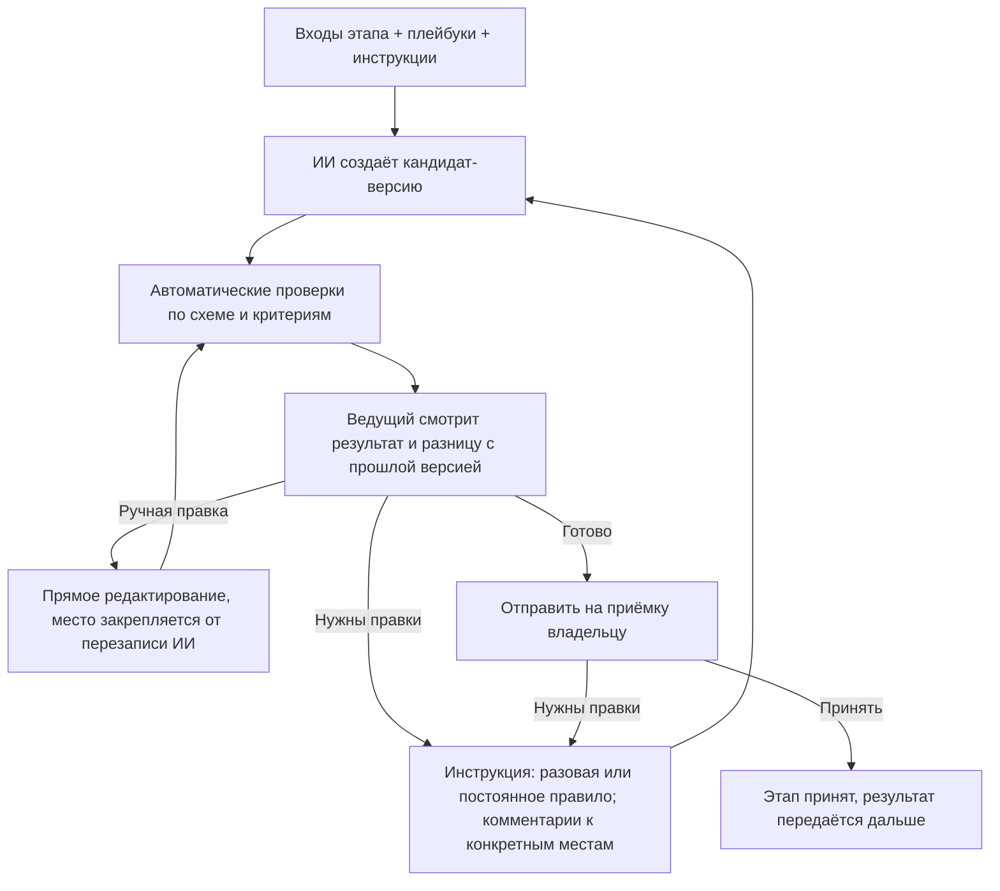
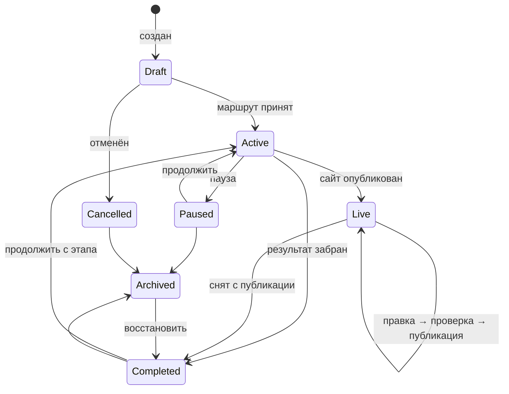
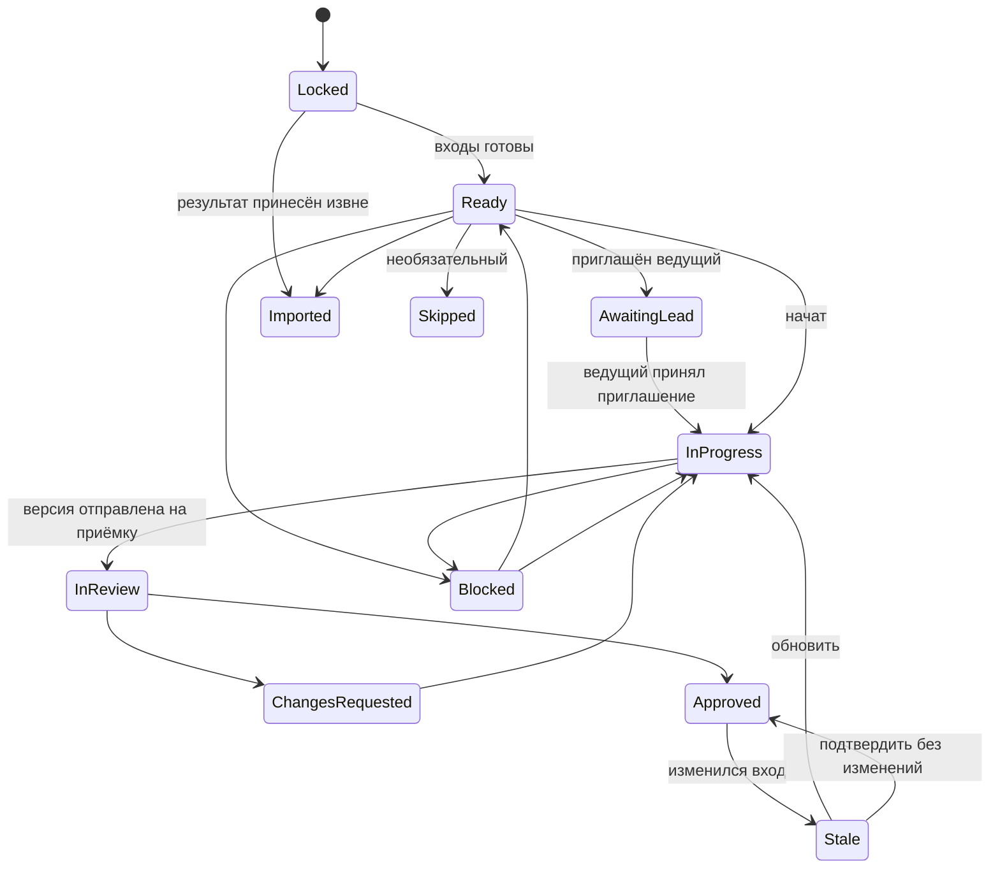

# BuildPath — модель работы по этапам: ИИ выполняет, люди направляют

**Статус:** проект нормативного документа. Часть II (карта проекта, контракты, полный цикл разработки) добавлена 10 ноября 2026 года. После согласования положения переносятся в PRODUCT_REQUIREMENTS.md, TECHNICAL_SPECIFICATION.md и IMPLEMENTATION_ROADMAP.md, а этот файл остаётся подробным описанием модели.

## 1. Идея

BuildPath — среда разработки, где работу на каждом этапе выполняет ИИ. Люди не делают работу вручную: они ставят задачу, дают ИИ инструкции, проверяют результат и решают, когда этап готов.

- Набор этапов зависит от типа проекта и его функций.
- На каждом этапе есть **ведущий** — человек, который направляет ИИ. По умолчанию это владелец проекта.
- Владелец может пригласить **специалиста** (UX, дизайнер, аналитик, разработчик, юрист…) ведущим или консультантом на конкретный этап. Ценность специалиста — его знания, переданные ИИ в виде инструкций, правок и проверки.
- Платформа даёт каждому этапу **встроенный набор экспертных инструкций**, поэтому новичок может пройти весь маршрут без специалистов.
- Проект можно остановить после любого этапа и забрать результат, а можно начать с любого этапа, принеся готовые материалы.

Ключевая единица продукта — **этап с контрактом** (входы, выходы, критерии приёмки) и **циклом работы с ИИ** (инструкция → версия → проверка → правка → приёмка).

## 2. Основные понятия

| Понятие | Смысл |
|---|---|
| **Тип проекта** | Лендинг, магазин, кабинет, мобильное приложение и т. д. Задаёт шаблон маршрута. |
| **Признаки (features)** | Оплата, аккаунты, персональные данные, бронирование… Добавляют обязательные этапы и проверки. |
| **Маршрут (Route)** | Граф этапов проекта с версией: шаблон типа + признаки + выбор владельца. |
| **Контракт этапа (StageDefinition)** | Версионированное описание: входы, выходы, критерии приёмки, уровень поддержки ИИ, встроенный плейбук, доступ по умолчанию, форматы экспорта. |
| **ИИ-агент этапа** | Исполнитель этапа. Работает только с материалами этапа и создаёт кандидат-версии артефактов. |
| **Ведущий этапа** | Человек, который даёт ИИ инструкции, запускает генерацию и отправляет версию на приёмку. Владелец или приглашённый специалист. |
| **Консультант** | Специалист без права запускать ИИ: комментирует, предлагает инструкции, проверяет. |
| **Плейбук (Playbook)** | Набор экспертных инструкций и чек-листов для типа этапа. Бывает встроенный (от BuildPath), проектный и личный плейбук специалиста. |
| **Инструкция этапа** | Конкретное указание ИИ в рамках этапа: разовая («сделай hero короче») или постоянная правило («все CTA — глаголом»). |
| **Запуск ИИ (GenerationRun)** | Одна генерация: входы, инструкции, плейбуки, модель, результат, проверки, стоимость. |
| **Артефакт** | Результат этапа (ТЗ, схема логики, структура, контент, дизайн, SiteSpec, код, отчёт). Только неизменяемые версии. |
| **Пакет результата** | То, что владелец забирает при остановке: принятые артефакты + сводка + открытые вопросы. |

## 3. Маршрут зависит от типа проекта

| Тип / признак | Этапы маршрута (по умолчанию) |
|---|---|
| Лендинг, портфолио, визитка | Цель → Контент и структура → Дизайн → Сборка → Проверка → Публикация |
| Сайт компании / каталог-меню | Цель → Требования → Структура → Контент → Дизайн → Сборка → Проверка → Публикация |
| Интернет-магазин, запись, кабинет | Цель → Требования → Бизнес-логика → Структура и сценарии → ТЗ → Прототип → Дизайн → Техплан → Реализация → Проверка → Публикация → Передача |
| Мобильное / desktop-приложение | Цель → Требования → Бизнес-логика → ТЗ → Прототип → Дизайн → Техплан → (Реализация, пока генерация не поддерживается — передача разработчику) |
| + оплата | + «Платёжные сценарии», усиленная проверка безопасности |
| + персональные данные | + «Данные и согласия» (какие данные, зачем, политика конфиденциальности, удаление) |
| + несколько ролей / аккаунты | + «Роли и права» внутри бизнес-логики, проверки авторизации |

Этап обязателен, если без его результата следующий этап нельзя выполнить или проверить, либо этого требует признак риска. Остальные этапы необязательны и пропускаются с объяснением, что останется неизвестным. Маршрут — ациклический граф; независимые этапы могут идти параллельно.

## 4. Контракт этапа

1. **Входы** — какие артефакты нужны и какая минимальная полнота.
2. **Выходы** — артефакты с типизированной схемой. ИИ возвращает данные по схеме, а не произвольный текст или код.
3. **Критерии приёмки** — автоматические проверки (схема, полнота, сборка, quality gate) и чек-лист для человека.
4. **Уровень поддержки ИИ** из каталога возможностей: `ai_full` (ИИ создаёт готовый результат), `ai_draft` (ИИ создаёт черновик, нужен эксперт), `ai_assist` (ИИ только помогает, результат загружается извне). Уровень определяет платформа, а не модель.
5. **Встроенный плейбук** — экспертные инструкции BuildPath для этого типа этапа.
6. **Рекомендация по специалисту** — например: «Платёжные сценарии: рекомендуем подключить специалиста, ИИ здесь даёт только черновик».
7. **Доступ по умолчанию** и **форматы загрузки/экспорта**.

## 5. Цикл работы на этапе

Правила цикла:

- **Запускать ИИ** могут только ведущий этапа и владелец. Консультанты и проверяющие оставляют комментарии; ведущий одним действием превращает комментарий в инструкцию.
- **Точечные правки.** Комментарий привязан к месту артефакта (раздел ТЗ, секция страницы, элемент макета). ИИ меняет только указанную часть и показывает разницу.
- **Ручные правки** допустимы всегда. Отредактированное вручную место закрепляется: ИИ не перезаписывает его без явной инструкции.
- **Правило вместо повторения.** Если ведущий исправляет одно и то же, система предлагает сохранить исправление как постоянное правило этапа или проекта.
- **Происхождение версии.** Каждая версия хранит: входы и их версии, плейбуки и их версии, инструкции, модель, автора запуска, результат проверок, стоимость. По этим данным видно, кто и почему изменил результат.
- **Приёмка.** ИИ никогда не принимает этап. Принимает владелец или назначенный им проверяющий. Если ведущий — сам владелец, он может принять результат сразу (личный режим, без тупика согласования).

## 6. Инструкции: приоритет и безопасность

Порядок приоритета (сверху — важнее):

1. Политика платформы, права доступа, quality gate.
2. Подтверждённые требования и решения владельца.
3. Постоянные правила проекта (их утверждает владелец).
4. Инструкции и плейбук ведущего этапа.
5. Встроенный плейбук BuildPath.
6. Комментарии участников, ещё не превращённые в инструкции.

- Инструкции специалиста **не могут** менять подтверждённые требования, права, проверки безопасности, расходы и публикацию. Если инструкция противоречит требованию, ИИ не выполняет её молча: система показывает конфликт и предлагает владельцу изменить требование.
- Предложения специалиста по изменению требований оформляются как **предложение изменения** и вступают в силу после подтверждения владельцем.
- Плейбуки и загруженные инструкции проходят ту же проверку, что и пользовательские инструкции для ИИ в PRODUCT_REQUIREMENTS.md: карантин, извлечение текста, проверка на prompt injection, явное включение.
- Граница доступа ИИ задаётся сервером, а не текстом инструкции: никакая инструкция не даёт ИИ прочитать материалы вне области этапа.

## 7. Специалисты

### 7.1. Роли на этапе

| Роль | Что может |
|---|---|
| **Ведущий** | Давать инструкции, запускать ИИ, редактировать, подключать свой плейбук, отправлять на приёмку. |
| **Консультант** | Видеть этап, комментировать, предлагать инструкции и правила, ставить отметку «проверено специалистом». |
| **Проверяющий** | Принимать или возвращать конкретную версию (назначается владельцем). |

На одном этапе может быть один ведущий и несколько консультантов. Владелец всегда может вернуть себе роль ведущего.

### 7.2. Доступ специалиста

По умолчанию специалист и ИИ, которым он управляет, видят одно и то же: принятые входы этапа и артефакты самого этапа.

| Можно | Нельзя по умолчанию |
|---|---|
| Читать принятые входные артефакты этапа | Видеть другие этапы и их обсуждения |
| Запускать ИИ на этапе (ведущий) в пределах бюджета | Видеть участников, бюджет проекта целиком, оплату, настройки |
| Редактировать артефакты этапа, обсуждать, загружать файлы этапа | Скачивать материалы без разрешения владельца |
| Подключать свой плейбук к этапу | Видеть секреты, ключи, подключённые аккаунты |
| Отправлять версию на приёмку | Публиковать, передавать код наружу, приглашать других |

Владелец может открыть дополнительный артефакт на чтение, отдать артефакт со скрытыми разделами, запретить или разрешить скачивание, задать срок доступа и условия конфиденциальности. До отправки приглашения система показывает, что именно увидит специалист.

### 7.3. Жизненный цикл доступа

1. Владелец приглашает специалиста на этап с ролью, областью доступа и бюджетом ИИ.
2. Специалист принимает приглашение и условия — доступ открывается.
3. После приёмки этапа право запускать ИИ и редактировать закрывается автоматически; чтение — через настраиваемый срок (по умолчанию 7 дней).
4. Владелец может отозвать доступ в любой момент; версии, инструкции и сообщения остаются в истории.
5. Если ведущий ушёл, этап получает статус «Ожидает ведущего», владелец берёт его на себя или приглашает другого.

Все выдачи, расширения и отзывы доступа и все запуски ИИ пишутся в журнал аудита.

### 7.4. Плейбук специалиста — его актив

- Специалист может сохранить свои инструкции и чек-листы как личный плейбук и применять его в разных проектах.
- Плейбук не содержит данных проектов: при сохранении правила из проекта система просит обобщить его и проверяет, что в нём нет фрагментов чужих материалов.
- Владелец видит, какой плейбук подключён к его этапу, версию и статус проверки. Содержимое по умолчанию видно владельцу; закрытые плейбуки возможны позже, только при проверке платформой (см. раздел 13).
- Проектные правила, созданные на этапе, принадлежат проекту и остаются у владельца после ухода специалиста.

## 8. Бюджет ИИ

- Генерации тратят лимиты тарифа владельца. До запуска показывается примерная стоимость.
- Владелец задаёт бюджет на этап или на назначение специалиста; специалист видит остаток. При исчерпании бюджета запуск останавливается, владелец может добавить.
- Учёт использования (UsageRecord) ведётся с первой версии продукта, даже если тарифов ещё нет.

## 9. Остановиться на любом этапе и забрать результат

- Владелец в любой момент нажимает «Забрать результат».
- Пакет результата: все принятые артефакты, сводка решений, допущения, открытые вопросы, список непройденных этапов и что для них понадобится. По желанию — постоянные правила проекта, чтобы следующий исполнитель (человек или другой ИИ) продолжил в том же стиле.
- Непринятые черновики можно добавить с пометкой «черновик, не принят».
- Форматы: ТЗ и логика — DOCX/PDF/MD; дизайн — изображения и ссылки; код — ZIP или Git; сайт — экспорт сборки.
- Пакет тоже версионируется; к проекту можно вернуться и продолжить.

## 10. Начать с любого этапа

1. Владелец выбирает стартовый этап.
2. Система показывает, какие входы требует этап, и просит загрузить их или указать ссылку.
3. Материалы проходят проверку безопасности и сопоставляются с типами артефактов. ИИ помогает разобрать документы в структуру этапа (например, ТЗ из PDF — в реестр требований), полнота считается по схеме.
4. По каждому входу видно: принят / неполный / не найден и что именно отсутствует.
5. По пробелам владелец выбирает: дозаполнить коротким опросом; дать ИИ восстановить недостающее в сокращённом этапе; принять риск — пробел становится допущением, видимым следующим этапам.
6. Предыдущие этапы получают статус **«Импортирован»**: результат внешний, платформа его не создавала. В сводке готовности это видно отдельно от «Принят».

Существующий сайт или код сначала проходит анализ в режиме только чтения (уже реализован); отчёт становится входом стартового этапа.

**Режим принесённого материала.** Для каждого принесённого результата (готовый бэкенд, дизайн, тексты) владелец выбирает, что с ним можно делать дальше:

| Режим | Смысл | Пример |
|---|---|---|
| **Закреплён** | Использовать как есть, ИИ и специалисты не меняют. Если следующему этапу чего-то не хватает, это показывается как пробел и вопрос владельцу, а не правка | «Вот наш API, его не трогать, сделайте фронтенд» |
| **Можно дорабатывать** | Становится обычной версией этапа: ИИ может предлагать изменения, они идут через приёмку и уведомления (раздел 11) | «Вот макеты, поправьте под мобильные» |
| **Справка** | Не артефакт этапа, а источник сведений: ссылки на документацию, примеры, конкурентов. ИИ читает их как данные, а не как инструкции | Ссылка на документацию платёжного сервиса |

Режим можно поменять позже; смена с «Закреплён» на «Можно дорабатывать» — решение владельца с записью в журнал.

## 11. Изменения между этапами: версии, уведомления, согласование

Каждый этап работает на **закреплённых версиях входов**: в версии артефакта записано, на каких принятых версиях предыдущих этапов она построена. Новая версия на предыдущем этапе ничего не меняет у следующего молча.

1. **Новая принятая версия** на этапе A создаёт **уведомление об изменении** (ChangeNotice) для каждого зависимого этапа B: что изменилось (разница), кто изменил, почему (комментарий автора) и что это значит для B (сводка влияния от ИИ: «меняется цена в 2 услугах, затрагивает блок "Услуги"»). Уведомление получают ведущий B и владелец — в приложении, по почте и в Telegram.
2. **Этап B продолжает работать на старой версии**, пока его ведущий не решит. На карте у B значок «Есть изменение входа»; если B был принят, он получает статус «Устарел».
3. **Решение на этапе B** (ведущий или владелец):
   - **Принять** — B переходит на новую версию входа; ИИ готовит предложение обновления B с разницей, оно идёт обычным циклом (раздел 5).
   - **Принять без изменений** — новая версия входа закрепляется, результат B остаётся в силе (например, изменение B не касается).
   - **Обсудить** — комментарий к конкретным местам изменения уходит автору этапа A: «если цены меняются, раздел "Тарифы" ломается, предлагаю…».
4. **Ответ этапа A** на обсуждение: выпустить новую версию с учётом комментария (цикл повторяется с шага 1), объяснить и оставить как есть, или передать решение владельцу.
5. **Владелец — арбитр.** Он видит все открытые обсуждения на карте, может закрыть любое решением и задать срок ответа. Если ведущий B не ответил в срок, владелец решает за него.
6. Пока по изменению идёт обсуждение, этапы, которые зависят от B, видят только принятые версии B — незавершённые споры не расползаются по графу.
7. Все уведомления, решения и ответы хранятся в истории этапов и в журнале проекта: видно, кто, когда и почему принял изменение.

**Реализовано (10 ноября 2026):** открытие принятого этапа больше не делает зависимые этапы устаревшими — они работают на его последней принятой версии. Новая принятая версия создаёт уведомление для каждого этапа, построенного на ней напрямую и уже имеющего работу: список изменений простым языком, закрепление прежней версии, запрет приёмки и отправки на приёмку до решения. Решения: «Принять и обновить», «Этот этап не затронут», «Задать вопрос»; ответ автора изменения: «оставить», «выпущу исправленную версию», «пусть решит владелец». Владелец может решить вместо ведущего. Новая версия заменяет уведомление и сохраняет закрепление; возврат к закреплённой версии закрывает его. Уведомления — в Telegram; на почту — ещё нет. Сводка влияния от ИИ и срок ответа (п. 1, 5) — ещё нет.

Изменения **контракта** (раздел 22) идут по тому же правилу, но новая версия контракта сначала утверждается владельцем, и уведомление получают все параллельные этапы, построенные на нём.

## 12. Состояния

### 12.1. Проект

- **Draft** — маршрут ещё не принят.
- **Active** — этапы идут.
- **Completed** — результат забран; продолжить можно обычным действием.
- **Live** — сайт опубликован; правки идут коротким циклом «инструкция → кандидат → проверки → публикация» без повторного маршрута.
- **Cancelled / Archived** — брошенный проект можно отменить и убрать в архив.

### 12.2. Этап

Статусы в интерфейсе: «Закрыт», «Готов к началу», «Ожидает ведущего», «В работе», «На приёмке», «Нужны правки», «Принят», «Устарел», «Импортирован», «Пропущен», «Заблокирован». Внутри «В работе» идёт цикл ИИ (раздел 5); отдельные запуски ИИ — это не смена статуса этапа.

## 13. Данные (дополнения к модели)

- **StageAssignment:** stage, user, role (`lead | consultant | reviewer`), accessScopeId, aiBudget, termsVersion, dueDate?, status.
- **AccessScope:** правила (artifact/stage, действие `read | write | comment | download | run_ai`, скрытые разделы, водяной знак, expiresAt). Вычисляется сервером на каждом запросе и передаётся в AI gateway как граница контекста.
- **Playbook / PlaybookVersion:** владелец (платформа / специалист / проект), тип этапа, инструкции, чек-лист, статус проверки, видимость.
- **StageInstruction:** этап, автор, тип (`one_off | stage_rule | project_rule`), привязка к месту артефакта, статус (`proposed | active | disabled`), кто утвердил.
- **GenerationRun:** этап, кто запустил, входы и версии, плейбуки и версии, инструкции, модель, результат (artifact version), проверки, стоимость, ошибки.
- **ChangeProposal:** предложение специалиста изменить подтверждённое требование; применяется после решения владельца.
- **ArtifactVersion.inputVersions:** версии входов, на которых построена версия (закрепление, раздел 11).
- **ChangeNotice:** исходный этап и версия, целевой этап, разница, сводка влияния, статус (`open | accepted | accepted_no_change | discussing | resolved_by_owner`), срок, решение и кто его принял.
- **ChangeDiscussion:** сообщения между ведущими двух этапов по уведомлению, привязанные к местам в разнице; итог (`revised | kept | escalated`).
- **ImportedArtifact:** источник, проверка безопасности, сопоставление со схемой, пробелы, решение по пробелам.
- **ResultPackage:** версия, список артефактов и версий, сводка, допущения, открытые вопросы, формат.
- **UsageRecord:** генерации, сборки, хранилище, публикации — по проекту, этапу и пользователю.

## 14. Специалисты и деньги — по фазам

1. **Фаза 1 (MVP):** владелец работает со встроенными плейбуками; может пригласить своего специалиста по ссылке. Оплата между ними — вне платформы, ИИ-расходы — из лимитов владельца.
2. **Фаза 2:** каталог специалистов по типам этапов с отзывами и примерами; публичные плейбуки специалистов, которые можно подключить к этапу без найма человека.
3. **Фаза 3:** оплата через платформу по результату (раздел 29.3): владелец платит при приёмке, платформа выплачивает специалисту; платные плейбуки. Доход платформы — оплата за проект по расходу ИИ (раздел 28), комиссия со специалистов — не решено.

## 15. Что ещё нужно для этапов сайта (MVP-генерация)

- **Формы заявок без своего сервера:** встроенный обработчик BuildPath отправляет заявки владельцу в Telegram и на email.
- **Контент:** этап «Контент» в MVP — ИИ пишет тексты по цели и аудитории, владелец загружает фото с телефона.
- **Публикация по умолчанию** на поддомен BuildPath без отдельного аккаунта; свой домен и внешний хостинг — опции.
- **Политика конфиденциальности и согласие** добавляются автоматически, если сайт собирает персональные данные.

## 16. Telegram в этой модели

- Ведущий может давать ИИ инструкции голосом или текстом в Telegram и получать новую версию с превью.
- Владелец получает «Принять / Нужны правки» по каждой отправленной версии и уведомления о заявках с сайта.
- Права проверяются так же, как в вебе: бот не расширяет область доступа.

## 17. Порядок реализации (предлагаемая правка roadmap)

1. **Маршрут, контракты этапов и цикл работы с ИИ** для лендинга и сайта компании: инструкции, точечные правки, закрепление ручных правок, происхождение версий, встроенные плейбуки, приёмка в личном режиме, пакет результата.
2. **Генерация сайта:** Контент → Дизайн (шаблоны) → Сборка → предпросмотр → правки → публикация на поддомен; встроенный обработчик форм; учёт использования ИИ.
3. **Начать с этапа:** приём материалов, статус «Импортирован», пробелы.
4. **Специалисты:** приглашение ведущим или консультантом, область доступа, бюджет ИИ, личные плейбуки, предложения изменений, автозакрытие доступа, аудит.
5. **Telegram:** инструкции, приёмка, уведомления.
6. **Live-режим** и свой домен.
7. **Каталог специалистов, публичные плейбуки и оплата.**

Уже реализованные анализ сайта и сверка с дизайном становятся инструментами этапов «Проверка исходных материалов» и «Проверка качества».

## 18. Критерии приёмки модели

- Новичок без специалистов проходит маршрут лендинга до опубликованного сайта, только давая ИИ инструкции и принимая результаты.
- Комментарий к конкретной секции превращается в инструкцию; ИИ меняет только эту секцию и показывает разницу.
- Место, отредактированное вручную, не перезаписывается следующей генерацией без явной инструкции.
- Для любой версии видно, какие входы, плейбуки, инструкции и модель её создали и кто запустил генерацию.
- Специалист-ведущий видит только свой этап; ИИ, запущенный им, не получает материалы других этапов — проверяется на уровне API и AI gateway.
- Инструкция специалиста, противоречащая подтверждённому требованию, не выполняется молча, а показывается владельцу как конфликт.
- После приёмки этапа специалист больше не может запускать ИИ и редактировать; событие видно в журнале.
- Запуск ИИ останавливается при исчерпании бюджета этапа.
- Владелец останавливается после ТЗ и скачивает пакет результата; начинает с «Реализации», загрузив дизайн, и видит пробелы и статус «Импортирован».
- Изменение принятого артефакта помечает зависимые этапы «Устарел» с предложением обновления.
- Новая версия на этапе не меняет работу следующего этапа, пока его ведущий не примет её; обсуждение изменения доходит до автора, и его ответ виден обоим этапам и владельцу.

## 19. Решения по умолчанию (9 ноября 2026)

Приняты, пока владелец продукта не решит иначе:

1. Первые типы проектов — «Одностраничный сайт» и «Сайт компании».
2. Владелец всегда видит содержимое плейбука, подключённого к его этапу.
3. Публичные плейбуки и каталог специалистов — после приглашения своих специалистов (фаза 2).
4. Модель дохода не выбрана; учёт использования ИИ ведётся с первой версии.
5. Первая публикация — на поддомен BuildPath; до её реализации результат скачивается файлом.

## 20. Что реализовано (срез 1)

- Каталог маршрутов `1.0.0` для двух типов, контракты этапов «Цель сайта», «Услуги и цены», «Структура и тексты», «Внешний вид», «Сборка и проверка» с пояснениями, полями, критериями приёмки и встроенными плейбуками.
- Старт с любого этапа: выбранный этап и предыдущие открываются; материалы можно вставить текстом; полные материалы получают статус «Импортирован».
- Цикл работы с ИИ: инструкция на весь этап или на один блок, постоянные правила этапа и проекта, закрепление ручных правок, происхождение каждой версии, возврат к любой версии, дневной лимит генераций на проект. Без ИИ — ручное заполнение и шаблонные черновики текстов и стиля.
- Приёмка владельцем в личном режиме, статус «Нужно проверить» (`stale`) для зависимых этапов при изменении принятого, пакет результата на любом этапе, завершение и продолжение проекта.
- Детерминированная сборка одностраничного сайта без скриптов с проверками (главная кнопка, контакты, пустые места, заголовки, контраст WCAG AA, SEO).

### Срез 2: публикация и заявки

- Публикация принятой сборки на поддомен BuildPath после явного подтверждения: адрес предлагается по названию (транслитерация), проверяется на занятость; сайт можно обновить до новой принятой сборки или снять с публикации. Пока сайт опубликован, проект в состоянии `live`, правки идут обычным циклом этапов.
- Опубликованные сайты отдаёт отдельный процесс на отдельном домене: только принятый HTML без скриптов, CSP с `frame-ancestors 'none'`, страница о данных, `robots.txt`, `sitemap.xml`.
- Главное действие «Оставить заявку на сайте»: форма без скриптов, обязательное согласие на обработку данных, страница о данных с контактами владельца, защита от спама (скрытое поле, запрет чужого Origin, лимиты 5 заявок в час на посетителя и 200 в сутки на сайт), IP хранится только в виде хеша, автоудаление заявок через 365 дней.
- Уведомления владельцу: Telegram (привязка аккаунта одноразовой ссылкой на бота, `/stop` для отключения) и email; статус доставки сохраняется у заявки. Список и удаление заявок в приложении.

### Срез 3: специалисты

- Владелец или менеджер приглашает специалиста на один этап как ведущего или консультанта; перед отправкой видно, что специалист сможет и чего не сможет. Приглашение действует 7 дней, привязано к почте и отправляется письмом (если настроена почта) или ссылкой, которую владелец пересылает сам.
- Специалист не становится участником проекта: он видит только свой этап и принятые результаты его входов, ИИ по его запросам получает тот же объём данных. Публикация, заявки, результат проекта, другие этапы и инструмент сверки ему недоступны.
- Ведущий даёт ИИ инструкции, правит, добавляет правила этапа (не проекта) и отправляет этап на приёмку; владелец получает уведомление в Telegram. Владелец принимает этап или возвращает его с комментарием (ведущему тоже приходит уведомление). Лимит запросов к ИИ на назначение задаёт владелец.
- Консультант предлагает правки; ведущий или владелец одним нажатием отправляет предложение ИИ или отклоняет его.
- После приёмки изменения специалисту закрываются сразу, просмотр — через 7 дней. Доступ можно отозвать в любой момент. Все действия пишутся в журнал проекта.

### Срез 4: этапы в Telegram

- Бот после привязки: список проектов (и этапов, где вы специалист), карточка этапа со статусом, кратким содержанием текущей версии и тем, чего не хватает. Кнопки: «Попросить ИИ» (следующее сообщение — инструкция), «Собрать сайт», «Принять» с подтверждением, «Отправить на приёмку», «Вернуть на доработку» с комментарием, «Предложить правку». Голосовые сообщения пока не распознаются — бот просит написать текстом.
- Права те же, что в вебе: бот действует от имени привязанного аккаунта через ту же доменную логику.
- Mini App: кнопка «Открыть в приложении» открывает нужный экран внутри Telegram и входит без пароля по подписанным данным Telegram, если аккаунт привязан.

### Срез 5: фото на сайте

- Фото загружаются с телефона в блоки «Первый экран», «О вас», «Услуги», «Преимущества» и «Призыв к действию» на этапе «Структура и тексты»; там же — библиотека фото проекта (до 30), замена, удаление неиспользуемых.
- Перед загрузкой нужно коротко описать, что на фото: описание выводится в `alt` для незрячих посетителей и поисковиков. Сборка предупреждает о фото без описания и не проходит, если выбранное фото удалено.
- Безопасность: принимаются только JPEG, PNG и WebP по содержимому файла (до 12 МБ). Оригинал проверяется ClamAV; если проверка недоступна, загрузка отклоняется. Затем фото декодируется и пересохраняется в WebP до 1600 px — метаданные (в том числе место съёмки) и всё, что не является пикселями, удаляются. Блоки ссылаются на фото только по идентификатору; ссылки на внешние адреса не принимаются, на сайте показываются только фото этого проекта.
- ИИ не выбирает и не меняет фото: при переписывании текстов выбранные фото сохраняются, а выбор фото не считается ручной правкой текста и не включает защиту от ИИ.
- Доступ: библиотеку видят участники проекта и специалисты этапа текстов; менять — те, кто может редактировать этот этап.
- Предпросмотр и скачанный `site.html` содержат фото внутри файла и работают без интернета. Опубликованный сайт отдаёт `/img/<id>.webp` только для фото, которые есть на странице.

Ещё не реализовано: тонкая настройка доступа (открыть дополнительный артефакт, скрыть разделы, разрешить скачивание), личные плейбуки, предложения изменений, распознавание голосовых сообщений, свой домен, кадрирование и галерея фото, проверка загружаемых файлов инструкций, состояние `Cancelled` проекта.

---

# Часть II. Карта проекта, контракты и полный цикл разработки

Принята 10 ноября 2026 года по постановке владельца продукта: BuildPath ведёт пользователя через все этапы разработки к качественному результату, показывает проект схемой, а не одним чатом, даёт варианты с инструкциями на каждом решении и позволяет работать параллельно там, где утверждён контракт.

## 21. Карта проекта

Главный экран проекта — **карта**: граф этапов маршрута, а не лента сообщений.

- **Узел** — этап. На нём видно: статус, кто ведёт (владелец, специалист или ИИ), версия результата, значки «ждёт вашего решения», «есть изменение входа», «идёт обсуждение».
- **Связи** — зависимости по артефактам. Связь от контракта к параллельным этапам выделена; связь, по которой пришло непринятое изменение, подсвечена.
- **Нажатие на узел** открывает рабочую область этапа: что нужно на входе, варианты и инструкции, работа с ИИ, версии и история, участники и их доступ.
- **Сводка над картой:** что сделать вам сейчас, что ждёт других, где обсуждения, сколько осталось до результата.
- **На телефоне** карта показывается вертикально: этапы сверху вниз, параллельные ветки — рядом в одной строке с горизонтальной прокруткой. Есть режим «список», где этапы сгруппированы по шагам маршрута.
- Карта строится из маршрута проекта (раздел 3) и меняется вместе с ним: добавили признак «оплата» — появился узел «Платёжные сценарии» с объяснением, откуда он взялся.

Чат с ИИ остаётся внутри этапа как способ давать инструкции, но не заменяет структуру проекта.

## 22. Контракты и параллельная работа

**Контракт** — артефакт, который фиксирует договорённость между этапами, чтобы они могли работать независимо. Примеры:

| Контракт | Что фиксирует | Кто на нём работает параллельно |
|---|---|---|
| Структура и сценарии | Страницы, экраны, переходы, роли | Тексты, дизайн, прототип |
| Технический план | Стек, модули, окружения, ограничения | Бэкенд, фронтенд, инфраструктура |
| Контракт API | Эндпоинты, схемы данных, ошибки (OpenAPI) | Бэкенд, фронтенд, тесты |
| Модель данных | Сущности, поля, связи | Бэкенд, миграции, аналитика |
| Дизайн-система | Цвета, шрифты, компоненты | Дизайн страниц, фронтенд |

Правила:

1. Контракт — обычный этап с версиями, но его **утверждает владелец** (или назначенный им проверяющий) отдельным действием «Утвердить контракт». ИИ готовит черновик контракта, проверяет полноту и непротиворечивость требованиям.
2. После утверждения все этапы, у которых контракт — единственный незакрытый вход, **стартуют одновременно**. Каждый работает только от контракта и своих входов.
3. Параллельные этапы не видят незавершённые версии друг друга. Если нужно что-то от соседа — это изменение контракта, а не договорённость в обход.
4. **Изменение контракта** — новая версия, которую снова утверждает владелец. Перед утверждением система показывает, какие параллельные этапы затронуты и в каком состоянии. После утверждения они получают уведомление об изменении (раздел 11).
5. Этап, который сводит ветки (например, «Интеграция и тесты»), стартует, только когда все входящие ветки приняты на одной и той же версии контракта. Его автоматические проверки сверяют каждую ветку с контрактом (схемы API, модель данных, компоненты).
6. Если ветка ушла вперёд на новой версии контракта, а другая ещё на старой, сводящий этап показывает, кого ждёт и почему.

**Реализовано (10 ноября 2026):** признак контракта в каталоге этапов; первый контракт — «Цель сайта» (кнопка «Утвердить», пояснение, что откроется одновременно и кто получит уведомление). «Внешний вид» теперь зависит только от цели и идёт параллельно с услугами и текстами. Этап, который сводит ветки (два и больше входов), нельзя собрать и принять, пока у этапов, на которых он построен, есть нерешённые изменения. Ещё нет: отдельных контрактов «Структура», «Технический план», «Контракт API», проверки веток на соответствие контракту (схемы API, модель данных).

## 23. Маршрут полной разработки

Для веб-приложения, магазина и кабинета маршрут по умолчанию:

Цель → Требования и ТЗ → Структура и сценарии (контракт) → **параллельно:** Тексты · Прототип и дизайн → Технический план (контракт: стек, API, модель данных) → **параллельно:** Бэкенд · Фронтенд · Инфраструктура → Интеграция и тесты → Хранение кода → Развертывание → Поддержка.

Для лендинга и сайта компании маршрут остаётся коротким (раздел 3); этапы «Хранение кода» и «Развертывание» в них необязательны: по умолчанию сайт публикуется на поддомен BuildPath, а код можно забрать.

Этапы, где генерация пока не поддерживается, получают уровень `ai_draft` или `ai_assist` (раздел 4) и честную рекомендацию подключить разработчика.

## 24. Карточки выбора: варианты и инструкции

Каждое решение с последствиями (технологии, хранение кода, хостинг, домен, почта, оплата) оформляется **карточкой выбора** — одним механизмом для всех этапов.

1. **Варианты** — 2–5 поддерживаемых вариантов. Для каждого простым языком: плюсы, ограничения, цена и кто платит, что придётся сопровождать, насколько легко уйти. Дата, на которую сведения актуальны.
2. **Рекомендация** — «для вашего проекта лучше X, потому что…» с опорой на требования и предпочтения владельца. Ни один вариант не объявляется лучшим всегда.
3. **Что нужно от вас** — пошаговая инструкция для выбранного варианта: создать аккаунт, нажать «Подключить», выдать доступ к одному репозиторию, купить сервер с такими параметрами, прислать адрес и ключ. Каждый шаг можно отметить выполненным.
4. **Проверка** — BuildPath сам проверяет результат шага (подключение работает, репозиторий доступен на запись, сервер отвечает, DNS настроен) и только тогда открывает следующий. Ошибка объясняется с тем, что сделать.
5. **Сделать самому** — для тех, кто не хочет давать доступ: BuildPath готовит пакет (код, инструкция, файлы настроек), пользователь выполняет шаги сам и отмечает готовность; проверка — по публичному результату, если это возможно.
6. Выбор записывается в проект с версией и причиной. Сменить вариант позже можно; карточка показывает, что это затронет.

Первые карточки:

| Карточка | Варианты на старте |
|---|---|
| Хранение кода | GitHub, GitLab (облако или свой сервер по адресу), скачать архив |
| Развертывание | Поддомен BuildPath; свой сервер или VPS (инструкция + Docker Compose + проверка); облачный хостинг статических сайтов; хостинг в Казахстане |
| Технологии | Рекомендованный стек из каталога возможностей и поддерживаемые альтернативы с объяснением, что меняется; «свой стек» — с честной пометкой, что генерация его не поддерживает и нужен разработчик |
| Домен | Купить у регистратора по инструкции, подключить свой, остаться на поддомене |

Подключение внешнего аккаунта, оплата, передача кода наружу и production-развертывание всегда требуют отдельного подтверждения владельца, даже если вариант выбран заранее.

**Реализовано (10 ноября 2026):** механизм карточек выбора (варианты, рекомендация с причиной, шаги с отметками, запись решения с версией карточки) и первая карточка «Где хранить код»: архив, GitHub, GitLab (gitlab.com или свой сервер с публичным адресом). Подключение — по ключу доступа к одному репозиторию; BuildPath проверяет право записи, хранит ключ зашифрованным и не показывает его. Отправка принятых результатов — одним коммитом, только после подтверждения с показом файлов и ветки. Вторая карточка — «Где будет работать сайт»: BuildPath (рекомендуется), GitHub Pages (только после подключения GitHub), свой сервер с готовым пакетом (страница, Caddy с автоматическим HTTPS, compose, инструкция) и автоматической проверкой адреса: BuildPath открывает сайт и сравнивает с принятой версией. Ещё нет: подключения через OAuth (кнопка «Подключить» без ключа), карточек «Технологии» и «Домен», развертывания на сервер самим BuildPath.

## 25. Доступ к внешним ресурсам и ИИ-агентам

Доступ к этапу (раздел 7) дополняется доступом к **подключённым ресурсам** проекта: репозиторию, хостингу, домену, сервисам.

| Право | Пример |
|---|---|
| Читать | Разработчик видит репозиторий, но не пушит |
| Писать в рабочую ветку | ИИ-агент или разработчик пушит только в ветку этапа, слияние — после приёмки |
| Развернуть на тестовом окружении | Разработчик обновляет staging |
| Развернуть в production | Только владелец или с его подтверждением на каждое действие |
| Управлять настройками и секретами | Только владелец; секреты никогда не показываются ни специалисту, ни ИИ |

- Права выдаются на этап и ресурс, со сроком; закрываются автоматически после приёмки этапа, как и доступ к этапу.
- **ИИ-агент** — такой же участник с ограниченными правами: работает в изолированной среде, видит только входы этапа, пишет только в ветку этапа, не получает секретов. Его действия пишутся в журнал так же, как действия людей.
- BuildPath использует подключения с минимальными правами (доступ к одному репозиторию, ключ только для развертывания) и показывает владельцу, что именно разрешено.

## 26. Порядок реализации части II

1. **Карта проекта** вместо списка этапов на текущих маршрутах; значки решений и изменений; режимы принесённого материала.
2. **Закрепление версий входов, уведомления об изменениях и обсуждение между этапами** (раздел 11) — сделано, кроме писем, сводки влияния от ИИ и сроков.
3. **Контракты и параллельный старт** в движке этапов: утверждение контракта, одновременный старт, сводящий этап — сделано для сайтов; контракты веб-приложения — с маршрутом «Онлайн-запись».
4. **Карточка выбора** как общий механизм; первая карточка — «Хранение кода» (GitHub, GitLab, архив) с проверкой подключения — сделано, без OAuth.
5. **Развертывание**: поддомен BuildPath, свой сервер по инструкции с проверкой, один облачный провайдер — сделано (GitHub Pages).
6. **Маршрут «Онлайн-запись к мастеру»** с техническим планом и контрактом API — первый полный цикл с кодом; доступ к внешним ресурсам и ИИ-агенты с ограниченными правами.
7. **Смета и учёт расхода ИИ по проекту**, затем оплата за проект вместо подписки (раздел 28, п. 4).
8. **Условия специалиста и учёт времени** (раздел 29): фиксированная цена или ставка, учёт активности, табель с результатами, лимиты, оплата при приёмке.
9. **История запросов к ИИ** (раздел 30) — сделано, кроме стоимости в деньгах и выгрузки.

## 27. Критерии приёмки части II

- Владелец видит весь проект одной схемой и за один взгляд понимает, что ждёт его решения.
- После утверждения контракта два этапа идут одновременно с разными ведущими; ни один не видит черновики другого; сводящий этап не стартует, пока обе ветки не приняты на одной версии контракта.
- Новая принятая версия этапа создаёт уведомление у зависимого этапа с разницей и сводкой влияния; зависимый этап продолжает работу на старой версии до решения; обсуждение доходит до автора, его ответ виден обоим и владельцу.
- Изменение контракта нельзя применить без утверждения владельца; перед утверждением видно, какие ветки затронуты.
- Карточка «Хранение кода» ведёт новичка от выбора до работающего подключения или до скачанного архива, объясняя каждый шаг; без подтверждения владельца код никуда не передаётся.
- Специалист с правом «писать в рабочую ветку» не может слить её в основную ветку и не видит секретов; ИИ-агент — тоже.

## 28. Решения владельца продукта (10 ноября 2026)

1. **Пользователь не разбирается в разработке.** Все экраны, варианты и уведомления пишутся для человека без технических знаний; технические детали — по кнопке «Подробнее». Приёмка кода опирается на объяснение изменений простым языком и автоматические проверки, а не на чтение кода.
2. **Весь код пишет ИИ внутри платформы.** Люди направляют, проверяют и принимают. Пользователь может принести готовый бэкенд или дизайн и начать со следующего этапа, выбрав режим принесённого материала (раздел 10): закреплён, можно дорабатывать или справка.
3. **Первый тип проекта с полным циклом** (код, хранение кода, развертывание) — **«Онлайн-запись к мастеру»**: услуги и мастера, расписание, запись клиента, уведомления, кабинет мастера. Понятная логика, есть данные и роли, частый спрос в малом бизнесе. Выбор сделан Claude по просьбе владельца.

   **Реализовано (10 ноября 2026), первый срез:** тип проекта «Онлайн-запись к мастеру» (цель → услуги → **Расписание и запись** → тексты → внешний вид → сборка). Новый этап без ИИ: длительность услуг, мастера (какие услуги, часы по дням недели), шаг времени, за сколько записываться, на сколько дней вперёд, срок отмены, часовой пояс; заполняется из принятых услуг. Сборка встраивает принятое расписание; на опубликованном сайте — раздел «Онлайн-запись» и страницы записи без скриптов: услуга → мастер или «любой свободный» → день и время → имя, телефон, согласие. Двойная запись к одному мастеру исключена (блокировка в транзакции, проверено 8 параллельными запросами). Клиент получает личную ссылку, по которой видит и отменяет запись до срока. Владелец получает уведомление в Telegram/на почту, видит «Записи клиентов», отменяет и отмечает «пришёл / не пришёл». **Свой сервер:** пакет для сайта с записью содержит программу записи (один файл без сторонних библиотек, Node.js 22+, собирается из тех же модулей расписания и страниц записи), принятое расписание, Caddy с HTTPS, compose и инструкцию; записи хранятся в файле на сервере владельца, страница записей /admin под паролем, уведомления в Telegram по желанию (проверено запуском скачанного пакета; сами файлы Docker Compose здесь не запускались). Ещё нет: технического плана и контракта API как отдельных этапов, кабинетов мастеров, напоминаний клиентам, перерывов и выходных по датам, предоплаты.
4. **Оплата — за проект плюс расход ИИ.** Платформа берёт деньги за проект; стоимость зависит от расхода токенов ИИ. До старта и перед дорогими действиями пользователь видит смету, во время работы — сколько потрачено против сметы. Это заменит текущие подписочные тарифы (docs/PLANS.md): переход описывается отдельно, существующие тарифы работают до него.

   **Реализовано (10 ноября 2026):** цены на ИИ задаются в админке (за миллион токенов на входе и выходе, с записью в журнал); у каждого запроса сохраняется его стоимость; смета проекта — диапазон по маршруту (обычное число запросов на этап × средний запрос × цена) и остаток на непринятые этапы; потрачено по этапам и участникам; цена одного запроса на странице этапа и в истории. Ещё нет: оплаты за проект, предупреждения перед дорогими действиями и лимита по смете.

## 29. Условия работы специалиста: фиксированная цена или почасовая ставка

Принято 10 ноября 2026 года. Специалист присоединяется к этапу на одном из условий, которые видны обоим до принятия приглашения.

| Условие | Что фиксируется | Когда начисляется |
|---|---|---|
| **Фиксированная цена за этап** | Сумма, что входит в работу, число доработок без доплаты | При приёмке этапа владельцем. Можно разбить на части, каждая оплачивается при её приёмке |
| **Почасовая ставка** | Ставка за час, лимит часов на этап и на неделю, нужно ли согласовывать превышение | При приёмке: подтверждённые часы × ставка в пределах лимита |

Условия — часть назначения (StageAssignment) и версионируются: изменить ставку или лимит можно только по согласию обеих сторон, изменение пишется в журнал.

### 29.1. Учёт времени

Платформа сама считает время, когда специалист **действительно работает над этапом внутри BuildPath**:

- **Активность** — действия на этапе: правка артефакта, инструкция ИИ, запуск генерации, комментарий, просмотр разницы и версий, работа в Telegram по этому этапу. Клиент отправляет сигнал активности, только когда вкладка этапа открыта и человек что-то делает (ввод, прокрутка, нажатия).
- **Простой** — если 5 минут нет действий, учёт останавливается; время ожидания ответа ИИ засчитывается, если специалист остаётся на этапе.
- **Время считает сервер** по сигналам активности; клиент не может прислать «отработал 3 часа».
- **Ручная запись** — для работы вне платформы (созвон с владельцем, изучение документации): специалист добавляет запись с описанием, она помечается «вручную» и требует отдельного подтверждения владельца.
- **Без слежки:** никаких снимков экрана, записи клавиш и отслеживания других вкладок. Специалист видит ровно то же, что владелец: какие интервалы и действия засчитаны.

### 29.2. Табель и подтверждение

- **Табель этапа** — по дням: интервалы, действия в них (например, «3 запуска ИИ, правка блока "Услуги"»), ручные записи, сумма.
- Владелец подтверждает табель раз в неделю или при приёмке этапа; можно оспорить конкретную запись с комментарием, специалист отвечает. Неподтверждённая неделя подтверждается автоматически через 3 дня, если владелец не оспорил.
- **Лимиты.** При приближении к лимиту часов (80 %) оба получают уведомление; при достижении лимита учёт останавливается, пока владелец не увеличит лимит.
- Владелец видит на карте по каждому этапу: потрачено часов и денег, лимит, остаток, плюс расход ИИ отдельной строкой.

### 29.3. Деньги: оплата через платформу по результату

Решено 10 ноября 2026 года: владелец платит специалисту через BuildPath; **главное — выполненная задача**, а не отработанное время. Заранее деньги не вносятся и не резервируются.

- **Основание для оплаты — приёмка.** Пока этап или задача не приняты, платить нечего. Владелец оплачивает при приёмке, в том же действии: «Принять и оплатить».
- **Фиксированная цена** — сумма из условий, к оплате при приёмке. Если условия делят работу на части (например, макеты, затем доработка), каждая часть оплачивается при приёмке своей части.
- **Почасовая ставка.** Время считается постоянно (раздел 29.1) и видно обоим: сколько потрачено, сколько осталось до лимита. Оплата — тоже при приёмке: к оплате подтверждённые часы × ставка, но не больше лимита из условий. Если работа не принята, часы остаются в табеле как информация, к оплате не выставляются.
- **Лимит часов** защищает владельца: работа сверх лимита не оплачивается без его согласия; при 80 % лимита оба получают уведомление.
- **Отказ от работы.** Если владелец закрывает этап без приёмки, специалист видит причину; спор по оплате решает поддержка по истории этапа (версии, комментарии, табель).
- **Выплаты специалисту** — на карту или счёт после оплаты владельцем; специалист указывает статус (физлицо, ИП, самозанятый) и реквизиты до первой выплаты.
- **Расход ИИ**, который запускает специалист, идёт из бюджета проекта владельца и в оплату специалиста не входит.
- **Смета проекта** показывает работу специалистов отдельно от расхода ИИ: фиксированные суммы и почасовые этапы по лимиту.

Нужно до запуска оплаты:

1. Платёжный сервис, который принимает оплату от владельца и делает выплаты на карты физлиц в Казахстане, с договором для площадки (сервис выбирается отдельной карточкой выбора с проверкой условий).
2. Юридическая схема: договор со специалистом, роль платформы в расчётах (агент или посредник), чеки и налоги с выплат.
3. Решение о комиссии платформы с оплаты специалиста (пока не принято).

### 29.5. Как отличить работу от потраченного времени

Учёт активности сам по себе не доказывает, что работа идёт: можно нажимать кнопки и ничего не сделать. Поэтому время всегда показывается вместе с результатом.

1. **Главная защита — оплата по приёмке** (раздел 29.3) и лимит часов: непринятая работа не оплачивается, сверх лимита — только с согласия владельца.
2. **Каждый интервал привязан к результату.** В табеле у интервала видно: какие запросы к ИИ дал специалист, какие версии получились, какие правки он принял или отклонил, что изменилось в артефакте (разница). Интервал с активностью, но без запросов, правок и версий, помечается **«без результата»**.
3. **Итог дня простым языком.** ИИ пишет короткую сводку по разнице версий, а не по времени: «переписал блок "Услуги", добавил 3 вопроса в FAQ, 2 версии отклонены».
4. **Показатели этапа:** часы, число запросов, версий, принятых изменений, время до приёмки; сравнение со сметой этапа.
5. **Подсказки владельцу** (не вердикт): много почти одинаковых запросов подряд, запросы не по теме этапа, долгие отрезки только с просмотром, большинство версий отброшено. Подсказка ведёт к конкретным записям истории, решение за владельцем.
6. **Настройка оплаты почасовой работы:** владелец может в условиях выбрать «засчитывать только интервалы с результатом». Это видно специалисту до принятия приглашения.

### 29.4. Данные

- **StageAssignment.terms:** `fixed | hourly`, сумма или ставка, валюта, лимит часов на этап и на неделю, число доработок, график частей оплаты, версия условий, кто и когда принял.
- **ActivityPing** (кратковременно): назначение, время, тип действия. Хранится до подтверждения табеля, потом агрегируется.
- **TimeEntry:** назначение, начало, конец, длительность, источник (`tracked | manual`), действия, статус (`pending | approved | disputed | auto_approved`), комментарий.
- **Timesheet:** назначение, период, сумма часов и денег, статус, кто подтвердил.
- **StagePayment:** назначение, приёмка (версия этапа или часть работы), сумма, расчёт (фиксированная сумма или часы × ставка в пределах лимита), статус (`due | paid | disputed | cancelled`), платёж у провайдера.
- **Payout:** специалист, сумма, основание (оплаченная приёмка), статус, реквизиты (ссылка, не номер карты), чек.

**Реализовано (10 ноября 2026):** условия в приглашении — почасово (ставка, лимит часов на этап, необязательный недельный лимит, «платить только за время с результатом»), фиксированная цена (с числом правок) или «договоримся сами»; условия и правила учёта видны на странице приглашения и в письме. Учёт: страница этапа раз в минуту сообщает об активности, пока специалист с активным назначением что-то делает на ней; сервер склеивает активность с паузами меньше 5 минут в отрезки и считает в них действия (черновик, запрос к ИИ, импорт, отправка на приёмку, предложение — в том числе из Telegram). Учёт останавливается на лимите, при 80% — предупреждение в Telegram обоим. Ручные записи за последние 14 дней с пояснением. Табель «Время и оплата» по дням с пометкой «без результата»; владелец подтверждает или оспаривает (с комментарием), специалист отвечает; не оспоренное за 3 дня считается подтверждённым. При приёмке этапа создаётся начисление: фиксированная сумма или подтверждённые минуты в пределах лимита × ставка; до подключения платёжного провайдера владелец платит напрямую и отмечает «Я оплатил напрямую». Импорт материалов специалистом больше не принимает этап сам. В смете проекта — специалисты: по условиям, к оплате, оплачено (видят владелец и менеджеры). Ещё нет: оплаты и выплат через провайдера, удержания платформы, частей оплаты по этапам работы (п. 29.3), изменения условий и лимита после приглашения, недельного отчёта, сравнения с историей запросов в табеле (п. 29.5), отдельной сущности Timesheet и ActivityPing — табель строится из записей TimeEntry.

## 30. История запросов к ИИ

Каждый запрос к ИИ хранится как часть истории проекта — это и происхождение версий (раздел 5), и основа для оценки работы (раздел 29.5).

- **Что хранится:** текст запроса или инструкции, кто дал (владелец, специалист, ИИ-агент), когда, этап и место (блок, раздел), откуда (приложение или Telegram), какие правила этапа и проекта применились, модель, расход (токены и стоимость), длительность, результат (версия или ошибка) и что с результатом стало (принят, отклонён, заменён).
- **Просмотр с фильтрами:** по проекту, по этапу, по участнику, по периоду; поиск по тексту. Из записи — переход к версии и разнице.
- **Кто видит:** владелец и менеджер — всю историю проекта; специалист — только запросы на своих этапах; консультант — запросы этапа, к которому он приглашён. ИИ-агент историю не читает, кроме запросов своего этапа как контекста.
- **Сводки:** по участнику — сколько запросов, сколько расхода, сколько принятых результатов; по этапу — то же. Используются в смете проекта (раздел 28, п. 4) и в табеле (раздел 29.2).
- **Хранение:** вместе с проектом, удаляется вместе с ним (политика конфиденциальности: «Инструкции и запросы к ИИ — вместе с проектом»). Можно выгрузить в пакете результата.
- Запросы — пользовательские данные: при показе и выгрузке они не исполняются, а при повторном использовании в генерации проходят те же проверки, что новые инструкции.

**Реализовано (10 ноября 2026):** запись источника (приложение или Telegram) и расхода токенов по каждому запросу, в том числе неудачному; `GET /projects/{id}/ai-history` с фильтрами по этапу, участнику, тексту и периоду, итогами по участникам и этапам и судьбой результата (принят, текущий черновик, заменён, ошибка); экран «История запросов к ИИ» в проекте. Специалист видит только свои этапы, других участников — по роли. Ещё нет: стоимости в деньгах, выгрузки в пакете результата, связи с табелем (раздел 29.2).
