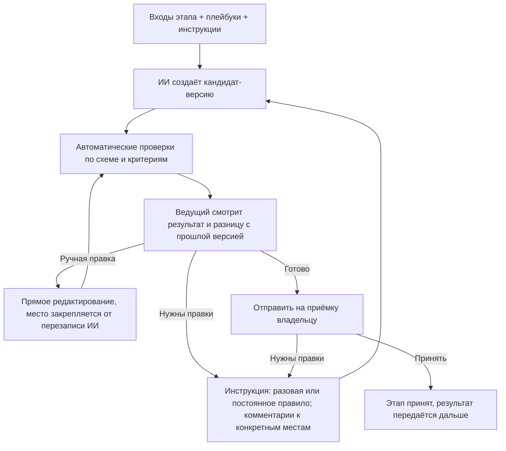
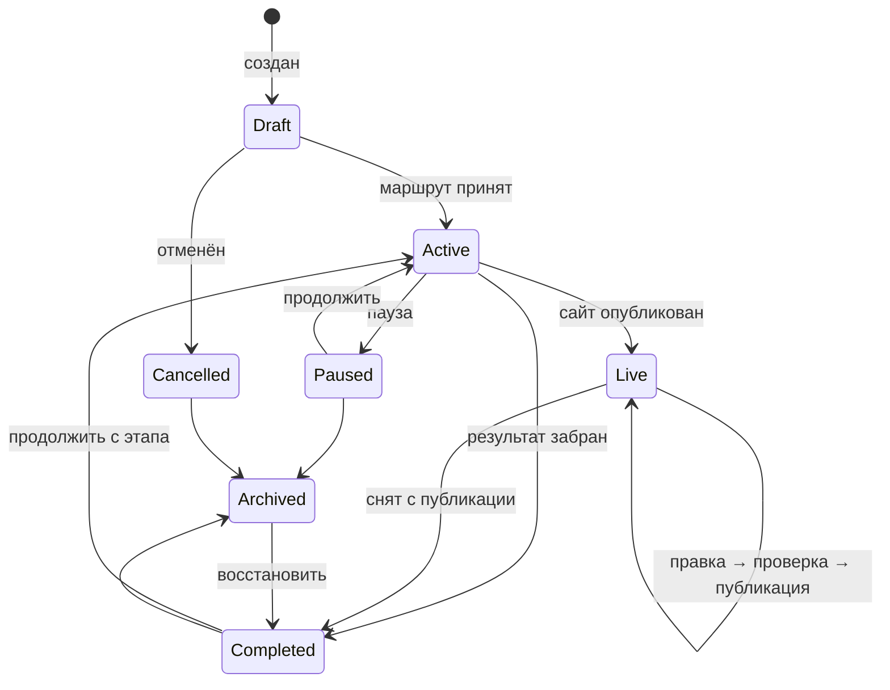
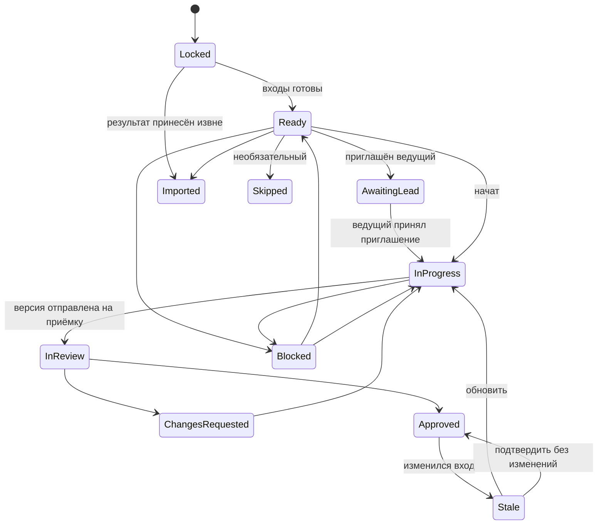

# BuildPath — модель работы по этапам: ИИ выполняет, люди направляют

**Статус:** проект нормативного документа. После согласования положения переносятся в PRODUCT_REQUIREMENTS.md, TECHNICAL_SPECIFICATION.md и IMPLEMENTATION_ROADMAP.md, а этот файл остаётся подробным описанием модели.

## 1. Идея

BuildPath — среда разработки, где работу на каждом этапе выполняет ИИ. Люди не делают работу вручную: они ставят задачу, дают ИИ инструкции, проверяют результат и решают, когда этап готов.

- Набор этапов зависит от типа проекта и его функций.
- На каждом этапе есть **ведущий** — человек, который направляет ИИ. По умолчанию это владелец проекта.
- Владелец может пригласить **специалиста** (UX, дизайнер, аналитик, разработчик, юрист…) ведущим или консультантом на конкретный этап. Ценность специалиста — его знания, переданные ИИ в виде инструкций, правок и проверки.
- Платформа даёт каждому этапу **встроенный набор экспертных инструкций**, поэтому новичок может пройти весь маршрут без специалистов.
- Проект можно остановить после любого этапа и забрать результат, а можно начать с любого этапа, принеся готовые материалы.

Ключевая единица продукта — **этап с контрактом** (входы, выходы, критерии приёмки) и **циклом работы с ИИ** (инструкция → версия → проверка → правка → приёмка).

## 2. Основные понятия

| Понятие | Смысл |
|---|---|
| **Тип проекта** | Лендинг, магазин, кабинет, мобильное приложение и т. д. Задаёт шаблон маршрута. |
| **Признаки (features)** | Оплата, аккаунты, персональные данные, бронирование… Добавляют обязательные этапы и проверки. |
| **Маршрут (Route)** | Граф этапов проекта с версией: шаблон типа + признаки + выбор владельца. |
| **Контракт этапа (StageDefinition)** | Версионированное описание: входы, выходы, критерии приёмки, уровень поддержки ИИ, встроенный плейбук, доступ по умолчанию, форматы экспорта. |
| **ИИ-агент этапа** | Исполнитель этапа. Работает только с материалами этапа и создаёт кандидат-версии артефактов. |
| **Ведущий этапа** | Человек, который даёт ИИ инструкции, запускает генерацию и отправляет версию на приёмку. Владелец или приглашённый специалист. |
| **Консультант** | Специалист без права запускать ИИ: комментирует, предлагает инструкции, проверяет. |
| **Плейбук (Playbook)** | Набор экспертных инструкций и чек-листов для типа этапа. Бывает встроенный (от BuildPath), проектный и личный плейбук специалиста. |
| **Инструкция этапа** | Конкретное указание ИИ в рамках этапа: разовая («сделай hero короче») или постоянная правило («все CTA — глаголом»). |
| **Запуск ИИ (GenerationRun)** | Одна генерация: входы, инструкции, плейбуки, модель, результат, проверки, стоимость. |
| **Артефакт** | Результат этапа (ТЗ, схема логики, структура, контент, дизайн, SiteSpec, код, отчёт). Только неизменяемые версии. |
| **Пакет результата** | То, что владелец забирает при остановке: принятые артефакты + сводка + открытые вопросы. |

## 3. Маршрут зависит от типа проекта

| Тип / признак | Этапы маршрута (по умолчанию) |
|---|---|
| Лендинг, портфолио, визитка | Цель → Контент и структура → Дизайн → Сборка → Проверка → Публикация |
| Сайт компании / каталог-меню | Цель → Требования → Структура → Контент → Дизайн → Сборка → Проверка → Публикация |
| Интернет-магазин, запись, кабинет | Цель → Требования → Бизнес-логика → Структура и сценарии → ТЗ → Прототип → Дизайн → Техплан → Реализация → Проверка → Публикация → Передача |
| Мобильное / desktop-приложение | Цель → Требования → Бизнес-логика → ТЗ → Прототип → Дизайн → Техплан → (Реализация, пока генерация не поддерживается — передача разработчику) |
| + оплата | + «Платёжные сценарии», усиленная проверка безопасности |
| + персональные данные | + «Данные и согласия» (какие данные, зачем, политика конфиденциальности, удаление) |
| + несколько ролей / аккаунты | + «Роли и права» внутри бизнес-логики, проверки авторизации |

Этап обязателен, если без его результата следующий этап нельзя выполнить или проверить, либо этого требует признак риска. Остальные этапы необязательны и пропускаются с объяснением, что останется неизвестным. Маршрут — ациклический граф; независимые этапы могут идти параллельно.

## 4. Контракт этапа

1. **Входы** — какие артефакты нужны и какая минимальная полнота.
2. **Выходы** — артефакты с типизированной схемой. ИИ возвращает данные по схеме, а не произвольный текст или код.
3. **Критерии приёмки** — автоматические проверки (схема, полнота, сборка, quality gate) и чек-лист для человека.
4. **Уровень поддержки ИИ** из каталога возможностей: `ai_full` (ИИ создаёт готовый результат), `ai_draft` (ИИ создаёт черновик, нужен эксперт), `ai_assist` (ИИ только помогает, результат загружается извне). Уровень определяет платформа, а не модель.
5. **Встроенный плейбук** — экспертные инструкции BuildPath для этого типа этапа.
6. **Рекомендация по специалисту** — например: «Платёжные сценарии: рекомендуем подключить специалиста, ИИ здесь даёт только черновик».
7. **Доступ по умолчанию** и **форматы загрузки/экспорта**.

## 5. Цикл работы на этапе

Правила цикла:

- **Запускать ИИ** могут только ведущий этапа и владелец. Консультанты и проверяющие оставляют комментарии; ведущий одним действием превращает комментарий в инструкцию.
- **Точечные правки.** Комментарий привязан к месту артефакта (раздел ТЗ, секция страницы, элемент макета). ИИ меняет только указанную часть и показывает разницу.
- **Ручные правки** допустимы всегда. Отредактированное вручную место закрепляется: ИИ не перезаписывает его без явной инструкции.
- **Правило вместо повторения.** Если ведущий исправляет одно и то же, система предлагает сохранить исправление как постоянное правило этапа или проекта.
- **Происхождение версии.** Каждая версия хранит: входы и их версии, плейбуки и их версии, инструкции, модель, автора запуска, результат проверок, стоимость. По этим данным видно, кто и почему изменил результат.
- **Приёмка.** ИИ никогда не принимает этап. Принимает владелец или назначенный им проверяющий. Если ведущий — сам владелец, он может принять результат сразу (личный режим, без тупика согласования).

## 6. Инструкции: приоритет и безопасность

Порядок приоритета (сверху — важнее):

1. Политика платформы, права доступа, quality gate.
2. Подтверждённые требования и решения владельца.
3. Постоянные правила проекта (их утверждает владелец).
4. Инструкции и плейбук ведущего этапа.
5. Встроенный плейбук BuildPath.
6. Комментарии участников, ещё не превращённые в инструкции.

- Инструкции специалиста **не могут** менять подтверждённые требования, права, проверки безопасности, расходы и публикацию. Если инструкция противоречит требованию, ИИ не выполняет её молча: система показывает конфликт и предлагает владельцу изменить требование.
- Предложения специалиста по изменению требований оформляются как **предложение изменения** и вступают в силу после подтверждения владельцем.
- Плейбуки и загруженные инструкции проходят ту же проверку, что и пользовательские инструкции для ИИ в PRODUCT_REQUIREMENTS.md: карантин, извлечение текста, проверка на prompt injection, явное включение.
- Граница доступа ИИ задаётся сервером, а не текстом инструкции: никакая инструкция не даёт ИИ прочитать материалы вне области этапа.

## 7. Специалисты

### 7.1. Роли на этапе

| Роль | Что может |
|---|---|
| **Ведущий** | Давать инструкции, запускать ИИ, редактировать, подключать свой плейбук, отправлять на приёмку. |
| **Консультант** | Видеть этап, комментировать, предлагать инструкции и правила, ставить отметку «проверено специалистом». |
| **Проверяющий** | Принимать или возвращать конкретную версию (назначается владельцем). |

На одном этапе может быть один ведущий и несколько консультантов. Владелец всегда может вернуть себе роль ведущего.

### 7.2. Доступ специалиста

По умолчанию специалист и ИИ, которым он управляет, видят одно и то же: принятые входы этапа и артефакты самого этапа.

| Можно | Нельзя по умолчанию |
|---|---|
| Читать принятые входные артефакты этапа | Видеть другие этапы и их обсуждения |
| Запускать ИИ на этапе (ведущий) в пределах бюджета | Видеть участников, бюджет проекта целиком, оплату, настройки |
| Редактировать артефакты этапа, обсуждать, загружать файлы этапа | Скачивать материалы без разрешения владельца |
| Подключать свой плейбук к этапу | Видеть секреты, ключи, подключённые аккаунты |
| Отправлять версию на приёмку | Публиковать, передавать код наружу, приглашать других |

Владелец может открыть дополнительный артефакт на чтение, отдать артефакт со скрытыми разделами, запретить или разрешить скачивание, задать срок доступа и условия конфиденциальности. До отправки приглашения система показывает, что именно увидит специалист.

### 7.3. Жизненный цикл доступа

1. Владелец приглашает специалиста на этап с ролью, областью доступа и бюджетом ИИ.
2. Специалист принимает приглашение и условия — доступ открывается.
3. После приёмки этапа право запускать ИИ и редактировать закрывается автоматически; чтение — через настраиваемый срок (по умолчанию 7 дней).
4. Владелец может отозвать доступ в любой момент; версии, инструкции и сообщения остаются в истории.
5. Если ведущий ушёл, этап получает статус «Ожидает ведущего», владелец берёт его на себя или приглашает другого.

Все выдачи, расширения и отзывы доступа и все запуски ИИ пишутся в журнал аудита.

### 7.4. Плейбук специалиста — его актив

- Специалист может сохранить свои инструкции и чек-листы как личный плейбук и применять его в разных проектах.
- Плейбук не содержит данных проектов: при сохранении правила из проекта система просит обобщить его и проверяет, что в нём нет фрагментов чужих материалов.
- Владелец видит, какой плейбук подключён к его этапу, версию и статус проверки. Содержимое по умолчанию видно владельцу; закрытые плейбуки возможны позже, только при проверке платформой (см. раздел 13).
- Проектные правила, созданные на этапе, принадлежат проекту и остаются у владельца после ухода специалиста.

## 8. Бюджет ИИ

- Генерации тратят лимиты тарифа владельца. До запуска показывается примерная стоимость.
- Владелец задаёт бюджет на этап или на назначение специалиста; специалист видит остаток. При исчерпании бюджета запуск останавливается, владелец может добавить.
- Учёт использования (UsageRecord) ведётся с первой версии продукта, даже если тарифов ещё нет.

## 9. Остановиться на любом этапе и забрать результат

- Владелец в любой момент нажимает «Забрать результат».
- Пакет результата: все принятые артефакты, сводка решений, допущения, открытые вопросы, список непройденных этапов и что для них понадобится. По желанию — постоянные правила проекта, чтобы следующий исполнитель (человек или другой ИИ) продолжил в том же стиле.
- Непринятые черновики можно добавить с пометкой «черновик, не принят».
- Форматы: ТЗ и логика — DOCX/PDF/MD; дизайн — изображения и ссылки; код — ZIP или Git; сайт — экспорт сборки.
- Пакет тоже версионируется; к проекту можно вернуться и продолжить.

## 10. Начать с любого этапа

1. Владелец выбирает стартовый этап.
2. Система показывает, какие входы требует этап, и просит загрузить их или указать ссылку.
3. Материалы проходят проверку безопасности и сопоставляются с типами артефактов. ИИ помогает разобрать документы в структуру этапа (например, ТЗ из PDF — в реестр требований), полнота считается по схеме.
4. По каждому входу видно: принят / неполный / не найден и что именно отсутствует.
5. По пробелам владелец выбирает: дозаполнить коротким опросом; дать ИИ восстановить недостающее в сокращённом этапе; принять риск — пробел становится допущением, видимым следующим этапам.
6. Предыдущие этапы получают статус **«Импортирован»**: результат внешний, платформа его не создавала. В сводке готовности это видно отдельно от «Принят».

Существующий сайт или код сначала проходит анализ в режиме только чтения (уже реализован); отчёт становится входом стартового этапа.

## 11. Изменения после приёмки

- Изменение принятого артефакта создаёт новую версию; зависимые этапы получают статус «Устарел».
- ИИ готовит для каждого устаревшего этапа предложение обновления с разницей; ведущий этапа получает уведомление. Обновление не применяется автоматически: ведущий или владелец решает — применить, доработать или подтвердить без изменений.

## 12. Состояния

### 12.1. Проект

- **Draft** — маршрут ещё не принят.
- **Active** — этапы идут.
- **Completed** — результат забран; продолжить можно обычным действием.
- **Live** — сайт опубликован; правки идут коротким циклом «инструкция → кандидат → проверки → публикация» без повторного маршрута.
- **Cancelled / Archived** — брошенный проект можно отменить и убрать в архив.

### 12.2. Этап

Статусы в интерфейсе: «Закрыт», «Готов к началу», «Ожидает ведущего», «В работе», «На приёмке», «Нужны правки», «Принят», «Устарел», «Импортирован», «Пропущен», «Заблокирован». Внутри «В работе» идёт цикл ИИ (раздел 5); отдельные запуски ИИ — это не смена статуса этапа.

## 13. Данные (дополнения к модели)

- **StageAssignment:** stage, user, role (`lead | consultant | reviewer`), accessScopeId, aiBudget, termsVersion, dueDate?, status.
- **AccessScope:** правила (artifact/stage, действие `read | write | comment | download | run_ai`, скрытые разделы, водяной знак, expiresAt). Вычисляется сервером на каждом запросе и передаётся в AI gateway как граница контекста.
- **Playbook / PlaybookVersion:** владелец (платформа / специалист / проект), тип этапа, инструкции, чек-лист, статус проверки, видимость.
- **StageInstruction:** этап, автор, тип (`one_off | stage_rule | project_rule`), привязка к месту артефакта, статус (`proposed | active | disabled`), кто утвердил.
- **GenerationRun:** этап, кто запустил, входы и версии, плейбуки и версии, инструкции, модель, результат (artifact version), проверки, стоимость, ошибки.
- **ChangeProposal:** предложение специалиста изменить подтверждённое требование; применяется после решения владельца.
- **ImportedArtifact:** источник, проверка безопасности, сопоставление со схемой, пробелы, решение по пробелам.
- **ResultPackage:** версия, список артефактов и версий, сводка, допущения, открытые вопросы, формат.
- **UsageRecord:** генерации, сборки, хранилище, публикации — по проекту, этапу и пользователю.

## 14. Специалисты и деньги — по фазам

1. **Фаза 1 (MVP):** владелец работает со встроенными плейбуками; может пригласить своего специалиста по ссылке. Оплата между ними — вне платформы, ИИ-расходы — из лимитов владельца.
2. **Фаза 2:** каталог специалистов по типам этапов с отзывами и примерами; публичные плейбуки специалистов, которые можно подключить к этапу без найма человека.
3. **Фаза 3:** оплата: работа специалиста за этап с выплатой при приёмке; платные плейбуки. Доход платформы — подписка/лимиты ИИ + комиссия.

## 15. Что ещё нужно для этапов сайта (MVP-генерация)

- **Формы заявок без своего сервера:** встроенный обработчик BuildPath отправляет заявки владельцу в Telegram и на email.
- **Контент:** этап «Контент» в MVP — ИИ пишет тексты по цели и аудитории, владелец загружает фото с телефона.
- **Публикация по умолчанию** на поддомен BuildPath без отдельного аккаунта; свой домен и внешний хостинг — опции.
- **Политика конфиденциальности и согласие** добавляются автоматически, если сайт собирает персональные данные.

## 16. Telegram в этой модели

- Ведущий может давать ИИ инструкции голосом или текстом в Telegram и получать новую версию с превью.
- Владелец получает «Принять / Нужны правки» по каждой отправленной версии и уведомления о заявках с сайта.
- Права проверяются так же, как в вебе: бот не расширяет область доступа.

## 17. Порядок реализации (предлагаемая правка roadmap)

1. **Маршрут, контракты этапов и цикл работы с ИИ** для лендинга и сайта компании: инструкции, точечные правки, закрепление ручных правок, происхождение версий, встроенные плейбуки, приёмка в личном режиме, пакет результата.
2. **Генерация сайта:** Контент → Дизайн (шаблоны) → Сборка → предпросмотр → правки → публикация на поддомен; встроенный обработчик форм; учёт использования ИИ.
3. **Начать с этапа:** приём материалов, статус «Импортирован», пробелы.
4. **Специалисты:** приглашение ведущим или консультантом, область доступа, бюджет ИИ, личные плейбуки, предложения изменений, автозакрытие доступа, аудит.
5. **Telegram:** инструкции, приёмка, уведомления.
6. **Live-режим** и свой домен.
7. **Каталог специалистов, публичные плейбуки и оплата.**

Уже реализованные анализ сайта и сверка с дизайном становятся инструментами этапов «Проверка исходных материалов» и «Проверка качества».

## 18. Критерии приёмки модели

- Новичок без специалистов проходит маршрут лендинга до опубликованного сайта, только давая ИИ инструкции и принимая результаты.
- Комментарий к конкретной секции превращается в инструкцию; ИИ меняет только эту секцию и показывает разницу.
- Место, отредактированное вручную, не перезаписывается следующей генерацией без явной инструкции.
- Для любой версии видно, какие входы, плейбуки, инструкции и модель её создали и кто запустил генерацию.
- Специалист-ведущий видит только свой этап; ИИ, запущенный им, не получает материалы других этапов — проверяется на уровне API и AI gateway.
- Инструкция специалиста, противоречащая подтверждённому требованию, не выполняется молча, а показывается владельцу как конфликт.
- После приёмки этапа специалист больше не может запускать ИИ и редактировать; событие видно в журнале.
- Запуск ИИ останавливается при исчерпании бюджета этапа.
- Владелец останавливается после ТЗ и скачивает пакет результата; начинает с «Реализации», загрузив дизайн, и видит пробелы и статус «Импортирован».
- Изменение принятого артефакта помечает зависимые этапы «Устарел» с предложением обновления.

## 19. Решения по умолчанию (9 ноября 2026)

Приняты, пока владелец продукта не решит иначе:

1. Первые типы проектов — «Одностраничный сайт» и «Сайт компании».
2. Владелец всегда видит содержимое плейбука, подключённого к его этапу.
3. Публичные плейбуки и каталог специалистов — после приглашения своих специалистов (фаза 2).
4. Модель дохода не выбрана; учёт использования ИИ ведётся с первой версии.
5. Первая публикация — на поддомен BuildPath; до её реализации результат скачивается файлом.

## 20. Что реализовано (срез 1)

- Каталог маршрутов `1.0.0` для двух типов, контракты этапов «Цель сайта», «Услуги и цены», «Структура и тексты», «Внешний вид», «Сборка и проверка» с пояснениями, полями, критериями приёмки и встроенными плейбуками.
- Старт с любого этапа: выбранный этап и предыдущие открываются; материалы можно вставить текстом; полные материалы получают статус «Импортирован».
- Цикл работы с ИИ: инструкция на весь этап или на один блок, постоянные правила этапа и проекта, закрепление ручных правок, происхождение каждой версии, возврат к любой версии, дневной лимит генераций на проект. Без ИИ — ручное заполнение и шаблонные черновики текстов и стиля.
- Приёмка владельцем в личном режиме, статус «Нужно проверить» (`stale`) для зависимых этапов при изменении принятого, пакет результата на любом этапе, завершение и продолжение проекта.
- Детерминированная сборка одностраничного сайта без скриптов с проверками (главная кнопка, контакты, пустые места, заголовки, контраст WCAG AA, SEO).

### Срез 2: публикация и заявки

- Публикация принятой сборки на поддомен BuildPath после явного подтверждения: адрес предлагается по названию (транслитерация), проверяется на занятость; сайт можно обновить до новой принятой сборки или снять с публикации. Пока сайт опубликован, проект в состоянии `live`, правки идут обычным циклом этапов.
- Опубликованные сайты отдаёт отдельный процесс на отдельном домене: только принятый HTML без скриптов, CSP с `frame-ancestors 'none'`, страница о данных, `robots.txt`, `sitemap.xml`.
- Главное действие «Оставить заявку на сайте»: форма без скриптов, обязательное согласие на обработку данных, страница о данных с контактами владельца, защита от спама (скрытое поле, запрет чужого Origin, лимиты 5 заявок в час на посетителя и 200 в сутки на сайт), IP хранится только в виде хеша, автоудаление заявок через 365 дней.
- Уведомления владельцу: Telegram (привязка аккаунта одноразовой ссылкой на бота, `/stop` для отключения) и email; статус доставки сохраняется у заявки. Список и удаление заявок в приложении.

Ещё не реализовано: специалисты и их доступ (раздел 7), бюджеты ИИ на назначение, личные плейбуки, предложения изменений, работа с этапами через Telegram (сейчас бот только присылает заявки), свой домен, загрузка фото, проверка загружаемых файлов инструкций, состояние `Cancelled` проекта.
