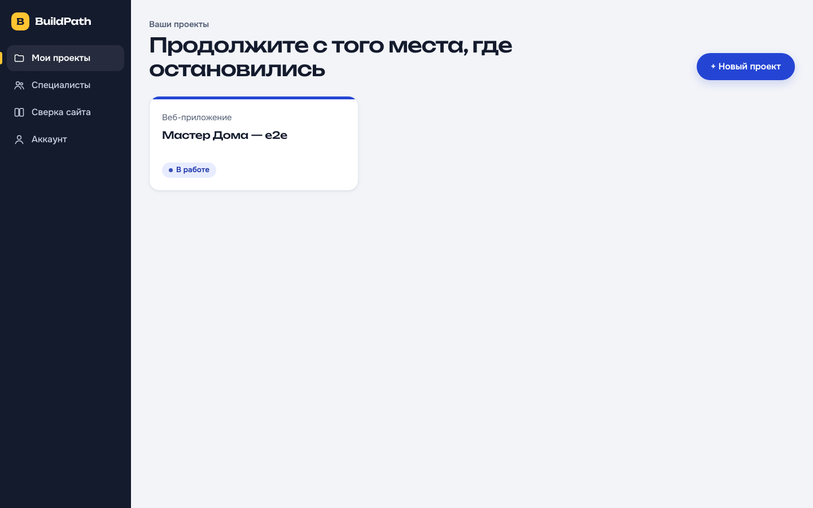
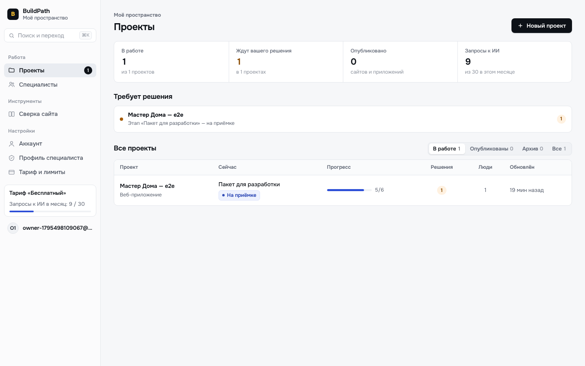
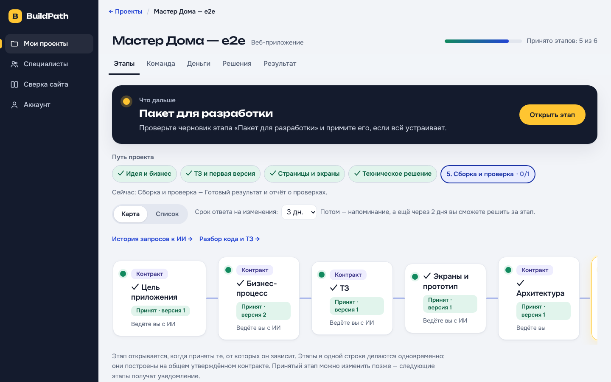
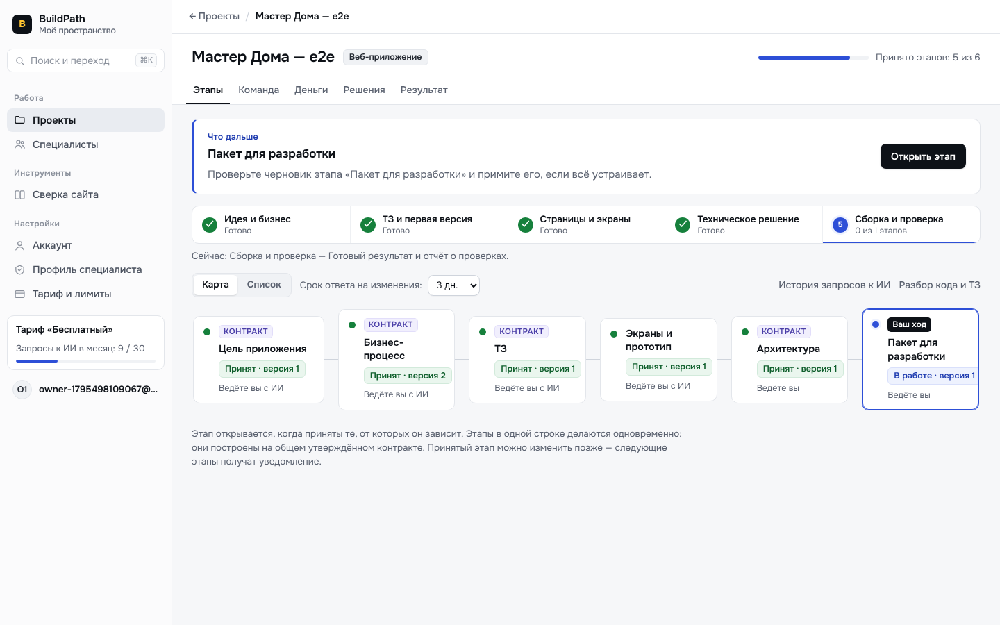

# Интерфейс: от MVP к рабочему продукту

Разбор от 24 ноября 2026 года. Документ описывает новое направление дизайна и то, чего не хватает пользовательскому пути, чтобы реализовать исходную бизнес-идею целиком. Нормативными остаются PRODUCT_REQUIREMENTS.md и STAGE_WORK_MODEL.md; согласованные пункты переносятся туда.

## 1. Почему интерфейс выглядел как MVP

Сравнение с Linear, Stripe Dashboard, Vercel и Upwork (снимки до и после — в PR builder-front).

| Было | Почему это «несерьёзно» | Как у крупных продуктов |
|---|---|---|
| Декоративный шрифт Unbounded в заголовках, заголовки 36–52 px | Читается как лендинг или детское приложение | Один рабочий шрифт, заголовки страниц 22–24 px |
| Кнопки-«таблетки» 48 px с синей тенью, жёлтые акценты | Маркетинговый стиль, нет иерархии действий | Тёмная основная кнопка 36 px, вторичная с рамкой, цвет бренда — только ссылки, фокус и прогресс |
| Тёмный сайдбар, тёмный блок «Что дальше» | Тяжело, внимание размазано | Светлый сайдбар с группами, акцент — тонкая полоса |
| Проекты — пустые карточки «название + статус» | Нет ответа на «что происходит и что от меня нужно» | Таблица со статусом, прогрессом, ожидающими решениями, людьми и датой |
| Нет поиска, нет рабочего пространства, нет тарифа и пользователя в каркасе | Не похоже на систему, где ведут много проектов | ⌘K, название пространства, расход лимитов и аккаунт в сайдбаре |
| Радиусы 18–24 px, крупные отступы, тени | Мало информации на экране | Радиусы 8–10 px, линии 1 px, плотность без мелкого текста |

| До | После |
|---|---|
|  |  |
|  |  |

## 2. Что сделано (24 ноября)

**Дизайн-система** (builder-front, `globals.css`, `journey.module.css`):
- нейтральная палитра, белые поверхности, линии 1 px; бренд-синий только для ссылок, фокуса, выбора и прогресса; жёлтый остался только в логотипе;
- один шрифт Onest, цифры моноширинные в таблицах и счётчиках;
- основная кнопка — тёмная, 36 px (42 px на телефоне), вторичная — с рамкой, «тихая» — ссылкой;
- статусы — квадратные бейджи с точкой, уведомления — полоса слева;
- текст остаётся крупным: 15 px на компьютере, 16 px на телефоне (решение владельца: не мельчить).

**Каркас приложения:** светлый сайдбар с рабочим пространством, поиском и переходом (⌘K), группами «Работа / Инструменты / Настройки», счётчиком решений у «Проектов», расходом запросов к ИИ по тарифу и аккаунтом внизу. На телефоне — нижняя панель, как раньше.

**Главная «Проекты»:** сводка (в работе, ждут вашего решения, опубликовано, запросы к ИИ), блок «Требует решения» и таблица проектов: текущий этап и его статус, прогресс по этапам, ожидающие решения, люди, последнее изменение; фильтры «В работе / Опубликованы / Архив / Все». Для этого `GET /projects` отдаёт `overview` по каждому проекту (builder-back).

**Проект и этап:** заголовок с типом и статусом, полоса фаз в виде степпера, компактная карта этапов, «Что дальше» — акцентная панель вместо тёмного блока. Вход, главная страница и «Сверка сайта» переведены на ту же систему.

## 3. Пользовательский путь: чего не хватает для бизнес-идеи

Идея: человек без опыта проходит путь от идеи до работающего продукта; работу на этапах делает ИИ, специалисты направляют ИИ за фиксированную цену или почасово, оплата через платформу, проект ведётся картой этапов с версиями и уведомлениями. Ниже — пробелы по ролям, по приоритету.

### P1 — без этого продукт не ощущается как рабочая система

1. ✅ *Сделано 24 ноября (см. IMPLEMENTATION_STATUS.md, «Входящие и журнал проекта»).* **Единые «Входящие».** Решения сейчас разбросаны по проектам, Telegram и почте: этап на приёмке, правки от владельца, уведомления об изменениях между этапами, предложения изменений, приглашения, споры, отчёт специалиста о времени. Нужна одна лента для каждого человека: что ждёт именно его, с крайним сроком (`respondBy` уже есть), фильтрами и отметкой «прочитано». Сводка на главной (§2) — первый шаг: она считает этапы и уведомления, но не знает, чья очередь. Нужен `GET /me/inbox` с правами по ролям.
2. ✅ *Сделано 24 ноября: вкладка «Журнал» в проекте.* **Лента действий проекта.** Кто и когда принял этап, запустил ИИ, оставил замечание, отработал часы, опубликовал. Сейчас есть только история запросов к ИИ. Для владельца это прозрачность работы специалистов, для споров — доказательная база.
3. ✅ *Сделано 24 ноября: раздел «Моя работа».* **Кабинет специалиста.** Специалист видит свои этапы среди проектов владельца. Нужен отдельный раздел: активные этапы и сроки, учёт времени за неделю, начисления и выплаты, отзывы, приглашения. Без этого маркетплейсу не на чем удерживать специалистов.
4. ✅ *Сделано 24 ноября: смета в мастере проекта, «Стоимость этапа», план и факт во вкладке «Деньги».* **Стоимость до старта.** Перед началом этапа и проекта показывать оценку: сколько примерно уйдёт на ИИ (по токенам) и на специалистов, и сколько уже потрачено против плана. Модель «оплата по токенам за проект» требует, чтобы человек понимал цену заранее.

### P2 — нужно, чтобы маркетплейс и команды работали

5. ✅ *Сделано 24 ноября: заявки на этап и доска для специалистов.* **Заявка на этап вместо приглашения по ссылке.** Владелец описывает задачу этапа, специалисты из каталога откликаются ценой и сроком, владелец выбирает. Сейчас специалиста можно только найти и пригласить самому.
6. **Несколько рабочих пространств.** В базе пространства есть, но интерфейс берёт первое. Агентству или компании нужно: переключатель пространств, участники на уровне пространства с ролями, общий тариф и счета.
7. **Счета и платежи на уровне аккаунта.** Кошелёк и чеки есть внутри проекта; нужен общий раздел: пополнения, списания по проектам, выплаты специалистам, закрывающие документы.
8. **Ссылка «только просмотр».** Показать карту проекта, ТЗ или превью партнёру, инвестору или заказчику без приглашения в команду.
9. ✅ *Сделано 24 ноября (см. IMPLEMENTATION_STATUS.md, «Безопасность аккаунта и уведомления»).* **Настройки уведомлений.** Какие события и в какой канал (почта, Telegram, только «Входящие»).

### P3 — доверие крупных клиентов

10. ✅ *Сделано 24 ноября (см. IMPLEMENTATION_STATUS.md, «Безопасность аккаунта и уведомления»).* **Безопасность аккаунта:** двухфакторный вход, список активных сессий с отзывом, журнал входов. Сессии в базе уже есть.
11. **Экспорт журнала действий** и хранение по политике (для компаний).
12. **Шаблоны и пример проекта** при первом входе: готовый проект «Онлайн-запись к мастеру», на котором видно весь путь, и чек-лист первых шагов.

## 4. Порядок работ

1. Дизайн-система, каркас, главная «Проекты» — *сделано 24 ноября*.
2. «Входящие» (бэкенд + раздел) и лента действий проекта — *сделано 24 ноября*.
3. Кабинет специалиста и оценка стоимости этапа — *сделано 24 ноября*.
4. Заявки на этап, пространства, счета.
5. Безопасность аккаунта, ссылки «только просмотр», шаблоны.
